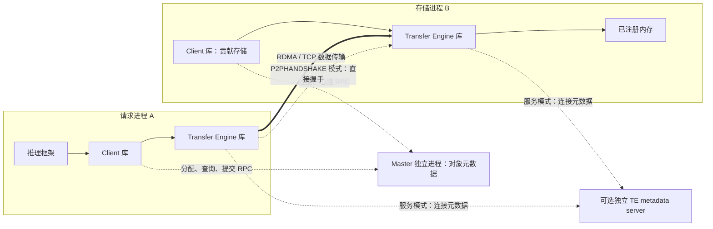
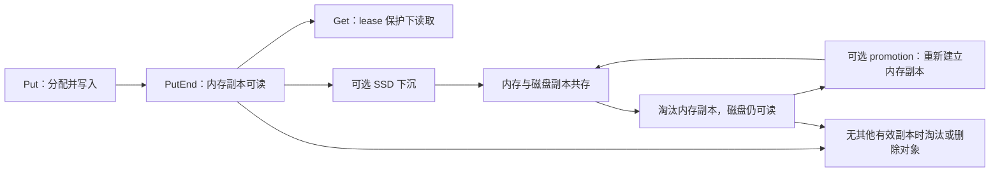

# 篇0 整体架构总览：一张图看懂 Mooncake 的 KV Cache 系统

> 系列：《Mooncake KV Cache 源码解析》
> 版本锚点：`v0.3.13.post1`（2026-08-31 发布）
> 源码链接基座：`https://github.com/kvcache-ai/Mooncake/blob/v0.3.13.post1/`

> 阅读与验证约定见[系列指南](README.md)。本篇的源码行号沿用历史版本；图示为逻辑解释，引用测试不代表已执行。

## 0.1 具体问题

在追任何一条调用链之前，先回答一个全局问题：**Mooncake 到底由哪些组件/进程组成？元数据与数据如何分路？有哪几种部署方式？一个 KV Cache 对象从写入到淘汰走完哪些阶段？**

这一篇不深入任何函数，只建立一张可复用的"地图"。后续篇1–篇10 的每一篇，都是这张地图上某一段的放大。

## 0.2 场景与版本

- **场景**：LLM 推理的 KV Cache 分布式缓存。Prefill 实例把生成的 KV Cache 写入分布式内存，Decode 实例（或另一个请求）按 key 读回，命中时跳过重复 Prefill。
- **版本**：`v0.3.13.post1`，commit `7197358`。仓库已重构为多子目录 monorepo，本系列只覆盖 KV Cache 主路径：`mooncake-store`、`mooncake-transfer-engine`、`mooncake-integration`、`python/mooncake`。
- **验证方式**：静态源码分析 + 引用设计文档与测试，不实际构建运行（RDMA 硬件与依赖环境不可用）。

## 0.3 组件与进程

Mooncake 的 KV Cache 系统由 Master、Client 和 Transfer Engine 三个核心角色组成。TE 的连接元数据机制按配置选择独立服务或直接握手。

### 0.3.1 Master Service（元数据中枢）

Master 是**独立进程**，负责整个集群逻辑存储空间池的编排：节点加入/离开、对象空间分配、元数据维护、副本位置选择、淘汰决策。它**不接管任何数据流**，只提供元数据信息。

> 设计文档原文（`docs/source/design/store/mooncake-store.md`）：
> "The Master Service does not take over any data flow, only providing corresponding metadata information."

Master 的入口在 `mooncake-store/src/master.cpp`，RPC 服务在 `src/master_service.cpp`。它对外暴露的 RPC 接口（protobuf 定义见 `mooncake-store.md` 的 `service MasterService`）包括：

- `PutStart` / `PutEnd`：Put 的两阶段——先申请空间，写完再标记可见。
- `GetReplicaList`：查询对象的副本列表。
- `Remove` / `RemoveByRegex`：删除对象。
- `MountSegment` / `UnmountSegment`：存储节点注册/注销内存段。
- `BatchQueryIp`：批量查询存储节点的网络位置。

**关键点**：Master 管的是"对象 → 副本（segment + offset + size）"的映射，以及每个副本的状态机（`INIT → PROCESSING → COMPLETE`）。数据本身在 Client 的内存里，Master 只记"数据在哪"。

### 0.3.2 Client（双角色：请求方 + 存储方）

`Client` 是唯一代表客户端逻辑的类，但它身兼两职（`mooncake-store/include/real_client.h`）：

1. **作为 client**：被上层应用调用，发出 `Put`/`Get` 等请求。
2. **作为 store server**：持有一段连续内存，贡献给分布式 KV cache，让其他 Client 读写。**数据实际是从一个 Client 传到另一个 Client，绕过 Master。**

> 设计文档原文：
> "Data transfer is actually from one Client to another, bypassing the Master Service."

`RealClient::setup_real` 的签名（`real_client.h:85`）暴露了双角色的配置开关：

```cpp
int setup_real(
    const std::string &local_hostname, const std::string &metadata_server,
    size_t global_segment_size = 1024 * 1024 * 16,   // 贡献给集群的内存段大小
    size_t local_buffer_size = 1024 * 1024 * 16,     // 本地暂存 buffer
    const std::string &protocol = "tcp",
    const std::string &rdma_devices = "",
    const std::string &master_server_addr = "127.0.0.1:50051",
    const std::shared_ptr<TransferEngine> &transfer_engine = nullptr,
    ...);
```

- `global_segment_size = 0` → **纯 client**，只发请求，不贡献内存。
- `local_buffer_size = 0` → **纯 server**，只提供内存，不允许 Get/Put。

### 0.3.3 Transfer Engine（数据面）

Transfer Engine 负责**实际的数据传输**。是否避免额外拷贝、能达到多少带宽，取决于传输后端、buffer 注册、设备和拓扑条件。它围绕两个核心抽象（`docs/source/design/transfer-engine/index.md`）：

- **Segment**：一段可被远端读写的连续地址空间（DRAM/VRAM 的 RAM Segment，或 NVMeof Segment）。每个进程有且仅有一个以 `local_hostname` 命名的 segment。
- **BatchTransfer**：一组读写请求，在多个非连续地址空间之间同步数据，支持双向 Read/Write。

Transfer Engine 的接口在 `mooncake-transfer-engine/include/transfer_engine.h`，核心方法：

```cpp
int init(const std::string& metadata_conn_string,
         const std::string& local_server_name, ...);   // 初始化，注册本机 segment
SegmentHandle openSegment(const std::string& segment_name);  // 打开远端 segment
int registerLocalMemory(void* addr, size_t length, ...);     // 注册本地内存（MR）
Status submitTransfer(BatchID batch_id,
                      const std::vector<TransferRequest>& entries);  // 提交传输
```

具体后端由 `Transport` 类实现：`TcpTransport`、`RdmaTransport`、`EfaTransport`、`NVMeoFTransport`、`NvlinkTransport`、`HipTransport` 等。

### 0.3.4 TE 连接元数据：独立服务或直接握手

使用 etcd / redis / http 服务模式时，TE 通过独立 metadata server 管理连接和 segment 元数据；它与 Store Master 是不同角色。使用 `P2PHANDSHAKE` 的启动方式则无需独立 TE metadata server。下面的设计文档引文描述服务模式，不应推广为所有配置的部署要求：

> "the metadata service required by the Transfer Engine (via etcd, Redis, or HTTP, etc.) is not included in the Master Service and needs to be deployed separately."

## 0.4 数据流总览：元数据与数据如何分路

这是理解 Mooncake 最重要的一张图。一次 Put/Get 涉及**两条完全不同的路径**：

```
┌─────────────┐  元数据 RPC (PutStart/PutEnd/GetReplicaList)  ┌──────────────┐
│   Client A  │ ────────────────────────────────────────────▶ │ Master Service│
│ (请求方)     │ ◀──────────────────────────────────────────── │ (管元数据/placement)
└─────┬───────┘                                               └──────────────┘
      │ 数据路径：Client A 的 TransferEngine
      │   ──(RDMA/TCP)──▶ Client B 的 TransferEngine
      ▼
┌─────────────┐
│   Client B  │  ← 持有实际内存段，作为 store server
│ (存储方)     │
└─────────────┘
```

- **元数据路径**：Client → Master RPC。负责分配空间、查询副本、提交完成、删除。
- **数据路径**：Client → Transfer Engine → 远端 Client 内存。Master 完全不参与。

把两条路径按时间顺序展开：

**一次 Put**：① 调用方把 buffer 切成 slice；② Master `PutStart` 选 segment/offset，返回 PROCESSING 状态的副本；③ client 用 TE 把 slice 写到副本地址；④ 全部 slice 完成 → `PutEnd` 把副本置 COMPLETE；⑤ 对象从此刻起对其他 client 可见（篇2）。

**一次 Get**：① `GetReplicaList` 取副本列表并授予 lease；② 客户端按本地性/介质挑副本；③ TE 按 `buffer_address_` 读回；④ 传输完成后客户端再复查 lease，决定返回成功还是 `LEASE_EXPIRED`（篇3）。

新对象的 `PutEnd` 控制可见性，`GetReplicaList` 查询可读副本并授予 lease；后者是读保护的起点，不是第二个写入提交点。数据路径只负责把字节搬到正确地址，不负责"什么时候能读"。

**为什么分路？** 因为 KV Cache 是带宽敏感、元数据轻量的场景。Master 只做"空间记账"和"位置决策"，把高带宽的数据搬运交给 RDMA 直通，避免 Master 成为瓶颈。这也是 Mooncake 与 Redis/Memcached 这类"数据经过服务端"的缓存系统的本质区别——Mooncake 是**分布式 KV cache**，数据在客户端内存之间直传。

### 0.4.1 逻辑架构：进程、库与两条路径



图中实线表示进程内调用，虚线表示控制交互，粗线表示对象数据传输。TE 是嵌入进程的库；独立 metadata server 与直接握手是不同配置路径，不要求同时启用。图示省略了同机读和 SSD 路径。

## 0.5 部署模式

Client 有三种使用方式（`mooncake-store.md`）：

1. **Embedded 模式**：Client 以共享库形式跑在 LLM 推理进程（如 vLLM）内。`global_segment_size > 0` 时同时贡献内存。
2. **Embedded + dummy-real**：每个推理 **rank** 持有一个不持资源的 **dummy** client；每个推理 **instance** 持有一个持资源的 **real** client（如 TP=8 时 8 个 dummy + 1 个 real）。所有 dummy 把请求转发给那一个 real client，real client 负责 RPC、内存管理、数据传输。dummy 与 real 之间用共享内存/零拷贝通信，保持数据路径高效。
3. **Standalone store service**：独立 store 服务（`python -m mooncake.mooncake_store_service`）包装一个 client，提供全局内存/SSD 资源池。embedded client 可设 `global_segment_size = 0` 只贡献网络/NIC 资源。

Master 有两种部署方式：

1. **默认模式**：单 master 节点，部署简单，但单点故障。
2. **HA 模式**：多个 master 节点通过 etcd 协调，etcd 选主。leader 故障或网络分区时，其余节点自动重新选主，保证持续可用。

两种模式下，leader 都通过周期性心跳监控所有 client 节点的健康。client 崩溃/恢复后能自动重新加入集群。

**怎么选（观点）**：单机单实例、只想扩 KV 容量，用 embedded + `kv_both` 最省事；TP 多 rank 且希望只保留一个真实 client 的 RPC/内存管理，用 dummy-real，避免 N 个 rank 各自注册 segment 和重复建连；多租户或多推理服务共享一个池，用 standalone service，把资源池与推理进程解耦。HA 解决的是 master 单点，不解决数据副本——副本仍由 `ReplicateConfig` 和 segment 分布决定，别把两者混为一谈。

## 0.6 生命周期总览：一个 KV Cache 对象的完整旅程

作为后续各篇的索引，一个对象从写入到淘汰走完以下阶段：



下沉先建立磁盘副本，内存淘汰是另一个动作；Get 可以发生在多个可读阶段。图中生命周期状态概括了篇2、篇3、篇8和篇9，不代表每个对象都会经过 SSD。


- **Put（篇2）**：`put_from` → Master `PutStart` 分配 segment/offset → 副本位置选择 → TE 数据传输 → Master `PutEnd` 提交元数据 → 可见。
- **Get（篇3）**：`get_into` → `batch_query`（元数据/lease）→ 副本选择 → TE 读取 → 完成/错误返回。
- **生命周期（篇8）**：读 lease 保护 → 容量压力触发淘汰 → 删除/回收 → 并发协调。
- **SSD 分层（篇9）**：写入完成或内存压力 → Heartbeat 后台卸载到 SSD → 命中时经 staging buffer 加载回内存 → 磁盘水位淘汰 → 段丢失后 client 扫描本地元数据重新注册。

## 0.7 三个关键代码片段

### 片段1：Master 的元数据/数据分离（protobuf 定义）

`docs/source/design/store/mooncake-store.md` 中 `service MasterService` 的接口设计，直接体现了"Master 只管元数据"：

```protobuf
service MasterService {
  rpc GetReplicaList(GetReplicaListRequest) returns (GetReplicaListResponse);
  rpc PutStart(PutStartRequest) returns (PutStartResponse);   // 申请空间
  rpc PutEnd(PutEndRequest) returns (PutEndResponse);         // 标记完成
  rpc Remove(RemoveRequest) returns (RemoveResponse);
  rpc MountSegment(MountSegmentRequest) returns (MountSegmentResponse);
  rpc UnmountSegment(UnmountSegmentRequest) returns (UnmountSegmentResponse);
}
```

注意：**没有任何一个 RPC 携带数据本体**。`PutStart` 只传 `key`、`value_length`、`slice_lengths`、`ReplicateConfig`，返回的是 `replica_list`（副本位置）。数据搬运完全在 Client 之间完成。

### 片段2：Client 的双角色（`real_client.h:85`）

`setup_real` 的参数同时决定"我贡献多少内存"和"我发不发请求"，是双角色的直接体现：

```cpp
int setup_real(
    const std::string &local_hostname, const std::string &metadata_server,
    size_t global_segment_size = 1024 * 1024 * 16,   // 贡献给集群的内存段
    size_t local_buffer_size = 1024 * 1024 * 16,     // 本地暂存 buffer
    const std::string &protocol = "tcp",
    const std::string &rdma_devices = "",
    const std::string &master_server_addr = "127.0.0.1:50051",
    const std::shared_ptr<TransferEngine> &transfer_engine = nullptr, ...);
```

### 片段3：Transfer Engine 的核心抽象（`transfer_engine.h`）

Segment 与 BatchTransfer 是 TE 的两大抽象，接口如下：

```cpp
int init(const std::string& metadata_conn_string,
         const std::string& local_server_name, ...);   // 注册本机 segment
SegmentHandle openSegment(const std::string& segment_name);  // 打开远端 segment
int registerLocalMemory(void* addr, size_t length, ...);     // 注册本地内存（MR）
Status submitTransfer(BatchID batch_id,
                      const std::vector<TransferRequest>& entries);  // 提交传输
```

## 0.8 异常与并发（全局视角）

这一篇只点出全局层面的并发/失败设计，细节留给各篇：

- **可见性**：Put 是两阶段的（`PutStart` → 写数据 → `PutEnd`）。`PutEnd` 之前对象不可读，防止脏读。这是篇2 的核心。
- **副本状态机**：每个副本有 `INIT → PROCESSING → COMPLETE` 状态，Master 据此判断对象是否可读。部分副本失败时 best-effort 处理。这是篇2/篇3 的核心。
- **lease 保护**：`GetReplicaList` 成功会授予对象 lease，lease 有效期内对象不被 Remove/Eviction，保证读安全。lease 过期则读失败。这是篇8 的核心。
- **故障恢复**：Master 自身元数据可由快照恢复（`enable_snapshot` / `enable_snapshot_restore`，`master.cpp:365`–`:393`）；但已下沉对象的元数据恢复**不是快照**，而是 client 收到 `SEGMENT_NOT_FOUND` 后扫描本地 `.meta` 重新 `NotifyOffloadSuccess`（篇9）。client 崩溃后其内存段被 leader 检测并处理。

## 0.9 验证与结论

- **架构图与双角色**：`docs/source/design/store/mooncake-store.md` 的 Architecture 章节（Master/Client 双角色、三种使用方式、两种部署模式）。
- **Segment/BatchTransfer**：`docs/source/design/transfer-engine/index.md` 的 Overview 章节。
- **最小启动流程**：`docs/source/getting_started/quick-start.md` 的 Python smoke test——`MooncakeDistributedStore.setup(...)` 后 `put`/`get`，用 `P2PHANDSHAKE` 免去独立 metadata server。
- **隔离边界**：`docs/source/deployment/kv-cache-sharing-and-isolation.md` 说明 key 由推理框架构造，模型/发布/请求组/tenant 四层隔离。

**结论**：Mooncake 的 KV Cache 系统 = **Master（元数据中枢，不碰数据）** + **Client（双角色，既是请求方又是存储方）** + **Transfer Engine（数据面，支持 RDMA/TCP 等后端）** + **TE 连接元数据机制（独立服务或直接握手，按配置选择）**。元数据与数据严格分路，这是它区别于传统缓存系统的根本设计。后续篇1 将沿最小 Put/Get 路径，把这张地图跑通一遍。

---

*下一篇：篇1 源码导航——一次 KV Cache 读写经过哪些组件？*
