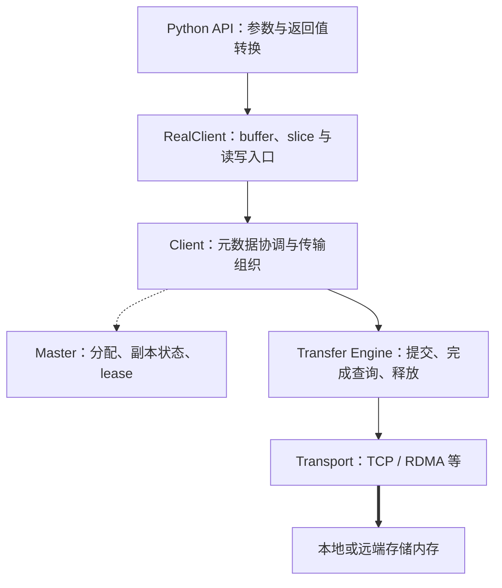
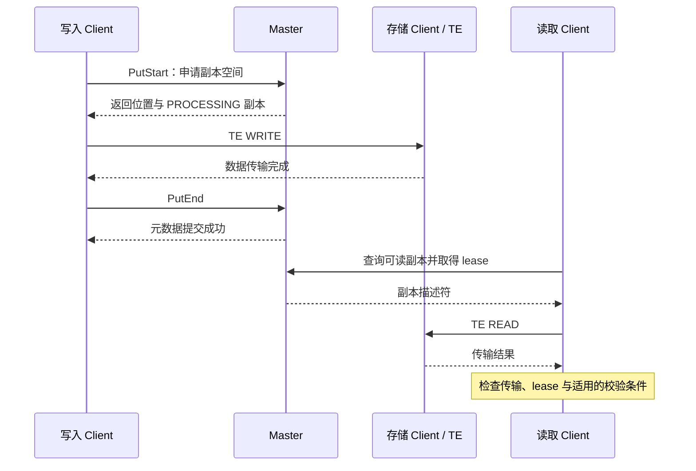

# 篇1 源码导航：一次 KV Cache 读写经过哪些组件？

> 系列：《Mooncake KV Cache 源码解析》
> 版本锚点：`v0.3.13.post1`（commit `7197358`）
> 源码链接基座：`https://github.com/kvcache-ai/Mooncake/blob/v0.3.13.post1/`

> 阅读与验证约定见[系列指南](README.md)。本篇的源码行号沿用历史版本；图示为逻辑解释，引用测试不代表已执行。

## 1.1 具体问题

一个推理实例生成了 KV Cache，另一个实例怎样找到并读取它？

这个问题看似简单，但回答它需要同时说清三件事：写的一方把数据放到了哪里，读的一方怎么知道该去哪读，以及"写完了"和"能读了"是不是同一时刻。本篇不深入单个函数的实现细节，而是沿最小 Put/Get 路径把篇0 的地图跑通一遍，建立三个认识：

1. **对象标识**：key 是什么，谁构造它，它决定什么。
2. **元数据与数据分路**：哪些调用走 Master RPC，哪些走 Transfer Engine。
3. **完成判断**：Put/Get 各自在什么条件下才返回成功。

后两篇（篇2、篇3）会分别把 Put 和 Get 放大；本篇只求把这条链走通、把边界标清。

## 1.2 场景与版本

- **场景**：两个 Store Client 进程共享 KV Cache。进程 A Put 一个对象，进程 B Get 它。两者可能在同一台机器，也可能跨机器；跨机器时数据走 RDMA/TCP。
- **版本**：`v0.3.13.post1`。本版本中 Python 绑定在 `mooncake-integration/store/store_py.cpp`，`python/mooncake/` 只保留包的入口，计划里提到的 `cli_client.py`/`cli.py` 在该 tag 已不存在。读源码时以 tag 树为准，不要以当前 HEAD 为准——两者目录结构相同，但函数行号会漂移。
- **传输后端**：先以 `tcp` 走通调用链（不需要 RDMA 硬件），后端选择只影响 `TransferSubmitter` 内部策略，不影响本节的元数据/数据分路结论。
- **最小示例**：`mooncake-store/rust/examples/basic_usage.rs` 提供了最干净的 `setup → put → get → remove` 序列。

## 1.3 调用链图

```
Python 调用方
  │  put_tensor_from(key, buffer_ptr, size)        store_py.cpp:1205
  │  get_tensor_into(key, buffer_ptr, size)        store_py.cpp:662
  ▼  （释放 GIL）
RealClient                                      real_client.h / real_client.cpp
  │  put_from  ──▶ put_from_internal              real_client.cpp:4219 / 4189
  │     └─ split_into_slices(buffer, size)        real_client.cpp:4209
  │  get_into  ──▶ get_into_range_internal        real_client.cpp:3758 / 3740
  │     └─ resolve_ranged_read_metadata           real_client.cpp:3456
  ▼
Client（PyClient 的实现）                        client_service.cpp
  │
  ├── 元数据路径 ─────────────────────────────────────────────┐
  │   Put:    master_client_.PutStart(...)        :1882      │
  │           master_client_.PutEnd / PutRevoke               │
  │   Get:    BatchGetReplicaList(...)           :1234       │
  │                                                            ▼
  │                                              MasterService（独立进程）
  │                                                PutStart   master_service.cpp:4292
  │                                                PutEnd     master_service.cpp:4509
  │                                                GetReplicaList :3626
  │
  └── 数据路径 ───────────────────────────────────────────────┐
      TransferSubmitter::submit(...)                            │
        └─ TransferData(WRITE/READ)            client_service.cpp:4250
             └─ TransferEngine::submitTransfer                  ▼
                                        ┌──────────────────────────────┐
                                        │ 本机 buffer ──RDMA/TCP──▶ 远端 │
                                        │             Client 内存段      │
                                        └──────────────────────────────┘
```

两条路径的交点只有一处：**Transfer Engine 需要目标地址**。这个地址由 Master 在元数据路径上给出（segment + offset + size），之后数据搬运完全不经过 Master。

### 1.3.1 分层职责：先找入口，再区分控制与搬运



先沿实线找应用调用入口，再沿虚线确认可见性与读保护，最后沿粗线追字节的搬运。这里展示逻辑分层，不意味着每个 API 都严格经过所有节点；具体函数入口仍以本节调用链为准。

### 1.3.2 最小读写时序：两个完成点



数据传输完成与元数据提交成功是两个时刻。默认新对象写入路径只有在提交后才对读方可见；后续读取仍可能受淘汰、故障或 lease 到期影响。

## 1.4 三个关键代码片段

### 片段1：Python 绑定——释放 GIL，且 Put 要求 tensor 头

`get_tensor_into` 在调用 C++ 前释放 GIL：

```cpp
// mooncake-integration/store/store_py.cpp:662
pybind11::object get_tensor_into(const std::string &key,
                                 uintptr_t buffer_ptr, size_t size) {
    if (!is_client_initialized()) { ... return pybind11::none(); }
    if (buffer_ptr == 0) { ... return pybind11::none(); }

    char *buffer = reinterpret_cast<char *>(buffer_ptr);
    int64_t total_length;
    {
        py::gil_scoped_release release_gil;      // 释放 GIL
        total_length = store_->get_into(key, buffer, size);
    }
    return buffer_to_tensor(NULL, buffer, total_length);
}
```

**输入/输出**：输入是调用方自己分配的 buffer 指针和容量；输出是实际读取的字节数（`total_length`），负值为错误码。**所有权**：buffer 始终归调用方，Store 不接管、不释放。

`put_tensor_from` 除了释放 GIL，还多做两件事：

```cpp
// mooncake-integration/store/store_py.cpp:1205
if (size < sizeof(TensorMetadata)) {
    return to_py_ret(ErrorCode::INVALID_PARAMS);
}
if (!ParseTensorMetadata(reinterpret_cast<const char *>(buffer), size)
         .has_value()) {
    return to_py_ret(ErrorCode::INVALID_PARAMS);
}
py::gil_scoped_release release_gil;
return store_->put_from(key, buffer, size, ReplicateConfig{});
```

这里有一个容易忽略的约束：**走 tensor API 写入的数据，buffer 开头必须是合法的 `TensorMetadata` 头**。也就是说 `put_tensor_from` 不是"任意字节的 Put"，它要求数据自带描述信息。读回时 `buffer_to_tensor` 依赖这个头还原 tensor 形状。若只想要原始字节，应走 `put`/`get` 而不是 tensor 接口。

> **分析（推断）**：释放 GIL 不是为了单次调用更快，而是为了让多个 Python 线程能并发发起传输。传输是毫秒级操作，若持有 GIL，整个解释器都会被阻塞。

### 片段2：RealClient 切 slice，Client::Put 走两阶段

`put_from_internal` 做两件事：把用户 buffer 切成 slice，然后交给 `Client::Put`：

```cpp
// mooncake-store/src/real_client.cpp:4189
tl::expected<void, ErrorCode> RealClient::put_from_internal(
    const std::string &key, void *buffer, size_t size,
    const ReplicateConfig &config) {
    if (config.prefer_alloc_in_same_node) {
        return tl::unexpected(ErrorCode::INVALID_PARAMS);
    }
    if (size == 0) { return {}; }                 // 空对象直接成功

    std::vector<mooncake::Slice> slices = split_into_slices(buffer, size);
    auto put_result = client_->Put(key, slices, config);
    if (!put_result) return tl::unexpected(put_result.error());
    return {};
}
```

`Client::Put` 才是真正决定可见性的地方，结构是"申请 → 传输 → 终结"三段：

```cpp
// mooncake-store/src/client_service.cpp:1853（节选）
auto start_result = master_client_.PutStart(key, slice_lengths, client_cfg);
if (!start_result) {
    ErrorCode err = start_result.error();
    if (err == ErrorCode::OBJECT_ALREADY_EXISTS) {
        VLOG(1) << "object_already_exists key=" << key;
        return {};                                 // 幂等：已存在即成功
    }
    if (err == ErrorCode::NO_AVAILABLE_HANDLE) { ... }
    return tl::unexpected(err);
}

// 先写磁盘副本（反向遍历，保证 disk 的 PutEnd 一定被调用）
// 再写 memory / NOF 副本
ErrorCode transfer_err = TransferWrite(replica, slices);
...
const auto finalize_decision =
    DetermineFinalizeDecision(config, transfer_summary);
if (finalize_decision.end_type.has_value()) {
    master_client_.PutEnd(ObjectMeta{key, object_checksum},
                          *finalize_decision.end_type);
}
if (finalize_decision.revoke_type.has_value()) {
    master_client_.PutRevoke(key, *finalize_decision.revoke_type);
}
```

**状态变化**：`PutStart` 在 Master 上创建对象的副本记录，副本初始是 `PROCESSING`；数据传完后 `PutEnd` 把对应副本标成 `COMPLETE`。**在 `PutEnd` 之前，这个对象对读方不可见**——这不是约定，是 Master 读路径的硬过滤（见片段3）。

### 片段3：Get 的副本选择，与 Master 的可读判定

读方先查元数据，再选副本，最后传输。`Client::Get` 的骨架：

```cpp
// mooncake-store/src/client_service.cpp:1352（节选）
ErrorCode err = FindFirstCompleteReplica(query_result.replicas, replica);
if (err != ErrorCode::OK) return tl::unexpected(err);

if (hot_cache_ && replica.is_memory_replica())
    cache_used = RedirectToHotCache(object_key, replica);

err = TransferRead(replica, slices);              // 数据路径
...
auto checksum_result = VerifyObjectChecksum(...); // 可选校验

if (query_result.IsLeaseExpired()) {
    return tl::unexpected(ErrorCode::LEASE_EXPIRED);  // 注意：在传输完成之后
}
```

`FindFirstCompleteReplica`（`client_service.cpp:4919`）只接受 `ReplicaStatus::COMPLETE` 的副本，第一个匹配即返回。

Master 侧的可读判定更严格：

```cpp
// mooncake-store/src/master_service.cpp:3546
bool MasterService::IsReplicaReadable(const Replica& replica) const {
    if (!replica.is_completed() || replica.has_invalid_mem_handle() ||
        replica.has_invalid_nof_handle()) {
        return false;
    }
    ...
    return !endpoint || !invalid_replica_endpoints_.contains(*endpoint);
}
```

`GetReplicaList`（`master_service.cpp:3626`）只把通过 `IsReplicaReadable` 的副本返回给读方；如果一个都没有，且对象并未被全部删除，则返回 `REPLICA_IS_NOT_READY`，而不是 `OBJECT_NOT_FOUND`。**这两者的区别很重要**：前者是"还在写"，后者是"确实没有"。

同一个 `GetReplicaList` 里还会给对象授予 read lease：

```cpp
// mooncake-store/src/master_service.cpp:3626 内
metadata.GrantReadLease(default_kv_lease_ttl_);
```

这就是 lease 保护的入口——读完之前对象不能被淘汰或删除，细节留给篇8。

## 1.5 三个认识

### 认识1：key 是不透明字符串，语义由推理框架决定

Mooncake Store 不解析 key 的内部结构（`docs/source/design/store/mooncake-store.md`）。它只把 key 当作路由和查找的依据。这意味着：

- 哪些请求能复用同一份 KV Cache，完全由框架拼 key 的规则决定；
- Store 的隔离边界（模型 / 发布 / 请求组 / tenant）是附加在 key 和 tenant 之上的策略，不是 key 本身（`docs/source/deployment/kv-cache-sharing-and-isolation.md`）。

vLLM 场景下 key 如何构造，留给篇10。

### 认识2：元数据与数据严格分路

| 维度 | 元数据路径 | 数据路径 |
|---|---|---|
| 经过 | Client → Master RPC | Client → Transfer Engine → 远端 Client |
| 内容 | 空间分配、副本位置、完成状态、lease | 实际 KV Cache 字节 |
| 谁主导 | `MasterService` | `TransferSubmitter` + `Transport` |
| 是否可绕过 | 否 | 同机可退化为 local memcpy |

需要强调一点：**Master 不参与数据搬运**，但它给出的地址是数据路径的唯一输入。所以"Master 宕机"不会破坏已建立的数据路径，但新请求无法定位副本。这是篇9 讨论故障恢复的前提。

### 认识3：完成判断——Put 与 Get 的语义不同

- **Put 成功**：`DetermineFinalizeDecision` 判定"分配到的副本全部传输成功"（可靠模式下），随后 `PutEnd` 提交成功。注意是**分配到的**副本，不是**请求的**副本——分配不足时返回 `NO_AVAILABLE_HANDLE`，不会假装成功。
- **Get 成功**：副本状态为 `COMPLETE` → 数据传输完成 → 校验（若开启）通过 → lease 未过期。四个条件缺一不可。

特别注意最后一个：**lease 检查发生在数据搬运完成之后**（`client_service.cpp:1352`）。也就是说，网络传输成功不等于 Get 成功；对象在传输期间过期，调用方仍会收到 `LEASE_EXPIRED`，尽管 buffer 里可能已经有数据。

> **观点**：这是正确的取舍。对 KV Cache 来说，读到一份"可能已被淘汰覆盖"的数据比显式失败危险得多，宁可让调用方重试。

## 1.6 异常与并发

- **对象已存在**：`PutStart` 返回 `OBJECT_ALREADY_EXISTS`，`Client::Put` 直接 `return {}`。Put 对同一 key 是**幂等**的——但注意它不会覆写已有内容，已有副本保持原样。需要覆盖语义时应使用 `Upsert`。
- **空间不足**：`PutStart` 返回 `NO_AVAILABLE_HANDLE`，日志会带 `PUT_NO_SPACE_HELPER_STR` 提示。此时对象未创建，`Put` 返回失败，不会留下半成品。
- **部分副本失败**：`DetermineFinalizeDecision`（`client_service.cpp:332`）决定去向。可靠模式下要求全部成功，否则 `PutRevoke` 回滚已分配的副本；`FLEXIBLE_DUAL_REPLICA` 模式只要求 memory 或 NOF 一侧成功，失败的一侧被 revoke。**因此"Put 成功"不保证每一份副本都在。**
- **读时未就绪**：`GetReplicaList` 返回 `REPLICA_IS_NOT_READY`，`get_into_range_internal`（`real_client.cpp:3740`）原样透传，不重试。
- **读与淘汰并发**：靠 lease。`GetReplicaList` 授予 lease；传输完成后才检查过期。过期即 `LEASE_EXPIRED`。
- **并发**：Python 绑定释放 GIL 后，多线程可并发进入 C++。但调用方必须保证**并发写同一个 buffer 是自己的责任**——Store 不做 buffer 级别的互斥。

## 1.7 验证与结论

- **最小路径**：`mooncake-store/rust/examples/basic_usage.rs` 的 `setup`(`:75`) / `put`(`:97`) / `get`(`:120`) / `get_size("nonexistent")`(`:154`)。
- **Python 绑定**：`store_py.cpp` 的 `get_tensor_into`(`:662`)、`put_tensor_from`(`:1205`)。
- **RealClient**：`real_client.cpp` 的 `put_from_internal`(`:4189`)、`get_into`(`:3758`)、`batch_query`(`:4033`)。
- **Client**：`client_service.cpp` 的 `Put`(`:1853`)、`Get`(`:1352`)、`DetermineFinalizeDecision`(`:332`)、`FindFirstCompleteReplica`(`:4919`)。
- **Master**：`master_service.cpp` 的 `PutStart`(`:4292`)、`PutEnd`(`:4509`)、`GetReplicaList`(`:3626`)、`IsReplicaReadable`(`:3546`)。
- **设计文档**：`docs/source/design/store/mooncake-store.md`（双角色、强一致性、副本 best-effort）。

**结论**：一次 KV Cache 读写 = **Python 绑定（释放 GIL）→ RealClient（切 slice / 查元数据）→ 元数据走 Master RPC、数据走 Transfer Engine → 远端 Client 内存**。key 是不透明字符串；元数据与数据严格分路；Put 的成功条件是"分配副本全部完成 + PutEnd 提交"，Get 的成功条件是"副本 COMPLETE + 传输完成 + 校验通过 + lease 未过期"。

**适用范围**：以上结论基于 `v0.3.13.post1` 的 `tcp` 后端与默认 `ReplicateConfig`。RDMA 后端不改变元数据/数据分路，但会改变 `TransferSubmitter` 内部的策略选择与失败语义，见篇5、篇6。

下一篇把 Put 放大：`PutStart` 到底分配了什么，部分副本失败时回滚做了什么，`PutEnd` 之后读方看到的是什么。

---

*下一篇：篇2 一次 Put——缓存对象如何从客户端写入分布式内存？*
