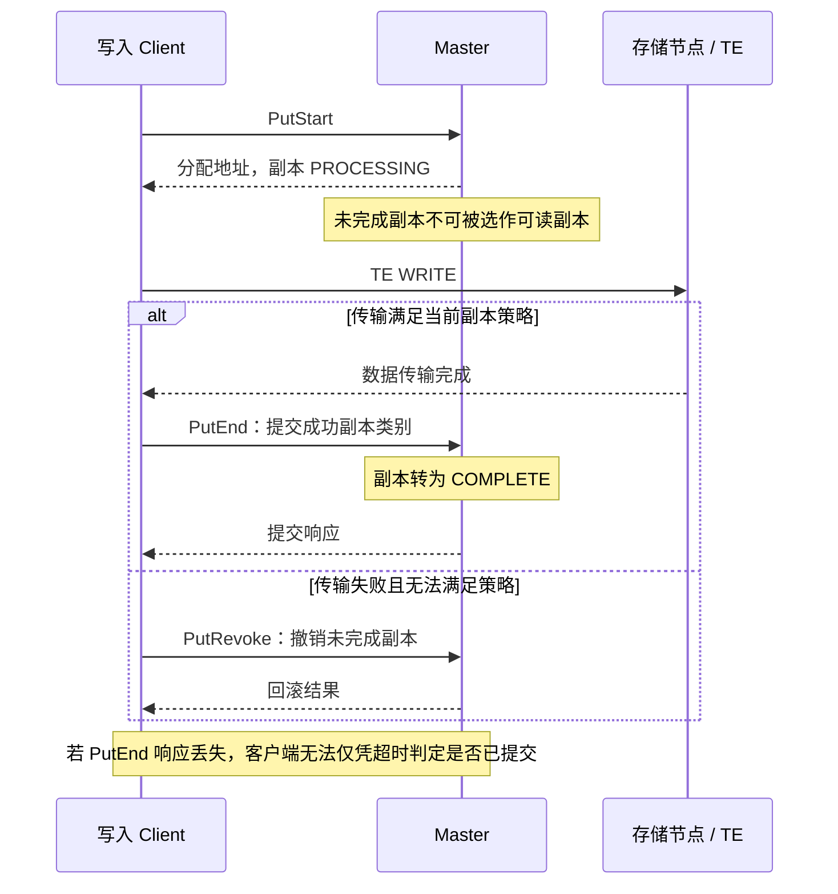
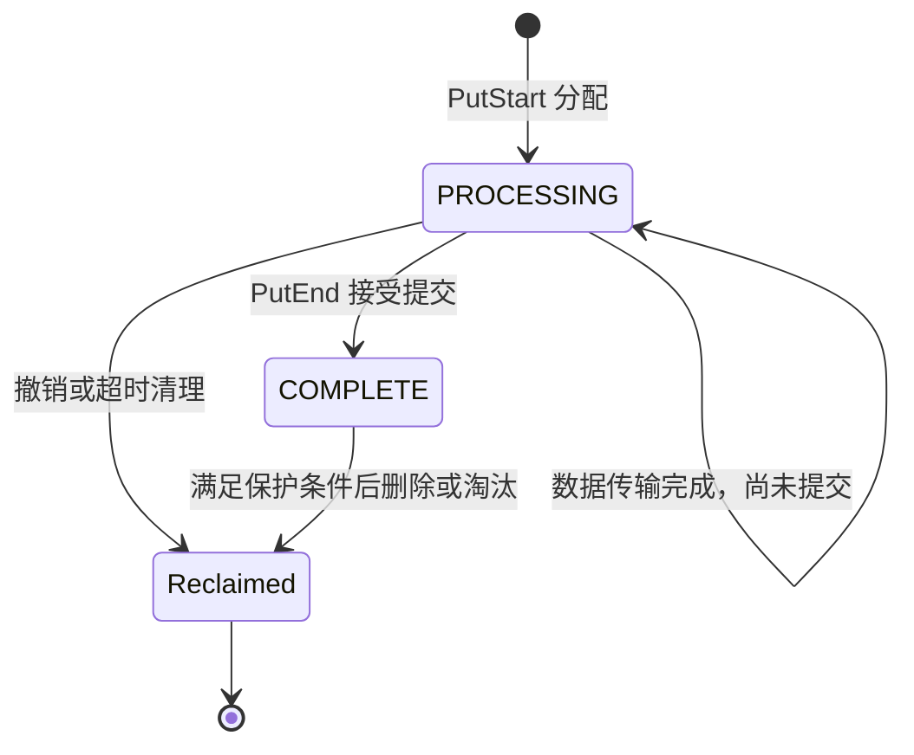

# 篇2 一次 Put：缓存对象如何从客户端写入分布式内存？

> 系列：《Mooncake KV Cache 源码解析》
> 版本锚点：`v0.3.13.post1`（commit `7197358`）
> 源码链接基座：`https://github.com/kvcache-ai/Mooncake/blob/v0.3.13.post1/`

> 阅读与验证约定见[系列指南](README.md)。本篇的源码行号沿用历史版本；图示为逻辑解释，引用测试不代表已执行。

## 2.1 具体问题

客户端 Put 返回成功的那一刻，另一个客户端是否已经能读取？如果不能，差在哪里？

这个问题问的是**可见性**。它容易被含糊带过："Put 完了就能读"。但"写完"至少有三种含义——数据到了远端内存、Master 记下了位置、对象状态允许读。三者不是同一时刻。本篇沿 `Client::Put` 追这条链，给出每个阶段的准确边界。

## 2.2 场景与版本

- **场景**：客户端 A Put 一个 KV Cache 对象，客户端 B 随后 Get。A 与 B 可以是同一进程、同机不同进程，或跨机。
- **版本**：`v0.3.13.post1`。
- **配置基线**：默认 `ReplicateConfig`（`replica_num = 1`，无 NoF/DFS 副本），传输后端 `tcp`。多副本与双副本模式的差异在 2.6 单独说明。
- **主路径**：`Client::Put`（`client_service.cpp:1853`）→ `MasterService::PutStart`（`master_service.cpp:4292`）→ `AllocateAndInsertMetadata`（`master_service.cpp:4021`）→ `TransferWrite`（`client_service.cpp:4479`）→ `DetermineFinalizeDecision`（`client_service.cpp:332`）→ `MasterService::PutEnd`（`master_service.cpp:4509`）。

## 2.3 调用链图

```
Client::Put                                        client_service.cpp:1853
  │
  ├─① PutStart(key, slice_lengths, config)         :1882
  │     └─ MasterService::PutStart                 master_service.cpp:4292
  │          └─ AllocateAndInsertMetadata          master_service.cpp:4021
  │               ├─ allocation_strategy_->Allocate        :4098
  │               │     └─ 选 segment + offset（按 slice 分散）
  │               ├─ replicas 初始状态 = PROCESSING
  │               └─ metadata.emplace(key, ...)  ← 记录 client_id/状态
  │
  ├─② 写数据
  │     ├─ 磁盘副本优先：PutToLocalFile            :1907 起
  │     └─ 内存/NoF 副本：TransferWrite            :1922 / :4479
  │           └─ TransferData                     :4250
  │                 └─ TransferSubmitter::submit → future->get()
  │
  └─③ DetermineFinalizeDecision                    :1967
        ├─ PutEnd(replica_type)    对象可见
        └─ PutRevoke(replica_type) 对象不可见
```

### 2.3.1 写入时序：可见性由提交控制



本图采用默认新对象写入路径；双副本策略的分类提交与撤销见 2.6。响应丢失属于结果不确定：重试时要结合已存在 key 的处理语义，不能直接把它当成“服务端没有写入”。

### 2.3.2 副本状态：数据写完还不等于可读



`Reclaimed` 是图示中的资源回收结果，不是新增的源码枚举。PutStart/PutEnd 是分阶段写入协议；这里不据此宣称具备数据库两阶段提交（2PC）的全部事务保证。

## 2.4 三个关键代码片段

### 片段1：Client::Put 的三段结构与磁盘优先

`PutStart` 返回的是**已分配好的副本描述**，不是"稍后告诉你"：

```cpp
// mooncake-store/src/client_service.cpp:1882
auto start_result = master_client_.PutStart(key, slice_lengths, client_cfg);
if (!start_result) {
    ErrorCode err = start_result.error();
    if (err == ErrorCode::OBJECT_ALREADY_EXISTS) {
        VLOG(1) << "object_already_exists key=" << key;
        return {};                                   // 幂等成功
    }
    if (err == ErrorCode::NO_AVAILABLE_HANDLE) { ... }
    return tl::unexpected(err);
}
```

随后按副本类型分别写。注意**磁盘副本先写**，源码给了理由：

```cpp
// mooncake-store/src/client_service.cpp:1907
// We must deal with disk replica first, then the disk putrevoke/putend can
// be called surely
if (storage_backend_) {
    for (auto it = start_result.value().rbegin(); ...; ++it) {
        if (replica.is_disk_replica()) {
            PutToLocalFile(key, slices, replica.get_disk_descriptor());
            break;                                 // 只写一个磁盘副本
        }
    }
}

// client_service.cpp:1922  内存 / NoF 副本
for (const auto& replica : start_result.value()) {
    if (replica.is_memory_replica() || replica.is_nof_replica()) {
        ErrorCode transfer_err = TransferWrite(replica, slices);
        if (transfer_err != ErrorCode::OK) {
            transfer_summary.RecordFailure(replica_type, transfer_err);
            continue;                              // 单个失败不中断
        }
        transfer_summary.RecordSuccess(replica_type);
    }
}
```

**输入/输出**：输入是切片后的 `slices`（`real_client.cpp:4209`）和 Master 给的副本；输出是一个 `TransferResultSummary`，记录成功/失败计数和第一个错误。**所有权**：slice 指向调用方 buffer，传输期间调用方不得释放。

### 片段2：分配与初始状态——`PROCESSING` 是可见性闸门

`AllocateAndInsertMetadata` 在同一个临界区里完成三件事：查重、分配、插入：

```cpp
// mooncake-store/src/master_service.cpp:4021（节选）
if (tenant_state.metadata.contains(key)) {
    return tl::make_unexpected(ErrorCode::OBJECT_ALREADY_EXISTS);
}

auto allocation_result = allocation_strategy_->Allocate(
    allocator_access, value_length, config.replica_num,
    preferred_segments, std::set<std::string>(), ReplicaType::MEMORY);
...
// 磁盘副本同样以 PROCESSING 插入
replicas.emplace_back(file_path, value_length, ReplicaStatus::PROCESSING);

auto [it, inserted] = tenant_state.metadata.emplace(...);
if (!inserted) {
    LOG(INFO) << "key=" << key << ", info=object_already_exists";
    refund_pending_quota();
    return tl::make_unexpected(ErrorCode::OBJECT_ALREADY_EXISTS);
}
tenant_state.processing_keys.insert(key);
```

**关键点**：对象在 `PutStart` 就已经进入 Master 的元数据表了，但所有副本都是 `PROCESSING`。读方此时查得到对象吗？查得到，但拿不到可读副本——因为 `GetReplicaList` 只返回 `IsReplicaReadable` 的副本，而 `PROCESSING` 不算可读（见 2.5）。

### 片段3：`PutEnd`——把 PROCESSING 翻成 COMPLETE

`PutEnd` 是可见性的开关：

```cpp
// mooncake-store/src/master_service.cpp:4509（节选）
if (client_id != metadata.client_id) {
    return tl::make_unexpected(ErrorCode::ILLEGAL_CLIENT);   // :4522
}
if (!accessor.InProcessing()) {
    // :4551 重试：若目标副本已全部 COMPLETE，视为 no-op
    ...
    return {};
}
metadata.VisitReplicas(
    [&is_target_replica](const Replica& replica) {
        return replica.is_processing() && is_target_replica(replica);
    },
    [this, &key, &metadata](Replica& replica) {
        replica.mark_complete();                             // :4574 起
        ...
    });
```

`PutEnd` 只影响 `PROCESSING` 且属于 `replica_type` 的副本；已经 `COMPLETE` 的不动。这样重试安全，也不会误改其他路径正在推进的副本。

## 2.5 可见性语义：Put 返回成功 = 对象可读，但成立条件要说全

副本状态机比"INIT → PROCESSING → COMPLETE"更完整（`mooncake-store/include/replica.h:52`）：

```cpp
enum class ReplicaStatus {
    UNDEFINED = 0,   // 未初始化
    INITIALIZED,     // 已分配空间，等待写入
    PROCESSING,      // 写入进行中
    COMPLETE,        // 写入完成，可读
    REMOVED,         // 已移除
    FAILED,          // 失败（可用于重新分配）
};
```

读路径的过滤在 Master：

```cpp
// master_service.cpp:3546
bool MasterService::IsReplicaReadable(const Replica& replica) const {
    if (!replica.is_completed() || replica.has_invalid_mem_handle() ||
        replica.has_invalid_nof_handle()) {
        return false;
    }
    ...  // 再排除 endpoint 已被标记失效的副本
}
```

于是可以精确回答开篇问题：

1. **`PutStart` 之后、`PutEnd` 之前**：对象存在，但副本是 `PROCESSING`。`GetReplicaList` 返回 `REPLICA_IS_NOT_READY`，不是"对象不存在"。读方读不到，但知道它还在写。
2. **`PutEnd` 成功之后**：目标副本变 `COMPLETE`，`GetReplicaList` 开始返回它。从这一刻起另一个客户端可以读。
3. **`Client::Put` 返回成功**：发生在 `PutEnd` 返回之后。所以**Put 成功返回时，对象确实已经可读**——可见性早于返回，不是同时。

> **分析（推断）**：因此存在一个短暂窗口：`PutEnd` 已生效、`Client::Put` 尚未返回，此时读方已经能读。反过来不存在"Put 返回成功但读不到"的窗口，除非 `PutEnd` 之后的元数据传播有延迟——本版本里读方每次 Get 都查 Master，没有本地缓存，所以这个窗口为零。

**网络传输完成 ≠ 对象写入成功**。`TransferWrite` 返回 `OK` 只说明数据到了远端内存段；让对象可读的是 `PutEnd`。这就是两阶段 Put 的意义：把"数据落位"和"对象发布"分开，避免读方看到半写状态。

## 2.6 异常与失败路径

### 空间不足

`Allocate` 失败时，非双副本模式返回 `NO_AVAILABLE_HANDLE`，并在有足够 segment 的情况下置淘汰标记：

```cpp
// master_service.cpp:4112
need_mem_eviction_ = true;
```

`Client::Put` 收到后直接返回失败，不自动重试。**分析**：重试策略应放在上层（例如推理框架），因为立即重试很可能再次失败——淘汰是异步的。

### 分配降级

若分配的副本数少于请求数，`PutStart` 会打 `put_start_partial_allocation` 警告并增加指标，但只在配置允许降级时继续。这解释了为什么"Put 成功"不等于"要了几副本就有几副本"。

### 部分副本失败

`DetermineFinalizeDecision`（`client_service.cpp:332`）决定去向：

- **可靠模式**（默认）：要求**分配到的**副本全部传输成功。否则 `PutRevoke(ALL)`，Put 失败。
- **FLEXIBLE_DUAL_REPLICA**：memory 或 NoF 任一侧成功即算成功。失败的一侧被 `PutRevoke` 撤销，成功的一侧 `PutEnd`。

也就是说，双副本模式下可能出现"Put 成功，但只有内存副本"的结果。**分析**：这不是 bug，而是把可用性放在冗余度之前的取舍；调用方若依赖副本数，需要读指标而不是假设。

### 回滚的边界：PutRevoke 只撤销仍 PROCESSING 的副本

```cpp
// master_service.cpp:4776（节选）
auto processing_rep = metadata.GetFirstReplica([replica_type](const Replica& r) {
    if (replica_type == ReplicaType::ALL)
        return (r.is_memory_replica() || r.is_nof_replica() ||
                r.is_dfs_replica()) && !r.is_processing();
    return r.type() == replica_type && !r.is_processing();
});
if (processing_rep != nullptr) {
    return tl::make_unexpected(ErrorCode::INVALID_WRITE);
}
```

如果目标副本里已经有一个 `COMPLETE`，Revoke 会失败。所以正确用法是"End 成功的那一类，Revoke 失败的那一类"——这正是 `DetermineFinalizeDecision` 的输出。**推断**：Confused deputy 式的错误调用（先 End 再 Revoke 同一类）会被拒绝，而不是误删数据。

### 重复 Put 是否安全

安全，但语义是**幂等而非覆盖**：`PutStart` 收到已存在的 key 返回 `OBJECT_ALREADY_EXISTS`，`Client::Put` 直接当成功返回（`client_service.cpp:1885`）。已有内容不变。需要覆盖语义要用 `Upsert`。

### Client 崩溃：僵尸对象

若 client 在 `PutStart` 后崩溃，未发 `PutEnd`/`PutRevoke`，对象成为"僵尸"：不可读、也不可正常删除，还挡住后续对同一 key 的 Put。Master 用两个超时处理（`docs/source/deployment/mooncake-store-deployment-guide.md:572`）：

| 参数 | 默认 | 作用 |
|---|---|---|
| `put_start_discard_timeout_sec` | 30 | 超时后允许后续 `PutStart` 顶替旧的 |
| `put_start_release_timeout_sec` | 600 | 超时后旧的空间可被淘汰回收 |

**关键细节**：顶替时**不复用旧空间**，而是重新分配；旧空间靠第二条超时回收（`docs/source/design/store/mooncake-store.md:672`）。所以僵尸对象在 30 秒内仍是故障源，只是不再永久阻塞。

### 并发

`AllocateAndInsertMetadata` 在 metadata 分片锁内完成查重与插入，`PutStart` 竞争同一 key 时只有一个能插入成功。`PutEnd` 校验 `client_id`，防止别的客户端替你提交。

## 2.7 验证与结论

- **Put 主流程**：`client_service.cpp` 的 `Client::Put`(`:1853`)、`TransferWrite`(`:4479`)、`TransferData`(`:4250`)、`DetermineFinalizeDecision`(`:332`)。
- **Master 侧**：`master_service.cpp` 的 `PutStart`(`:4292`)、`AllocateAndInsertMetadata`(`:4021`)、`PutEnd`(`:4509`)、`PutRevoke`(`:4776`)、`IsReplicaReadable`(`:3546`)。
- **状态机**：`mooncake-store/include/replica.h:52`。
- **测试**：`mooncake-store/tests/client_integration_test.cpp`（Put/Get 集成）、`dynamic_replication_test.cpp`（动态副本）、`task_integration_test.cpp`（传输任务）。
- **设计文档**：`docs/source/design/store/mooncake-store.md` 的 PutStart/PutEnd 与 Zombie Object Cleanup；`docs/source/deployment/mooncake-store-deployment-guide.md:572` 的超时参数表。

**结论**：Put 是两阶段操作。`PutStart` 分配空间并把副本置为 `PROCESSING`，`TransferWrite` 把数据搬到远端，`PutEnd` 把副本翻成 `COMPLETE`——**这一步才让对象可读**。因为 `Client::Put` 在 `PutEnd` 之后才返回，所以**Put 返回成功时另一客户端已经可以读**；但"成功"的强度取决于配置：默认要求分配到的副本全部成功，双副本模式只要求一侧成功。

下一篇反过来问：Get 如何在若干副本里选一个、读回后又如何确认这次读是有效的。

---

*下一篇：篇3 一次 Get——如何找到远端缓存并读回数据？*
