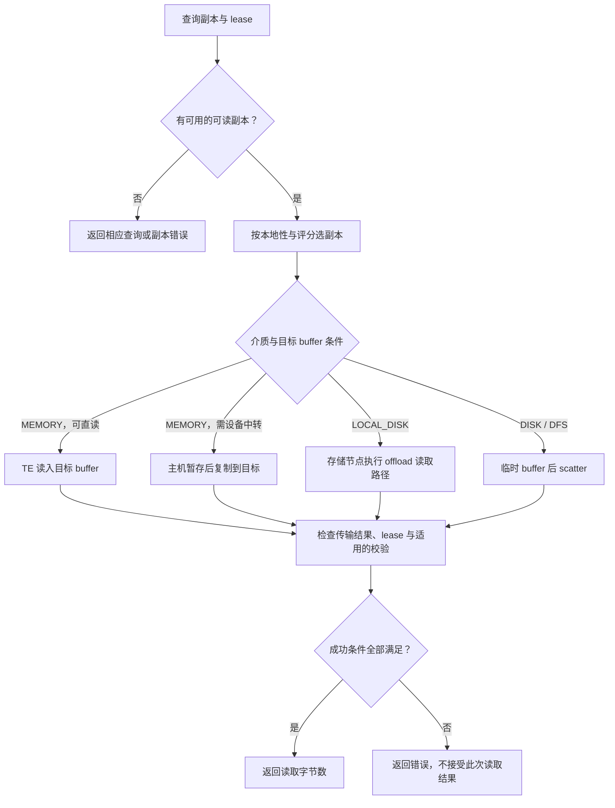
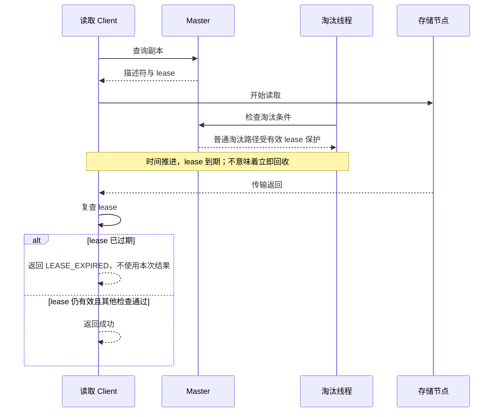

# 篇3 一次 Get：如何找到远端缓存并读回数据？

> 系列：《Mooncake KV Cache 源码解析》
> 版本锚点：`v0.3.13.post1`（commit `7197358`）
> 源码链接基座：`https://github.com/kvcache-ai/Mooncake/blob/v0.3.13.post1/`

> 阅读与验证约定见[系列指南](README.md)。本篇的源码行号沿用历史版本；图示为逻辑解释，引用测试不代表已执行。

## 3.1 具体问题

Get 拿到一个 key，怎么知道该去哪读？多个副本时读哪个？读回来了怎么确认这次读有效？

这三个问题对应三段独立的逻辑，而且它们的失败语义完全不同：

1. **定位**：从 key 找到对象的所有副本位置（元数据路径，可能失败于"对象不存在"或"副本未就绪"）。
2. **选择**：在若干副本里挑一个（纯本地决策，失败于"没有一个 COMPLETE"）。
3. **读取**：按副本类型选不同的搬运方式（可能失败于 buffer 太小、传输错误、lease 过期、校验不符）。

把这三段混在一起谈，就会得出"Get 失败"这种没有信息量的结论。本篇逐段拆开。

## 3.2 场景与版本

- **场景**：客户端 B 读取客户端 A 写入的对象。对象可能有多个副本，分布在不同的 store 节点；B 可能和某个副本同机。
- **版本**：`v0.3.13.post1`。副本选择逻辑在 **header-only** 的 `mooncake-store/include/replica_selection.h`，该 tag 没有 `src/replica_selection.cpp`——这一点容易看错。
- **配置基线**：默认单副本、`tcp` 后端、对象校验默认关闭（`StoreChecksumEnabled`），开启后的差异在 3.7 说明。
- **主路径**：`get_into`（`real_client.cpp:3758`）→ `get_into_range_internal`（`:3740`）→ `resolve_ranged_read_metadata`（`:3456`）→ `execute_ranged_read`（`:3475`）→ `Client::Get`（`client_service.cpp:1352`）。

## 3.3 调用链图

```
RealClient::get_into                              real_client.cpp:3758
  └─ get_into_range_internal                      :3740
       └─ resolve_ranged_read_metadata            :3456
            └─ batch_query                        :4033
                 └─ Client::BatchQuery            client_service.cpp:1230
                      └─ Master BatchGetReplicaList        ← 元数据 RPC
                           └─ 返回 replicas + lease_ttl_ms + checksum

       └─ execute_ranged_read                     :3475
            ├─ build metadata / SelectBestReplica replica_selection.h:123
            └─ 按副本类型分支：
                 ├─ MEMORY + 可 local memcpy → Client::Get（TE 直读）
                 ├─ MEMORY + GPU 目标        → 主机暂存 → scatter 到 GPU
                 ├─ LOCAL_DISK               → offload RPC 直读目标 buffer
                 └─ DISK / DFS               → 临时 buffer → scatter 到目标

Client::Get                                       client_service.cpp:1352
  ├─ FindFirstCompleteReplica                     :4919
  ├─ hot cache redirect（可选）
  ├─ TransferRead → TransferEngine                :4497
  ├─ VerifyObjectChecksum（可选）                  :1319
  └─ lease 过期检查（在传输之后）
```

### 3.3.1 读取决策：先判断可读，再选择搬运路径



“直读”说明目标 buffer 的使用方式，不自动等价于所有后端都没有拷贝。查询、数据传输和完成检查的错误应分别保留，方便上层决定重试或重算。

### 3.3.2 lease 到期：读到字节不代表结果可接受



lease 保护的是承诺的时间窗口，不能把任意长的传输都算作受保护读取。强制删除等特殊路径另见篇8；图中不把“到期”与“发生删除”视作同一事件。

## 3.4 三个关键代码片段

### 片段1：`batch_query`——一次 RPC 拿到副本、lease 和校验和

`Client::BatchQuery` 把 Master 的响应包装成 `QueryResult`，其中 lease 的绝对过期时间由**本地时钟起点 + Master 给的 TTL** 算出：

```cpp
// mooncake-store/src/client_service.cpp:1230
std::vector<tl::expected<QueryResult, ErrorCode>> Client::BatchQuery(
    const std::vector<std::string>& object_keys, const std::string& tenant_id) {
    std::chrono::steady_clock::time_point start_time =
        std::chrono::steady_clock::now();
    auto response = master_client_.BatchGetReplicaList(object_keys, tenant_id);
    ...
    results.emplace_back(QueryResult(
        std::move(response[i].value().replicas),
        start_time + std::chrono::milliseconds(response[i].value().lease_ttl_ms),
        response[i].value().object_checksum));
}
```

**输入/输出**：输入是 key 列表；输出每项含 `replicas`、`lease_timeout`、`object_checksum`。**注意 `lease_ttl_ms` 是 TTL 而不是绝对时间**，用本地 `steady_clock` 起点换算，避免依赖两台机器的墙钟一致。

> **分析（推断）**：用 `steady_clock` 而不是 `system_clock`，说明 lease 的判定只要求本机单调时钟，不要求跨机对时。这降低了分布式时钟假设。

### 片段2：`SelectBestReplica`——本地优先，然后远端评分

副本选择是纯本地计算，扫一遍列表，优先级写死在代码里：

```cpp
// mooncake-store/include/replica_selection.h:123
inline const Replica::Descriptor *SelectBestReplica(
    const std::vector<Replica::Descriptor> &replicas,
    const std::unordered_set<std::string> &local_endpoints) {
    const Replica::Descriptor *first_memory = nullptr;
    const Replica::Descriptor *first_nof = nullptr;
    for (const auto &r : replicas) {
        if (r.status != ReplicaStatus::COMPLETE) continue;
        if (r.is_memory_replica()) {
            if (local_endpoints.count(r.get_memory_descriptor()
                                          .buffer_descriptor.transport_endpoint_)) {
                return &r;                     // 本地 MEMORY：直接返回
            }
            if (!first_memory) first_memory = &r;
        } else if (r.is_nof_replica()) {
            if (local_endpoints.count(r.get_nof_descriptor()
                                          .buffer_descriptor.transport_endpoint_)) {
                return &r;                     // 本地 NOF_SSD
            }
            if (!first_nof) first_nof = &r;
        }
    }
    if (first_memory && RemoteReplicaScoringEnabled()) {
        if (const auto *scored = PickBestRemoteMemory(replicas, local_endpoints))
            return scored;
    }
    if (first_memory) return first_memory;
    if (first_nof) return first_nof;
    // 兜底：LOCAL_DISK > DFS > DISK
}
```

优先级是：**本地 MEMORY → 本地 NOF_SSD → 远端 MEMORY（可评分）→ 远端 NOF_SSD → LOCAL_DISK → DFS → DISK**。

**关键点**：`status != COMPLETE` 的直接跳过。所以即使 Master 没过滤干净，这里也不会读到半写副本。本地副本优先意味着**零网络开销**——同一台机器上，`Client::Get` 会退化成 local memcpy。

### 片段3：`execute_ranged_read`——同一个 Get，四条搬运路径

选定副本后，搬运方式取决于两件事：副本介质，以及目标 buffer 在什么设备上。

```cpp
// mooncake-store/src/real_client.cpp:3497  ① LOCAL_DISK 全量读：直通
if (src_offset == 0 && size == total_size) {
    if (replica.is_local_disk_replica()) {
        std::unordered_map<std::string, std::vector<Slice>> objects;
        objects.emplace(key, std::vector<Slice>{
                         {static_cast<char *>(buffer) + dst_offset, size}});
        auto result = batch_get_into_offload_object_internal(endpoint, objects);
        ...
        return static_cast<int64_t>(total_size);
    }
    // :3523 ② DISK/DFS 全量读：临时 buffer + scatter
    ...
    // :3559 ③ MEMORY 但目标是 GPU：主机暂存 + scatter
    if (runtime_accelerator.FindDeviceForPointer(dst) && ...) { ... }
}
// :3730 ④ MEMORY 且可直读：直接构造 slice 交给 Client::Get
std::vector<Slice> slices;
slices.emplace_back(Slice{dst, size});
auto get_result = client_->Get(key, filtered_qr, slices, src_offset);
```

四条路径的取舍很清楚：

| 副本类型 | 目标 | 路径 | 为什么 |
|---|---|---|---|
| MEMORY | 主机且可直读 | TE 读到目标 buffer | 避免额外应用层暂存拷贝；后端内部拷贝另论 |
| MEMORY | GPU 但不可直读 | 主机暂存 → `scatter_host_to_maybe_device` | GPU 内存未注册给 TE 时只能中转 |
| LOCAL_DISK | 任意 | offload RPC 直读目标 buffer | SSD 侧直接写目标 |
| DISK / DFS | 任意 | 临时 buffer → scatter | `allocateSlices` 要求全对象 slice |

**所有权**：临时 buffer 来自 `client_buffer_allocator_`，用 `BufferHandle` 的 RAII 释放；目标 buffer 归调用方。

这里还有一个容易被忽略的细节——`FilterQueryResult`（`real_client.cpp:402`）：

```cpp
inline QueryResult FilterQueryResult(const QueryResult &qr,
                                     const Replica::Descriptor &replica,
                                     bool include_object_checksum = true) {
    return QueryResult({replica}, qr.lease_timeout,
                       include_object_checksum ? qr.object_checksum : std::nullopt);
}
```

它把副本列表裁成**只剩选中的那一个**，再交给 `Client::Get`。原因写在注释里：`Client::Get` / `BatchGet` 内部还会再调 `FindFirstCompleteReplica`，如果不裁剪，它可能选中与 `execute_ranged_read` 假设不同的副本类型，导致走错搬运路径。

> **观点**：这是"选一次、用一次"的防御性设计。代价是多一次拷贝构造，收益是避免两处独立决策不一致——这类 bug 很难复现。

## 3.5 完成判断：Get 成功的条件

`get_into` 的成功返回值是**读取的字节数**（`int64_t`），负值为错误码。但正数只说明最后一层；完整条件是：

1. 对象存在且至少一个副本 `COMPLETE`（否则 `OBJECT_NOT_FOUND` / `REPLICA_IS_NOT_READY`）。
2. 选中副本成功选到（否则 `INVALID_REPLICA`）。
3. 数据传输完成（`TransferRead` 返回 `OK`）。
4. 校验通过（若启用且有期望 checksum，否则 `CHECKSUM_MISMATCH`）。
5. lease 未过期（否则 `LEASE_EXPIRED`）。

第 4、5 条的顺序值得注意：**二者都在数据搬运完成之后检查**。也就是说，网络传输成功不等于 Get 成功。

```cpp
// mooncake-store/src/client_service.cpp:1352（节选）
err = TransferRead(replica, slices);
...
auto checksum_result = VerifyObjectChecksum(...);
if (!checksum_result) return tl::unexpected(checksum_result.error());

if (query_result.IsLeaseExpired()) {
    LOG(WARNING) << "lease_expired_before_data_transfer_completed key=" << object_key;
    return tl::unexpected(ErrorCode::LEASE_EXPIRED);
}
```

校验默认关闭；开启后若期望 checksum 存在而实际不符，返回 `CHECKSUM_MISMATCH`（`client_service.cpp:1319`）。

> **分析（推断）**：先传输、后判 lease，是"尽力读 + 事后否决"的模式。好处是实现简单、不需要在传输前阻塞；代价是过期时已经浪费了一次带宽。对 KV Cache 这种"读失败可以重算"的场景，这个取舍成立。

## 3.6 副本选择的三个层次

把选择逻辑按决策依据分层，会更清楚：

1. **状态层**：`COMPLETE` 才可读（`SelectBestReplica` 与 Master 的 `IsReplicaReadable` 双重过滤）。
2. **位置层**：本地 endpoint 优先，避免网络。
3. **评分层**：多个远端 MEMORY 副本时，`PickBestRemoteMemory` 按延迟/负载打分（issue #2516 引入）。

前两层是确定性规则，第三层是启发式。**分析**：这意味着"选哪个副本"在副本集合不变时是稳定的，但集合变化（例如某副本被淘汰）会立刻改变选择——没有缓存副本选择的机制。

## 3.7 异常与失败路径

### 对象不存在 vs 副本未就绪

`build_ranged_read_metadata_from_query_result`（`real_client.cpp:4043`）对两者都原样透传：

```cpp
if (query_result.error() == ErrorCode::OBJECT_NOT_FOUND ||
    query_result.error() == ErrorCode::REPLICA_IS_NOT_READY) {
    return tl::unexpected(query_result.error());
}
```

语义区别来自 Master（`master_service.cpp:3626`）：副本列表为空且所有副本都是 `REMOVED` → `OBJECT_NOT_FOUND`；否则 → `REPLICA_IS_NOT_READY`。**前者让调用方放弃，后者值得短暂重试**——这是上层重试策略应该区分的。

### 没有可用副本

`SelectBestReplica` 返回 `nullptr`，`build_ranged_read_metadata_from_query_result` 返回 `INVALID_REPLICA`（`real_client.cpp:4066`）。Get 不重试。

### buffer 太小

`size_is_buffer_capacity = true` 时（`get_into` 的默认行为），`size < total_size` 直接返回 `INVALID_PARAMS`（`real_client.cpp:3483`），不会截断读取。**分析**：宁可失败也不返回部分数据，避免调用方误以为读全了。

### 读取与删除/淘汰并发

靠 lease。`GetReplicaList` 在返回副本的同时授予 read lease（`master_service.cpp:3626` 内 `GrantReadLease`），lease 有效期内对象不被 `Remove`/淘汰。若删除先于查询发生，`BatchGetReplicaList` 返回 `OBJECT_NOT_FOUND`；若删除发生在读完之前，则读完成后 `IsLeaseExpired()` 为真，返回 `LEASE_EXPIRED`。

> **观点**：`LEASE_EXPIRED` 不是"没读到"，而是"读到了但这份数据不再受保护"。调用方应把它当作可重试错误，而不是数据损坏。

### 校验失败的边界

`VerifyObjectChecksum` 有两个提前返回：`object_checksum_enabled_` 为假，或期望 checksum 不存在。也就是说**校验是尽力而为的**——只有写入方开启校验并写入了 checksum，读方才校验。

## 3.8 验证与结论

- **Get 主流程**：`real_client.cpp` 的 `get_into`(`:3758`)、`get_into_range_internal`(`:3740`)、`resolve_ranged_read_metadata`(`:3456`)、`execute_ranged_read`(`:3475`)、`build_ranged_read_metadata_from_query_result`(`:4043`)、`FilterQueryResult`(`:402`)。
- **副本选择**：`mooncake-store/include/replica_selection.h:123`；`Client::Get`(`client_service.cpp:1352`)、`FindFirstCompleteReplica`(`:4919`)、`VerifyObjectChecksum`(`:1319`)。
- **Master 侧**：`GetReplicaList`(`master_service.cpp:3626`)、`IsReplicaReadable`(`:3546`)。
- **测试**：`mooncake-store/tests/client_integration_test.cpp`、`master_service_scenario_test.cpp`、`replica_selection_test.cpp`（本地优先、评分选择、无可用副本返回 nullptr）。
- **设计文档**：`docs/source/design/store/mooncake-store.md`（强一致性、lease、副本 best-effort）。

**结论**：Get 分三段——`batch_query` 从 Master 拿"副本 + lease + checksum"，`SelectBestReplica` 按"状态 → 位置 → 评分"选副本，`execute_ranged_read` 按副本介质与目标设备选四条搬运路径之一。成功返回字节数，但真正的成功条件有五条，其中校验与 lease 都在**传输完成之后**判定。lease 保证读期间对象不被删除/淘汰，`COMPLETE` 过滤保证不读半写副本。

下一篇进入数据结构：key、对象、slice、segment、副本到底是怎么组织的。

---

*下一篇：篇4 缓存对象如何组织？读懂核心数据结构*
