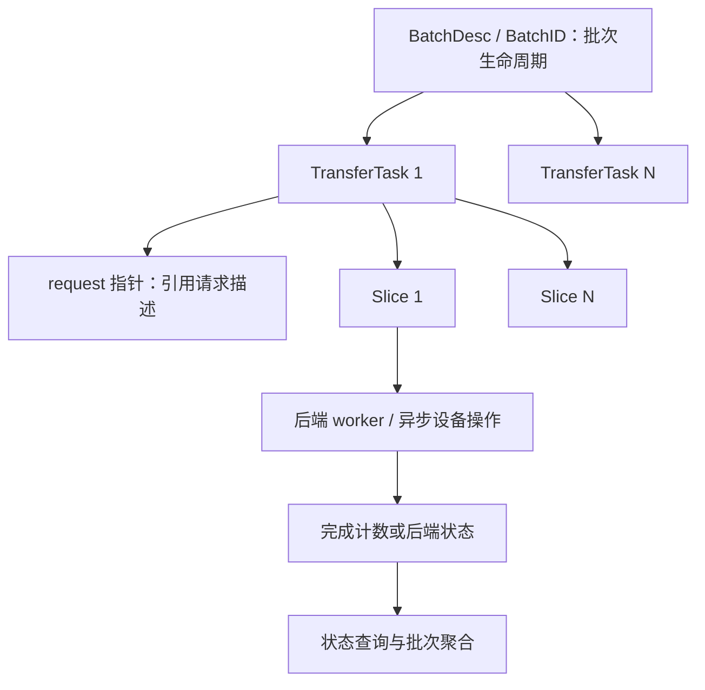
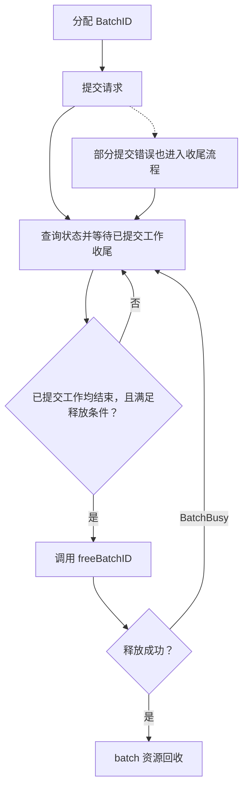

# 篇5 Transfer Engine：传输任务如何提交和完成？

> 系列：《Mooncake KV Cache 源码解析》
> 版本锚点：`v0.3.13.post1`（commit `7197358`）
> 源码链接基座：`https://github.com/kvcache-ai/Mooncake/blob/v0.3.13.post1/`

> 阅读与验证约定见[系列指南](README.md)。本篇的源码行号沿用历史版本；图示为逻辑解释，引用测试不代表已执行。

## 5.1 具体问题

前四篇都在 Store 侧：Master 管元数据，Client 管读写。但数据真正从一台机器搬到另一台机器，靠的是 Transfer Engine（TE）。这一篇回答三个问题：

1. **提交**：一次传输请求如何被拆分成任务、绑定到具体传输后端？
2. **状态**：任务状态如何流转，异步完成如何被检查？
3. **释放**：BatchID 何时能释放，资源如何回收？

## 5.2 场景与版本

- **场景**：Store 的 `TransferWrite`/`client_->Get` 拿到副本位置后，调用 TE 把数据从本机 buffer 传到远端 Client 内存（见篇2/篇3）。
- **版本**：`v0.3.13.post1`。注意：本版本中 `submitTransfer`/`getTransferStatus` 的实现不在 `transfer_engine_impl.cpp`，而是**内联在 `transfer_engine_impl.h` 里委托给 `multi_transports_`**；真正的逻辑在 `src/multi_transport.cpp`。
- **主路径**：`TransferEngine::submitTransfer`（`transfer_engine.h:134`）→ `TransferEngineImpl::submitTransfer`（`transfer_engine_impl.h:128`）→ `MultiTransport::submitTransfer`（`multi_transport.cpp:130`）→ 各 `Transport::submitTransferTask` → 异步传输 → `getTransferStatus` 轮询 → `freeBatchID`。

## 5.3 调用链图

```
TransferEngine::submitTransfer (transfer_engine.h:134)   ← 门面
   │  impl_->submitTransfer(...)
   ▼
TransferEngineImpl::submitTransfer (transfer_engine_impl.h:128)  ← 内联委托
   │  multi_transports_->submitTransfer(...)
   ▼
MultiTransport::submitTransfer (multi_transport.cpp:130)   ← 核心
   │
   ├─ 1. selectTransport(request)  ← 按目标地址选传输后端 (rdma/tcp/nvlink...)
   ├─ 2. 按 task_group_id 分组，构造 task_list
   ├─ 3. 按 transport 聚合 → submit_tasks[transport] = [task...]
   └─ 4. 每个 transport 调 submitTransferTask(task_list)  ← 真正下发 WR
         ▼
   异步传输 (RDMA WR / TCP / NVLink)
         ▼
getTransferStatus (multi_transport.cpp:256)   ← 轮询完成
   │  委托 transport_->getTransferStatus → 触发完成轮询
   │  叠加 slice_timeout 超时检查
   ▼
getBatchTransferStatus (multi_transport.cpp:363)  ← 聚合整个 batch
   ▼
freeBatchID (multi_transport.cpp:108)   ← 全部完成才允许释放
```

### 5.3.3 两个核心结构：BatchDesc 与 TransferTask

TE 的任务状态全部落在这两个结构里（`mooncake-transfer-engine/include/transport/transport.h`）：

```cpp
// transport.h:337
struct TransferTask {
    volatile uint64_t slice_count = 0;
    volatile uint64_t success_slice_count = 0;
    volatile uint64_t failed_slice_count = 0;
    volatile uint64_t transferred_bytes = 0;
    volatile bool is_finished = false;
    uint64_t total_bytes = 0;
    BatchID batch_id = 0;
    Transport *transport_ = nullptr;      // 完成轮询要委托给它
    const TransferRequest *request = nullptr;  // 指向调用方的 entries[i]
    size_t request_count = 1;             // 分组后的请求数
    std::vector<Slice *> slice_list;      // 来自 slice cache，析构时归还
};

// transport.h:379
struct BatchDesc {
    BatchID id;
    size_t batch_size;
    std::vector<TransferTask> task_list;
    std::atomic<bool> has_failure{false};
    std::atomic<bool> is_finished{false};
    std::atomic<uint64_t> finished_transfer_bytes{0};
};
```

这里有**三层不同的生命周期**，混在一起就会踩坑：

1. `BatchDesc` 拥有 `task_list`，`freeBatchID` 删除 `BatchDesc` 时任务一起销毁。
2. `TransferTask::request` 是**裸指针**，指向调用方传入的 `entries` 元素。**调用方必须保证 `entries` 在 batch 释放前一直有效**，不能扩容、不能提前析构。
3. `TransferTask::slice_list` 持有从 `SliceCache` 借来的 `Slice*`，在 `~TransferTask()` 里归还（`transport.h:373` 附近）。slice 的所有权在 TE 内部，不在 `request` 里。

> **分析（推断）**：`request` 用裸指针而不是拷贝，是为了避免每个请求一次分配。代价是把生命周期责任推给调用方，且编译器无法检查。Store 侧的用法是安全的——`TransferSubmitter` 提交后立即 `future->get()` 等待完成，`slices` 在整个调用期间都活着。

### 5.3.1 任务层级与资源边界



请求描述、数据 buffer 与 batch 的生命周期必须分别管理。提交返回错误也可能已有部分工作进入后端；是否可释放要看已提交工作的结束情况及接口检查，不能仅凭返回码判断。

### 5.3.2 状态与释放：失败不代表所有工作都已停止



此图是生命周期流程，不把聚合的 `FAILED`/`TIMEOUT` 直接等同于设备操作已取消。完成的推进方式依后端而异：RDMA 的后台 CQ 轮询与部分异步后端的状态查询不能混为一谈。

## 5.4 三个关键代码片段

### 片段1：BatchID 的分配与释放（`multi_transport.cpp:93` / `:108`）

`allocateBatchID` 分配一个 `BatchDesc`，**用指针本身当 BatchID**——这是零查找的句柄设计。`freeBatchID` 是**有条件的释放**：只要还有任务没完成，就拒绝：

```cpp
// multi_transport.cpp:93  分配 batch，指针即 ID
MultiTransport::BatchID MultiTransport::allocateBatchID(size_t batch_size) {
    auto batch_desc = new BatchDesc();
    if (!batch_desc) return ERR_MEMORY;
    batch_desc->id = BatchID(batch_desc);   // ← 指针强转成 ID
    batch_desc->batch_size = batch_size;
    batch_desc->task_list.reserve(batch_size);
    ...
    return batch_desc->id;
}

// multi_transport.cpp:108  有条件的释放
Status MultiTransport::freeBatchID(BatchID batch_id) {
    auto& batch_desc = *((BatchDesc*)(batch_id));
    for (size_t task_id = 0; task_id < batch_desc.task_list.size(); task_id++) {
        if (!batch_desc.task_list[task_id].is_finished) {
            return Status::BatchBusy(
                "BatchID cannot be freed until all tasks are done");
        }
    }
    delete &batch_desc;   // ← 全部完成才真正释放
    ...
    return Status::OK();
}
```

**关键点**：`BatchID` 是 `BatchDesc*` 的别名。`freeBatchID` 返回 `BatchBusy` 而不是静默失败——调用方必须等所有任务 `is_finished` 才能释放，否则会 double-free 或 use-after-free。这是 TE 资源生命周期的核心约束。

### 片段2：submitTransfer 拆分与绑定（`multi_transport.cpp:130`）

`submitTransfer` 先为每个请求 `selectTransport` 选后端，再按 `task_group_id` 分组（支持 grouped scatter），最后**按 transport 聚合**后逐个下发：

```cpp
// multi_transport.cpp:142  ① 每个请求选传输后端
for (const auto& request : entries) {
    Transport* transport = nullptr;
    auto status = selectTransport(request, transport);   // ← 按目标地址选 rdma/tcp...
    if (!status.ok()) return status;
    transports.push_back(transport);
}

// multi_transport.cpp:155  ② 按 task_group_id 分组，构造 task
for (size_t i = 0; i < entries.size();) {
    size_t count = 1;
    const auto group_id = entries[i].task_group_id;
    if (task_sizes && group_id != TransferRequest::kNoTaskGroup &&
        transports[i]->supportsGroupedScatter()) {
        while (i + count < entries.size() &&
               entries[i + count].task_group_id == group_id &&
               transports[i + count] == transports[i])
            ++count;   // ← 同组 + 同 transport 的请求合并成一个 task
    }
    auto& task = task_list.emplace_back();
    task.batch_id = batch_id;
    task.transport_ = transports[i];
    task.request = &entries[i];
    task.request_count = count;
    submit_tasks[transports[i]].push_back(&task);   // ← 按 transport 聚合
    i += count;
}

// multi_transport.cpp:183  ③ 每个 transport 下发
for (auto& entry : submit_tasks) {
    auto status = entry.first->submitTransferTask(entry.second);  // ← 真正提交 WR
    if (!status.ok()) overall_status = status;
}
```

**关键点**：`selectTransport` 是"数据路径选择"的入口（详见篇7 多网卡与 NUMA）。`submitTransferTask` 才是真正把任务交给 RDMA/TCP/NVLink 后端的地方。`overall_status` 只反映**提交**是否成功，不代表传输完成——完成要靠 `getTransferStatus` 轮询。

### 片段3：getTransferStatus 轮询完成（`multi_transport.cpp:256`）

`getTransferStatus` 委托给 transport 触发完成轮询，并叠加 `slice_timeout` 超时检查：

```cpp
// multi_transport.cpp:289  委托 transport 触发完成轮询
if (task.transport_) {
    auto ret = task.transport_->getTransferStatus(batch_id, task_id, status);
    if (!ret.ok()) return ret;
    // 叠加超时检查：WAITING 且超时 → TIMEOUT
    if (status.s == Transport::TransferStatusEnum::WAITING &&
        checkSliceTimeout(task)) {
        status.s = Transport::TransferStatusEnum::TIMEOUT;
    }
    return Status::OK();
}

// multi_transport.cpp:309  无 transport 的 legacy 路径：按 slice 计数判断
if (success_slice_count + failed_slice_count == task.slice_count) {
    if (failed_slice_count) {
        status.s = Transport::TransferStatusEnum::FAILED;
    } else {
        status.s = Transport::TransferStatusEnum::COMPLETED;
    }
    task.is_finished = true;   // ← 完成标记，freeBatchID 依赖它
} else {
    status.s = checkSliceTimeout(task)
                   ? Transport::TransferStatusEnum::TIMEOUT
                   : Transport::TransferStatusEnum::WAITING;
}
```

**关键点**：状态查询会委托后端检查或推进完成，例如部分 NVLink 异步路径在这里调用 `cudaStreamQuery`。但不能把该行为推广到所有后端：RDMA 的 CQ 由后台 worker 轮询并更新 slice 状态。应分别说明“设备工作如何推进”和“调用方如何观察完成”。

## 5.5 完成语义：提交 ≠ 完成

回答开篇问题，TE 的完成语义分两层：

1. **提交成功**（`submitTransfer` 返回 OK）：请求已被相应后端接受；可能仍在队列中，不能统一断言 WR 已下发。**不代表数据已到达**。
2. **传输完成**（`getTransferStatus` 返回 `COMPLETED`）：所有 slice 成功。`getBatchTransferStatus`（`multi_transport.cpp:363`）聚合整个 batch——所有 task 都 `COMPLETED` 才置 `batch_desc.is_finished = true`，并缓存 `finished_transfer_bytes`。

**关键点**：`is_finished` 是 `freeBatchID` 的释放前提。`getBatchTransferStatus` 在全部完成时用 `store(true, release)` 写 `is_finished`，`freeBatchID` 读它判断能否释放。这个 release/acquire 配对保证：**看到 `is_finished=true` 的线程，一定能看到所有 slice 的完成状态**。

## 5.6 异常与并发

### BatchBusy：释放被拒绝

`freeBatchID` 遇到未完成任务返回 `BatchBusy`（`multi_transport.cpp:113`）。调用方必须继续轮询 `getTransferStatus` 直到完成，再重试释放。**这是防止 use-after-free 的保护**——BatchID 是裸指针，提前释放会导致悬垂指针。

### 超时：TIMEOUT 状态

`checkSliceTimeout`（`multi_transport.cpp:267`）用 `globalConfig().slice_timeout`（秒）判断：某个 slice 的 `ts` 超过 `slice_timeout` 秒未完成，置 `TIMEOUT`。`getBatchTransferStatus` 把 `TIMEOUT` 当失败处理（`multi_transport.cpp:390`），置 batch 为 `FAILED` 并记 `has_failure`。

### 部分失败

`getTransferStatus` 的 legacy 路径：`success + failed == slice_count` 时，只要 `failed_slice_count > 0` 就置 `FAILED`（`multi_transport.cpp:310`）。`getBatchTransferStatus` 遇到任一 task `FAILED`/`TIMEOUT` 立即返回 batch `FAILED`（`multi_transport.cpp:390`），不再等其余 task。

### 提交失败

`submitTransfer` 中某个 transport 的 `submitTransferTask` 失败，`overall_status` 记录错误，但**其余 transport 仍会继续提交**（`multi_transport.cpp:183` 循环不中断）。调用方需检查 `overall_status` 决定是否重试。

注意这里有一个部分提交的生命周期边界：**已提交到其他 transport 的任务不会被自动取消**。调用方拿到错误的 `overall_status` 后，仍然必须先轮询到 batch 结束、再 `freeBatchID`，直接丢弃 batch 会泄漏。**分析**：TE 没有提供"部分提交后的原子回滚"，因为它跨多个后端，回滚本身就不可靠；把决定权交给调用方是更诚实的做法。

### 超出 batch 容量

`submitTransfer` 在入口检查容量：

```cpp
// multi_transport.cpp:134
if (!task_sizes &&
    batch_desc.task_list.size() + entries.size() > batch_desc.batch_size) {
    return Status::TooManyRequests("Exceed the limitation of batch capacity");
}
```

`task_sizes` 非空时跳过该检查，因为分组会把多个 request 合成一个 task，最终 `batch_size` 被重设为 `task_list.size()`（`multi_transport.cpp:181`）。**推断**：这意味着批量接口的容量语义取决于是否启用分组，调用方按"请求数"计算 batch_size 时可能被分组后的实际任务数改变。

### 事件驱动完成（编译期开关）

`USE_EVENT_DRIVEN_COMPLETION` 打开时，任务多一个 `completed_slice_count` 和 `submission_sealed`，完成判定和通知走 condition_variable，而不是纯轮询。**边界**：本篇描述的是轮询路径（默认配置），事件驱动路径的行为需要单独验证。

## 5.7 验证与结论

- **门面**：`mooncake-transfer-engine/include/transfer_engine.h` 的 `submitTransfer`(L134)、`allocateBatchID`(L211)、`freeBatchID`(L213)、`getTransferStatus`(L225)、`getBatchTransferStatus`(L228)。
- **内联委托**：`mooncake-transfer-engine/include/transfer_engine_impl.h` 的 `submitTransfer`(L128)、`allocateBatchID`(L261)、`freeBatchID`(L265)、`getTransferStatus`(L279)。
- **核心逻辑**：`mooncake-transfer-engine/src/multi_transport.cpp` 的 `allocateBatchID`(L93)、`freeBatchID`(L108)、`submitTransfer`(L130)、`getTransferStatus`(L256)、`getBatchTransferStatus`(L363)。
- **测试**：`mooncake-transfer-engine/tests/multi_transport_batch_test.cpp`（batch 生命周期）、`transfer_metadata_test.cpp`（元数据）、`rdma_transport_submit_task_test.cpp`（提交任务）。

**结论**：TE 的任务生命周期是**分配 → 提交 → 轮询 → 释放**四步。`allocateBatchID` 用指针当 ID，`submitTransfer` 按目标地址选 transport、按 `task_group_id` 分组、按 transport 聚合下发，`getTransferStatus` 委托后端触发完成轮询并叠加超时检查，`getBatchTransferStatus` 聚合整个 batch，`freeBatchID` 在全部完成前拒绝释放。**提交成功 ≠ 传输完成**，完成由后端机制推进，调用方通过状态接口观察，`is_finished` 的 release/acquire 配对保证释放安全。下一篇深入 RDMA 数据路径，看 WR 如何真正下发。

---

*下一篇：篇6 RDMA 数据路径——从内存注册到完成事件*
