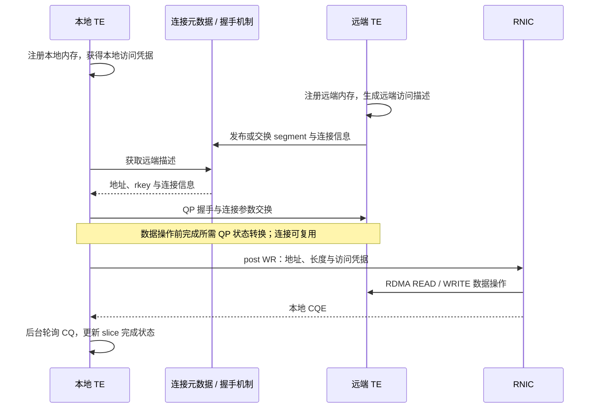
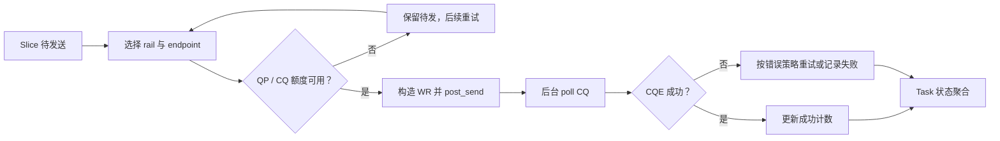

# 篇6 RDMA 数据路径：从内存注册到完成事件

> 系列：《Mooncake KV Cache 源码解析》
> 版本锚点：`v0.3.13.post1`（commit `7197358`）
> 源码链接基座：`https://github.com/kvcache-ai/Mooncake/blob/v0.3.13.post1/`

> 阅读与验证约定见[系列指南](README.md)。本篇的源码行号沿用历史版本；图示为逻辑解释，引用测试不代表已执行。

## 6.1 具体问题

篇5 看到 `submitTransferTask` 把任务交给 transport。这一篇深入 RDMA 后端，回答三个问题：

1. **注册**：本地内存如何变成远端可访问的 MR（Memory Region）？
2. **下发**：连接如何先建立、请求如何被拆成 slice、绑定 lkey/rkey、提交 WR？
3. **完成**：CQ 完成事件如何驱动 slice 状态更新？

这里有一个容易误解的点：RDMA 连接不是"每个请求建一次"，而是按 `peer_nic_path` 缓存在 endpoint 上；QP 必须先走完 `INIT → RTR → RTS`，`ibv_post_send` 才合法。

## 6.2 场景与版本

- **场景**：Store 的 `TransferWrite`/`Get` 通过 TE 在节点间搬数据。RDMA 是默认高性能后端。
- **版本**：`v0.3.13.post1`。注意：本版本 RDMA 后端拆成多文件，位于 `src/transport/rdma_transport/`（`rdma_transport.cpp`、`rdma_context.cpp`、`rdma_endpoint.cpp`、`endpoint_store.cpp`、`worker_pool.cpp`），头文件在 `include/transport/rdma_transport/rdma_transport.h`。
- **主路径**：`registerLocalMemory`（`rdma_transport.cpp:276`）→ `submitTransferTask`（`rdma_transport.cpp:822`）→ worker `performPostSend`（`worker_pool.cpp:357`）→ 必要时 `setupConnectionsByActive`（`rdma_endpoint.cpp:345`）→ `RdmaEndPoint::submitPostSend`（`rdma_endpoint.cpp:915`）→ `ibv_post_send`（`:990`）→ worker `performPollCq`（`worker_pool.cpp:552`）→ `getTransferStatus`（`rdma_transport.cpp:998`）。

## 6.3 调用链图

```
registerLocalMemory (rdma_transport.cpp:276)
   │  registerLocalMemoryInternal (L284)
   │    ├─ 1. 计算 access_rights (IBV_ACCESS_REMOTE_WRITE/READ)
   │    ├─ 2. 按 max_mr_size 拆分大 buffer 成 chunks (Mooncake#2017)
   │    ├─ 3. getMemoryLocation 解析 location (cpu:N / gpu:N)
   │    └─ 4. 每个 chunk 在每个 context 上 ibv_reg_mr → 得到 lkey/rkey
   ▼
submitTransferTask (rdma_transport.cpp:822)
   │  ├─ 1. selectDevice 选本地 HCA + buffer
   │  ├─ 2. SliceLengthCalculator 把 request 拆成 slice
   │  ├─ 3. 每个 slice 绑定 source_lkey + dest_addr
   │  └─ 4. 按 context 聚合 → RdmaContext::submitPostSend (rdma_context.cpp:1471)
   ▼
WorkerPool::performPostSend (worker_pool.cpp:357)
   ├─ rail 可用？connect 暂停？                worker_pool.cpp:443
   ├─ endpoint 已连接？否 → setupConnectionsByActive  rdma_endpoint.cpp:345
   │      └─ RPC 握手 → QP: INIT → RTR → RTS    rdma_endpoint.cpp:1138/1160/1216
   ▼
RdmaEndPoint::submitPostSend (rdma_endpoint.cpp:915)
   ├─ 构造 WR: wr_id=slice / opcode=READ|WRITE / SIGNALED   :969-975
   ├─ remote_addr + rkey                                  :977-978
   └─ ibv_post_send                                      :990
   ▼
异步 RDMA 传输
   ▼
WorkerPool::performPollCq (worker_pool.cpp:552)
   ├─ ibv_poll_cq (rdma_context.cpp:1462)
   └─ wc.status 判定 (worker_pool.cpp:621)
        ├─ IBV_WC_SUCCESS → markSuccess (transport.h:206)
        └─ 其他          → markFailed  (transport.h:215)
   ▼
getTransferStatus (rdma_transport.cpp:998)   ← 轮询聚合
   │  success + failed == slice_count → COMPLETED/FAILED
   ▼
is_finished = true → freeBatchID 可释放
```

### 6.3.1 双端交互：建连与数据传输分开看



握手机制可能来自独立元数据服务或直接握手配置，图中合并为一个逻辑角色。CQE 是传输完成证据，不是 Store 对象可见性的提交；PutEnd 仍由 Store 层负责。

### 6.3.2 队列流水线：背压与错误走不同出口



资源额度不足是背压，不能直接记成传输失败。连接建立、WR 提交和 CQE 回收分别占据流水线的不同位置，排障时也应分别观察。

## 6.4 三个关键代码片段

### 片段1：内存注册（`rdma_transport.cpp:284`）

`registerLocalMemoryInternal` 是 RDMA 数据路径的起点。它决定访问权限、按 `max_mr_size` 拆分大 buffer、解析 location，然后逐 chunk 注册 MR：

```cpp
// rdma_transport.cpp:289  访问权限
int access_rights = IBV_ACCESS_LOCAL_WRITE;
if (remote_accessible)
    access_rights |= IBV_ACCESS_REMOTE_WRITE | IBV_ACCESS_REMOTE_READ;

// rdma_transport.cpp:303  按 max_mr_size 拆分大 buffer
size_t chunk_limit = (size_t)globalConfig().max_mr_size;
if (chunk_limit > 0 && length > chunk_limit) {
    for (size_t offset = 0; offset < length;) {
        size_t chunk_len = std::min(chunk_limit, length - offset);
        chunks.emplace_back((char*)addr + offset, chunk_len);
        offset += chunk_len;
    }
    // Mooncake#2017: ibv_reg_mr 会静默截断到 max_mr_size，
    // 但元数据仍广播完整长度，导致远端 op 越界失败
}

// rdma_transport.cpp:321  解析 location
if (name == kWildcardLocation) {
    const std::vector<MemoryLocationEntry> entries =
        getMemoryLocation(addr, length, only_first_page);
    resolved_name = entries[0].location;   // ← cpu:N / gpu:N
}
```

**关键点**：`remote_accessible` 决定是否加 `IBV_ACCESS_REMOTE_WRITE/READ`——只有远端可访问的 buffer 才能被对端 RDMA 读写。**大 buffer 拆分**（Mooncake#2017）是重要 bugfix：`ibv_reg_mr` 会静默截断到设备 `max_mr_size`，但元数据仍广播完整长度，导致远端 op 越界报 `IBV_WC_REM_ACCESS_ERR`。拆成 chunk 后每个 chunk 一个 MR、一个 BufferDesc，地址区间查找能拿到正确的 key。

### 片段2：请求拆 slice + 绑定 key（`rdma_transport.cpp:822`）

`submitTransferTask` 把每个 request 拆成 slice，为每个 slice 选设备、绑定 `source_lkey` 和 `dest_addr`，按 context 聚合后下发：

```cpp
// rdma_transport.cpp:901  拆 slice
for (uint64_t offset = 0; offset < request.length;) {
    size_t slice_length = slice_calc.calculate(offset);   // ← 按 slice_size 切分
    Slice *slice = getSliceCache().allocate();
    slice->source_addr = (char*)request.source + offset;
    slice->length = slice_length;
    slice->opcode = request.opcode;
    slice->rdma.dest_addr = request.target_offset + offset;  // ← 远端地址
    slice->rdma.retry_cnt = request.advise_retry_cnt;
    slice->status = Slice::PENDING;
    task.slice_list.push_back(slice);
    ...
    // rdma_transport.cpp:970  绑定本地 lkey
    slice->rdma.source_lkey =
        local_segment_desc->buffers[buffer_id].lkey[device_id];
    slices_to_post[context].push_back(slice);   // ← 按 context 聚合
    __sync_fetch_and_add(&task.slice_count, 1);
    ...
    // rdma_transport.cpp:982  达到水位就下发，避免 WR 堆积
    if (nr_slices >= kSubmitWatermark) {
        for (auto &entry : slices_to_post)
            entry.first->submitPostSend(entry.second);
        slices_to_post.clear();
        nr_slices = 0;
    }
}
```

**关键点**：`source_lkey` 是本地 MR 的 key，`dest_addr` 是远端地址（由篇4 的 `Replica::Descriptor` 的 `buffer_address_` + `transport_endpoint_` 提供）。`kSubmitWatermark = max_wr * num_qp_per_ep` 控制 WR 下发节奏，防止一次提交过多 WR 撑爆 QP。`slice_count` 用原子自增，供 `getTransferStatus` 判断完成。

### 片段3：完成判断（`rdma_transport.cpp:998`）

`getTransferStatus` 读原子的 `success_slice_count`/`failed_slice_count`，与 `slice_count` 比较判断完成：

```cpp
// rdma_transport.cpp:1006  读原子计数
uint64_t success_slice_count =
    __atomic_load_n(&task.success_slice_count, __ATOMIC_ACQUIRE);
uint64_t failed_slice_count =
    __atomic_load_n(&task.failed_slice_count, __ATOMIC_ACQUIRE);
if (success_slice_count + failed_slice_count == task.slice_count) {
    if (failed_slice_count)
        status[task_id].s = TransferStatusEnum::FAILED;
    else
        status[task_id].s = TransferStatusEnum::COMPLETED;
    task.is_finished = true;   // ← 完成标记，freeBatchID 依赖
} else {
    status[task_id].s = TransferStatusEnum::WAITING;
}
```

**关键点**：`success/failed_slice_count` 由 CQ 完成事件回调（`slice->markSuccess()`/`markFailed()`）原子更新。`getTransferStatus` 只是**读聚合**——真正的完成驱动在 CQ 轮询线程。`is_finished` 置位后，篇5 的 `freeBatchID` 才允许释放。

## 6.5 连接建立：QP 必须先走到 RTS

`submitTransferTask` 只负责把 slice 放进队列（`rdma_transport.cpp:822`），真正建连和下发的在 worker 线程 `WorkerPool::performPostSend`（`worker_pool.cpp:357`）。它在 post 之前先检查 rail 是否可用、是否处于 connect pause（`worker_pool.cpp:443`），再取 endpoint（`:454`）；若 `!endpoint->connected()`（`:461`），调用 `setupConnectionsByActive()`（`:462`）。

主动侧 `RdmaEndPoint::setupConnectionsByActive`（`rdma_endpoint.cpp:345`）先看 `readyToSend()`（`:354`），已就绪直接返回；loopback 走本地 `doSetupConnection`（`:362`），不经过网络。跨机时只有第一个 `UNCONNECTED` 调用者把状态置为 `CONNECTING`（`:372`）并发起 RPC（`sendHandshake`，`:433`），其余线程自旋/退避等待；等待超时则 `resetConnection` 并返回 `ERR_ENDPOINT`（`:404`–`:411`），避免并发线程重复握手。RPC 调用特意不持锁，以支持"同时打开"——双方可能同时发起连接。

被动侧由 `RdmaTransport::onSetupRdmaConnections`（`rdma_transport.cpp:1055`）接住 RPC，调 `setupConnectionsByPassive`（`:1087`，失败重试 `:1104`）。它处理三种情况：`ready_ack` 把 endpoint 推到 `CONNECTED`（`rdma_endpoint.cpp:650`/`:670`）；QP 号不匹配视为 stale ack 拒绝（`:658`）；已连接且 QP 号相同则复用（`:677`），peer 重启导致 QP 变化则 reset 重连（`:694`）。

QP 状态迁移在 `doSetupConnection`（`rdma_endpoint.cpp:1112`）里完成：`INIT`（`:1138`/`:1143`）→ `RTR`（`:1160`/`:1187`）→ `RTS`（`:1216`/`:1222`）。**只有 RTS 状态的 QP 才能合法 `ibv_post_send`**。

**分析（推断）**：主动/被动不是 client/server 的角色，而是"谁先发现需要这条连接"。连接按 `peer_nic_path` 缓存在 endpoint 上，一个 endpoint 可承载多条 request 的 slice，所以握手成本摊薄到连接建立那一刻，而不是每个请求一次。代价是状态机复杂：peer 重启、同 QP 复用、stale ack、同时打开都要单独处理。

## 6.6 下发与完成：WR 怎么发出去，CQE 怎么回来

**下发**。`RdmaContext::submitPostSend`（`rdma_context.cpp:1471`）把 slice 列表转给 `WorkerPool::submitPostSend`（`worker_pool.cpp:144`），后者入队；worker 主循环 `transferWorker`（`:957`）在 `performPostSend`（`:988`）和 `performPollCq`（`:992`）之间交替。没有待处理 slice 且没有未完成 CQ 时，worker 在条件变量上最多等 1 秒（`:968`–`:987`），不是忙等。

`RdmaEndPoint::submitPostSend`（`rdma_endpoint.cpp:915`）先做状态护栏：endpoint 不 active 或状态不是 `CONNECTED` 时，直接把整批 slice 推入 `failed_slice_list` 返回（`:920`–`:924`）——**连接在检查与下发之间断掉，slice 会被显式失败，而不是静默丢弃**。随后按 `num_qp`、`max_wr_depth_` 和 `cq_remaining = max_cqe - cq_outstanding_`（`:930`–`:931`）切分到各 QP：

```cpp
// rdma_endpoint.cpp:969  构造 WR：wr_id 回指 slice，完成时用它找 slice
wr.wr_id = (uint64_t)slice;
wr.opcode = slice->opcode == Transport::TransferRequest::READ
                ? IBV_WR_RDMA_READ
                : IBV_WR_RDMA_WRITE;
wr.num_sge = 1;
wr.sg_list = &sge;
wr.send_flags = IBV_SEND_SIGNALED;      // 每条 WR 都要 CQE
wr.wr.rdma.remote_addr = slice->rdma.dest_addr;
wr.wr.rdma.rkey = slice->rdma.dest_rkey;
slice->ts = getCurrentTimeInNano();
slice->status = Transport::Slice::POSTED;

// rdma_endpoint.cpp:990
int rc = ibv_post_send(qp_list_[qp_index], wr_list.data(), &bad_wr);
```

**关键点**：`wr_id` 存的是 `Slice*`，CQE 回来时靠它反查 slice；`IBV_SEND_SIGNALED` 保证每条 WR 都产生完成事件，否则 CQ 上收不到、`slice_count` 永远凑不齐。`cq_remaining <= 0` 时函数直接返回 0 不 post（`:932`），这是 CQ 背压，不是失败——slice 留在队列里等下一轮。

**完成**。`WorkerPool::performPollCq`（`worker_pool.cpp:552`）每轮最多取 `kPollCount = 64` 个 CQE（`:587`），遍历所有 CQ，调 `context_.poll`（`:599`）→ `ibv_poll_cq`（`rdma_context.cpp:1462`）：

```cpp
// worker_pool.cpp:578  终态统一走 finalize_slice
auto finalize_slice = [&](Transport::Slice *slice, bool success) {
    if (success) { slice->markSuccess(); succeeded_slice_count++; }
    else         { slice->markFailed(); }
    processed_slice_count++;
};
...
// worker_pool.cpp:613  从 wr_id 取回 slice
Transport::Slice *slice = (Transport::Slice *)wc[i].wr_id;
...
// worker_pool.cpp:621
if (wc[i].status != IBV_WC_SUCCESS) { ... }
```

`markSuccess`（`transport.h:206`）做三件事：置 `Slice::SUCCESS`、累加 `transferred_bytes`、原子自增 `success_slice_count`；`markFailed`（`:215`）原子自增 `failed_slice_count`。二者都调 `check_batch_completion`（`:212`/`:220`），但**在默认轮询配置下这个函数是空的**（`#ifdef USE_EVENT_DRIVEN_COMPLETION` 之外无实现）——`is_finished` 仍然由 `getTransferStatus` 读聚合后懒设置（`rdma_transport.cpp:1011`）。

**关键点**：这与篇5 的 legacy 路径一致——`success + failed == slice_count` 是统一的终态判据。RDMA 路径的 slice 状态由 CQ 轮询驱动，`getTransferStatus` 只做聚合，不主动触发完成；即使某个 CQE 早已到达，不轮询就永远看不到。

## 6.7 异常与并发

### 大 buffer 越界（Mooncake#2017）

`ibv_reg_mr` 静默截断到 `max_mr_size`，元数据却广播完整长度，远端 op 越界报 `IBV_WC_REM_ACCESS_ERR`。修复：按 `max_mr_size` 拆 chunk，每 chunk 一个 MR + 一个 BufferDesc（`rdma_transport.cpp:303`）。`unregisterLocalMemory` 只收到 base addr，靠 `chunk_map_` 记住每个 base buffer 的 chunk 起始地址用于清理（`rdma_transport.h:159`）。

### 内存未注册

`selectDevice` 找不到任何 active 设备注册该地址时，`submitTransferTask` 返回 `AddressNotRegistered`（`rdma_transport.cpp:958`），并 `fail_task_and_cleanup` 把未启动的 task 也标记失败（`fail_unstarted_tasks`，`rdma_transport.cpp:845`）——保证 `success + failed == slice_count` 终态成立，任务能正常收尾。

### 设备不 active

选中的 context 不 active，返回 `InvalidArgument`（`rdma_transport.cpp:966`）。`selectDevice` 带 `retry_cnt` 重试，尝试其他设备。

### WR flush error 不是网络错误

`IBV_WC_WR_FLUSH_ERR`（`worker_pool.cpp:626`）表示 QP 进入 ERR 时硬件把尚未完成的 WR 一次性冲掉；正常销毁 endpoint 时也会产生。所以它不触发 rail 失败处理，也不删除 endpoint。inactive context 上的 flush 进 `local_failed_slice_list`，active context 上进 `failed_slice_list`（`:627`–`:648`），之后统一交给 `shouldRetrySlice` 与 `finalize_slice` 处理。

### local fault 与 remote fault 走不同的降级路径

`isLocalWcFailure`（`worker_pool.cpp:1424`）把完成错误分成本地 RNIC 故障和远端/网络故障两类（`:666`）：

- **本地故障**：退役当前 endpoint（`handleLocalFailure`，`:1451`），slice 进 `local_failed_slice_list`，由 `redispatch(..., true)` 交给另一个本地 RNIC（`:732`），后者重建到同一 peer NIC 的 endpoint。
- **远端/默认故障**：保留本地 context，若有可用 peer rail 则 `markRailFailed(peer_nic_path, true)`（`:700`）并切到另一条 rail，slice 进 `failed_slice_list` 后 `redispatch`（`:735`）。

一个细节：QP 本地故障会把该 QP 上所有未完成 WR 一次性完成掉。为避免"一个故障算 N 次错误"，代码用 `local_failed_peer_paths` 集合让同一 peer path 在一轮里只记一次 rail 错误（`:590`–`:593`）。

### 重试发生在"失败计数"之前

`shouldRetrySlice`（`worker_pool.cpp:1419`）先自增 `retry_cnt`，再判断是否小于 `max_retry_cnt`：

```cpp
// worker_pool.cpp:1419
bool WorkerPool::shouldRetrySlice(Transport::Slice *slice) {
    slice->rdma.retry_cnt++;
    return slice->rdma.retry_cnt < slice->rdma.max_retry_cnt;
}
```

只有重试次数耗尽，才走 `finalize_slice(slice, false)` → `markFailed()`。**因此 `failed_slice_count` 表示的是"终态失败"，不是"发生过错误"**——中间失败可能已经重试成功，计数上看不出来。

### CQ 背压：先扣信用再 post

`cq_outstanding_` 在 post 前按 WR 数增加（`rdma_endpoint.cpp:986`），在 poll 后按 CQE 数减少（`worker_pool.cpp:717`）。`submitPostSend` 用 `max_cqe - cq_outstanding_` 判断还剩多少信用（`rdma_endpoint.cpp:930`–`:931`），信用为 0 就不 post、直接返回 0。**分析**：这是把"设备能力"显式建模为配额，而不是靠 `ibv_post_send` 失败来发现——后者在 CQ 满时可能只返回 EAGAIN，调用方极难区分"临时背压"和"真错误"。

### 连接建立失败与 peer 重启

主动握手失败时，worker 不会立刻判整批失败：它先看有没有可用的 peer rail 替代，有就切换 rail；只有在本地 context 已 inactive 时才移交给另一个本地 RNIC（`worker_pool.cpp:462` 起的错误分支）。connect pause 单独处理——pause 是策略决定，不是新故障，所以检查放在建 endpoint 之前（`:443`），避免把 pause 误记成连接错误。

peer 重启也会被识别：被动侧发现 QP 号与已保存的不一致，就 reset 后重连（`rdma_endpoint.cpp:694`）；主动侧 RPC 失败但被动同时打开已把 endpoint 连上时，会复用现有连接而不是重置（`:445`–`:458`）。

### 部分 slice 失败

终态失败 slice 会把 `failed_slice_count` 加一。`getTransferStatus` 只要 `failed_slice_count > 0` 就置 `FAILED`（`rdma_transport.cpp:1011`），即使其余 slice 成功。**没有"部分成功"状态**：一个 batch 里只要有终态失败 slice，整个 task 就是 `FAILED`，调用方拿不到"哪些 slice 成功"的细分信息。

## 6.8 验证与结论

- **头文件**：`mooncake-transfer-engine/include/transport/rdma_transport/rdma_transport.h` 的 `registerLocalMemory`(L64)、`submitTransferTask`(L92)、`getTransferStatus`(L100)、`selectDevice`(L130)；`include/transport/transport.h` 的 `markSuccess`(L206)、`markFailed`(L215)。
- **实现**：`mooncake-transfer-engine/src/transport/rdma_transport/rdma_transport.cpp` 的 `registerLocalMemoryInternal`(L284)、`submitTransferTask`(L822)、`getTransferStatus`(L998)、`onSetupRdmaConnections`(L1055)。
- **连接与下发**：`rdma_endpoint.cpp` 的 `setupConnectionsByActive`(L345)、`setupConnectionsByPassive`(L647)、`submitPostSend`(L915)、`doSetupConnection`(L1112)，`ibv_post_send`(L990)。
- **worker**：`worker_pool.cpp` 的 `submitPostSend`(L144)、`performPostSend`(L357)、`performPollCq`(L552)、`transferWorker`(L957)、`shouldRetrySlice`(L1419)、`isLocalWcFailure`(L1424)、`handleLocalFailure`(L1451)；`rdma_context.cpp` 的 `poll`(L1461)、`submitPostSend`(L1471)。
- **location 解析**：`mooncake-transfer-engine/include/memory_location.h` 的 `getMemoryLocation`(L37)、`MemoryLocationEntry`(L28)。
- **测试**：`mooncake-transfer-engine/tests/rdma_transport_test.cpp`、`rdma_loopback_test.cpp`、`rdma_large_mr_test.cpp`（大 MR 拆分）、`rdma_transport_submit_task_test.cpp`。

**结论**：RDMA 数据路径是**注册 → 建连 → 拆 slice → 下发 WR → CQ 轮询 → 聚合**六步。`registerLocalMemory` 决定访问权限、按 `max_mr_size` 拆大 buffer、解析 location 后逐 chunk 注册 MR；worker 在下发前确认 endpoint 已连接，必要时走主动/被动握手把 QP 推到 RTS；`submitTransferTask` 把 request 拆成 slice、绑定 `source_lkey`/`dest_addr`；`ibv_post_send` 的每条 WR 带 `wr_id=Slice*` 和 `IBV_SEND_SIGNALED`；worker 轮询 CQ，用 CQE 状态驱动 `markSuccess`/`markFailed`，`getTransferStatus` 读原子计数判断终态。失败不是一步到位的：WR flush、本地故障、远端故障分别走不同的降级路径，重试耗尽后才计入终态失败。**大 buffer 拆分**（Mooncake#2017）、**未注册地址的失败收尾**、**CQ 信用背压**是三个关键边界。下一篇看多网卡与 NUMA 如何选路径。

---

*下一篇：篇7 多网卡与 NUMA——数据传输路径如何选择？*
