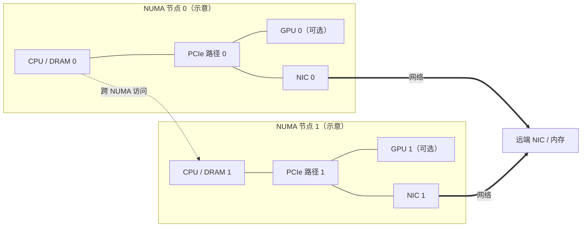
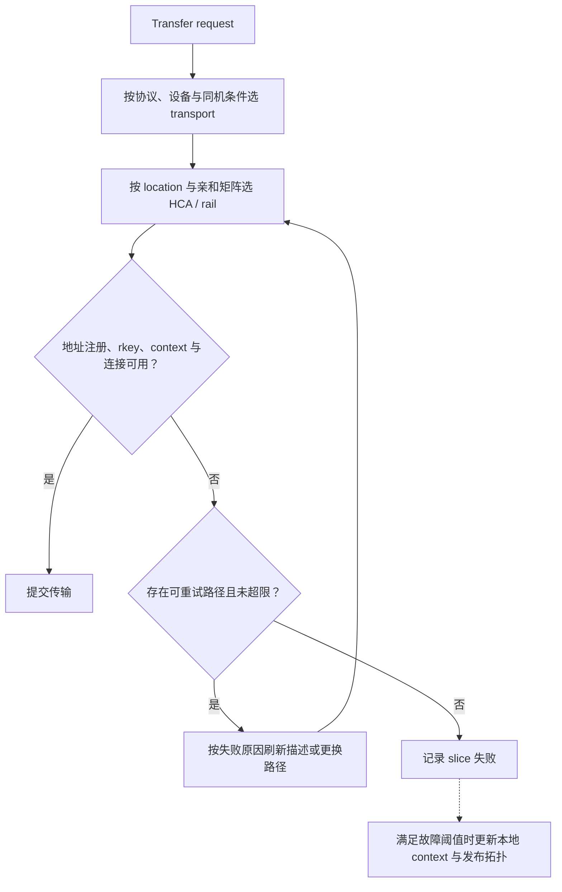

# 篇7 多网卡与 NUMA：数据传输路径如何选择？

> 系列：《Mooncake KV Cache 源码解析》
> 版本锚点：`v0.3.13.post1`（commit `7197358`）
> 源码链接基座：`https://github.com/kvcache-ai/Mooncake/blob/v0.3.13.post1/`

> 阅读与验证约定见[系列指南](README.md)。本篇的源码行号沿用历史版本；图示为逻辑解释，引用测试不代表已执行。

## 7.1 具体问题

一台机器往往有多张网卡（HCA），内存分布在多个 NUMA 节点。篇6 的 `selectDevice` 选 HCA，这一篇回答四个问题：

1. **发现**：拓扑矩阵如何生成——每个存储位置（cpu:N / gpu:N）该用哪张 HCA？
2. **广播**：本机拓扑如何让对端看到，对端又如何用它做选择？
3. **选择**：传输时如何先选 transport、再按内存地址选 preferred/secondary NIC？
4. **降级**：首选 NIC 失败后如何处理，拓扑会不会更新？

路径选择其实有**两层**：`MultiTransport` 先决定用哪个后端（rdma / hip / tcp），`Topology` 再决定用哪张 HCA。两层混在一起谈，就会把"跨机不能用 GPU IPC"和"跨 NUMA 不能选远端 HCA"混为一谈。

## 7.2 场景与版本

- **场景**：多网卡 + 多 NUMA 节点的高性能节点上，TE 需要为每个内存地址选最优 HCA，避免跨 NUMA 访问；同机 GPU 还要能走 GPU IPC 快路径。
- **版本**：`v0.3.13.post1`。注意：本版本拓扑逻辑在 `src/topology.cpp`（`include/topology.h`），拓扑广播在 `src/transfer_metadata.cpp` 的 `priority_matrix` 字段，后端路由在 `src/multi_transport.cpp`，`multi_transport_locality.h` 提供主机/段名解析辅助。
- **主路径**：`Topology::discover`（`topology.cpp:625`）→ `Topology::resolve`（`topology.cpp:794`）→ 发布 `priority_matrix`（`transfer_metadata.cpp:341`）→ 对端 `Topology::parse`（`topology.cpp:648`）→ `MultiTransport::selectTransport`（`multi_transport.cpp:581`）→ `WorkerPool::selectPeerDevice`（`worker_pool.cpp:52`）→ `RdmaTransport::selectDevice`（`rdma_transport.cpp:1155`）→ `Topology::selectDevice`（`topology.cpp:761`）→ 绑定 `dest_rkey`（`worker_pool.cpp:225`）。

## 7.3 调用链图

```
本机段描述（发布到 metadata server）
   ├─ devices[]: name / lid / gid
   ├─ buffers[]: addr / length / protocol / rkey[]
   └─ priority_matrix = topology.toJson()      transfer_metadata.cpp:341

Topology::discover (topology.cpp:625)
   │  ├─ listInfiniBandDevices  ← 枚举 HCA，读 PCI bus id + numa_node
   │  ├─ discoverCpuTopology    ← 每个 cpu:N，同 NUMA 的 HCA 为 preferred
   │  └─ discoverCudaTopology   ← 每个 gpu:N，按 PCI 距离选 preferred HCA
   ▼
Topology::resolve (topology.cpp:794)
   │  把 HCA 名映射成稳定索引，构建 resolved_matrix_
   │  + precomputeResolvedHcaPeerAffinity（HCA 对端亲和）
   ▼
对端 getSegmentDesc → topology.parse(priority_matrix)   transfer_metadata.cpp:672
   ▼
MultiTransport::selectTransport (multi_transport.cpp:581)
   ├─ 单协议段 → transport_map_[proto]
   └─ 多协议段（如 "rdma,hip"）→ 按目标 buffer 的 protocol 选
        └─ gpu_ipc_reachable? 否 → 跳过 hip/musa，落到 rdma
   ▼
WorkerPool::selectPeerDevice (worker_pool.cpp:52)
   ├─ MC_ENABLE_HCA_PEER_AFFINITY  → selectDeviceByLocalHca
   ├─ MC_ENABLE_DEST_DEVICE_AFFINITY → selectDevice(..., hint=local_hca)
   └─ 默认 → selectDevice(..., hint="")   ← 远端 preferred 中随机/轮询
   ▼
Topology::selectDevice (topology.cpp:761)
   ├─ retry=0: 随机/轮询 preferred，preferred 空则用 avail
   └─ retry>0: 按 (retry-1) 遍历 preferred + avail
   ▼
dest_rkey = buffers[buffer_id].rkey[device_id]   worker_pool.cpp:225
rail paused? → 换 alt_dev_id                    worker_pool.cpp:231
   ▼
performPostSend → 建连 → WR
```

### 7.3.1 NUMA 拓扑：优先选择亲和路径



本图是亲和关系示意，不代表每台机器的实际 PCIe 布线。优先路径取决于发现的拓扑与地址注册情况；跨 NUMA 路径可能增加访问成本，但不能仅凭拓扑图量化吞吐损失。

### 7.3.2 两层选择与故障降级



更换 HCA/rail 与切换 transport 是不同层次，图中不暗示任意 RDMA 故障都能自动降级成 TCP。HCA 索引需保持稳定，更新可用集合时不能任意压缩已有索引。

## 7.4 三个关键代码片段

### 片段1：拓扑发现（`topology.cpp:625`）

`discover` 枚举 HCA，为每个存储位置（cpu:N / gpu:N）计算 preferred/avail HCA。CPU 拓扑按 NUMA 节点归类，GPU 拓扑按 PCI 距离：

```cpp
// topology.cpp:471  CPU 拓扑：同 NUMA 节点的 HCA 是 preferred
for (const auto &hca : all_hca) {
    if (hca.numa_node == node_id) {
        preferred_hca.push_back(hca.name);   // ← 同 NUMA，优先
    } else {
        avail_hca.push_back(hca.name);
    }
}
topology.push_back(TopologyEntry{
    .name = "cpu:" + std::to_string(node_id),
    .preferred_hca = std::move(preferred_hca),
    .avail_hca = std::move(avail_hca)});

// topology.cpp:563  GPU：优先只看同 NUMA 的 HCA，没有才退回全部
const auto &candidate_preferred_hca =
    same_numa_hca.empty() ? all_hca : same_numa_hca;

// topology.cpp:566  GPU 拓扑：按 PCI 距离选 preferred HCA
for (const auto &hca : candidate_preferred_hca) {
    int distance = getPciDistance(hca.pci_bus_id.c_str(), pci_bus_id);
    if (distance < min_distance) {
        min_distance = distance;
        min_distance_hcas.clear();
        min_distance_hcas.push_back(hca.name);
    } else if (distance == min_distance) {
        min_distance_hcas.push_back(hca.name);
    }
}
```

**关键点**：`getPciDistance`（`topology.cpp:494`）比较两个 PCI bus id 的公共前缀长度，公共前缀越长距离越近。GPU 拓扑优先选**同 NUMA 且 PCI 距离最近**的 HCA；同 NUMA 一张都没有时才退回全部 HCA（`:563`）——这是避免跨 NUMA 访问的核心。`MC_TE_FILTERS` 环境变量可做 HCA 白名单（`topology.cpp:163`）。

### 片段2：HCA 索引解析（`topology.cpp:794`）

`resolve` 把 HCA 名映射成**稳定索引**，构建 `resolved_matrix_`。索引稳定性至关重要——RDMA transport 按索引存 lkey/rkey 和 context 数组：

```cpp
// topology.cpp:801  为每个 HCA 分配稳定索引
for (auto &hca : entry.second.preferred_hca) {
    if (!hca_id_map.count(hca)) {
        hca_list_.push_back(hca);
        hca_id_map[hca] = next_hca_map_index++;   // ← 稳定索引
        resolved_matrix_[kWildcardLocation].preferred_hca.push_back(
            hca_id_map[hca]);
    }
    resolved_matrix_[entry.first].preferred_hca.push_back(hca_id_map[hca]);
    ...
}
```

**关键点**：每个 HCA 同时也写进 `kWildcardLocation` 的 preferred 列表——这是"按位置查不到就退回通配"的兜底（`rdma_transport.cpp:1195`–`:1199`）。

`disableDevice`（`topology.cpp:836`）注释明确说明——**必须保持 HCA 索引稳定**，因为 RDMA transport 的 lkey/rkey 和 context 数组按 resolved HCA 索引存储。若重新 `resolve()` 压缩索引，这些数组会指向错误的 RNIC。所以 `disableDevice` 只从各 entry 里删索引，不重排（`:858`）。`initializeRdmaResources`（`rdma_transport.cpp:1112`）进一步把这条约束做实：某个 HCA 构造 context 失败时，仍往 `context_list_` 推一个 `set_active(false)` 的占位 context（`:1132`–`:1133`），保证下标不塌陷。**分析**：这是"用空间换索引稳定"——占位对象没有资源，但保住了数组对齐。

### 片段3：设备选择（`topology.cpp:761`）

`selectDevice` 按 `retry_count` 区分：首次随机/轮询选 preferred，重试时按索引遍历 preferred + avail：

```cpp
// topology.cpp:769  首次：随机或轮询选 preferred
if (retry_count == 0) {
    int rand_value;
    if (use_round_robin_) {   // MC_PATH_ROUNDROBIN=1 时轮询
        thread_local int tl_counter = 0;
        rand_value = tl_counter;
        tl_counter = (tl_counter + 1) % 10000;
    } else
        rand_value = SimpleRandom::Get().next();
    if (!entry.preferred_hca.empty())
        return entry.preferred_hca[rand_value % entry.preferred_hca.size()];
    else
        return entry.avail_hca[rand_value % entry.avail_hca.size()];
} else {
    // 重试：按 (retry-1) 索引遍历 preferred + avail
    size_t index = (retry_count - 1) %
                   (entry.preferred_hca.size() + entry.avail_hca.size());
    if (index < entry.preferred_hca.size())
        return entry.preferred_hca[index];
    else {
        index -= entry.preferred_hca.size();
        return entry.avail_hca[index];
    }
}
```

**关键点**：重试从 `(retry_count - 1)` 开始，所以第一次重试选的是 preferred 的第 0 个，不是再随机一次——**降级是有序的**。`selectDeviceByLocalHca`（`topology.cpp:731`）支持 HCA 对端亲和：本地 HCA 与远端 GPU 的 preferred HCA 有映射时，优先选对端可达的 HCA（`precomputeResolvedHcaPeerAffinity`，`topology.cpp:304`）。启用条件是 `MC_ENABLE_HCA_PEER_AFFINITY` 且 `MC_NIC_PEER_AFFINITY` 有有效映射，两者与 `MC_ENABLE_DEST_DEVICE_AFFINITY` 互斥（`config.cpp:493`–`:510`）。`MC_PATH_ROUNDROBIN` 把首次选择从随机改为轮询（`topology.cpp:598`）。

## 7.5 两层路由：先选 transport，再选 HCA

第一层是 `MultiTransport::selectTransport`（`multi_transport.cpp:581`）。单协议段直接按段描述里的 `protocol` 查 `transport_map_`；`rdma` 段若没装 one-sided transport，则回退到 `rdma_twosided`（`:675`）。多协议段（协议字符串含逗号，如 `"rdma,hip"`）逐请求按目标地址落在哪个 buffer 选后端，优先级是 hip/maca/musa=4、cxl=3、rdma=2、tcp=1（`:602`–`:607`）。

关键在 GPU IPC：hip/musa 只能同机进程间用。多协议段先用 `isGpuIpcReachableTarget` 判断目标段与本机是否同主机（`:616`），跨机时跳过 hip/musa buffer，落到同一块 device KV pool 的 rdma 注册上。**因此同一段描述可以自动同时支持同机快路径和跨机 RDMA，不需要运维设 `MC_DISABLE_HIP`**；`MC_DISABLE_HIP` 只是强制把 hip 优先级降到 0（`:602`）。

**关键点**：transport 选择在 `submitTransfer` 的最外层按 request 粒度发生（`:144`）；HCA 选择在 worker 的 `selectPeerDevice`（`worker_pool.cpp:52`），更靠近下发。两层失败语义不同：transport 选不出来直接返回 `NotSupportedTransport`/`InvalidArgument`，整个请求失败；HCA 选不出来还能换 buffer descriptor、换 rail。

## 7.6 拓扑广播：priority_matrix 如何到达对端

拓扑不是本地私有数据。`TransferMetadata::SegmentDesc` 序列化时把 `desc.topology.toJson()` 写进 `priority_matrix`（`transfer_metadata.cpp:341`；多协议路径同样在 `:462`/`:485`）。对端拿到段描述后调 `desc->topology.parse(...)`（`:672`；`:878`/`:914`），得到**远端**的 preferred/avail HCA 名列表。

这一步决定了一个容易搞错的点：`RdmaTransport::selectDevice` 收到的 `desc` 是**目标段**描述（`rdma_transport.cpp:1155`），所以 `desc->topology.selectDevice(...)` 选的是**远端**的 HCA 索引，不是本地 HCA。选出的 `device_id` 随后索引 `buffers[buffer_id].rkey[device_id]`（`worker_pool.cpp:225`）和 `devices[device_id].name`（`:227`）——都是远端的 rkey 和 NIC 名。本地 HCA 只通过 `hint`/`local_hca` 参与亲和判断。

**分析（推断）**：把拓扑随段描述一起发布，而不是单独建拓扑服务，是为了让"能不能访问这个段"和"该用它的哪张网卡"来自同一份快照，避免两个服务不一致。代价是段描述变更要重新拉取——工作线程在 `selectPeerDevice` 失败时会用 `getSegmentDescByID(target_id, true)` 强制刷新（`worker_pool.cpp:199`）。

## 7.7 选择与降级：尽力而为，但拓扑会更新

路径选择是**尽力而为**的：`Topology::selectDevice` 返回一个 HCA 索引，但**不保证该 HCA 一定可用**。`RdmaTransport::selectDevice`（`rdma_transport.cpp:1155`）按 buffer 地址区间过滤、解析 segment location，再调 topology；位置查不到就用 `kWildcardLocation` 兜底（`:1195`–`:1199`）。找不到覆盖该地址的 buffer 或设备，返回 `ERR_ADDRESS_NOT_REGISTERED`（`:1201`）。

选出来只是"应该用哪张"，真正下发前还有三道检查：

1. **rkey 是否存在**：`selectPeerDevice` 校验 `device_id` 不越界 `rkey` 数组，否则返回 `ERR_ADDRESS_NOT_REGISTERED`（`worker_pool.cpp:74`–`:80`）。
2. **rail 是否 paused**：`isRailAvailable(peer_nic_path)` 为假时，遍历其他 `device_id` 找可用 rail（`worker_pool.cpp:231`–`:250`）；一条都没有就 `markFailed` 并计入 `all_rails_failed_count`（`:253`–`:256`）。
3. **本地 context 是否 active、endpoint 是否 connected**：篇6 的 `performPostSend` 检查，失败则 `setupConnectionsByActive` 或换 rail。

**关键点**：启动时 `discover` 得到的矩阵不是一成不变的。`WorkerPool::refreshPublishedLocalTopology`（`worker_pool.cpp:1197`）复制本地段描述，用当前 `local_topology_` 覆盖 topology，对每个 inactive context 调 `disableDevice`，再 `updateLocalSegmentDesc` 重新发布；context 恢复（`:1143`/`:1157`）、本地故障（`:1457`）都会触发。所以一张坏掉的 RNIC 会从本机发布的矩阵里消失，对端下次拉段描述时就不再选它——**降级既靠本地重试，也靠拓扑广播**。

还有一个兜底：如果某一轮所有 slice 都因"无可用 rail"失败、`submitted_slice_count == 0`，worker 调 `markContextFailure()`，达到阈值后把本地 context 标记为不可用并刷新拓扑（`worker_pool.cpp:282`–`:287`）。**分析**：这是把"数据面全失败"升级成"控制面可见的拓扑变更"，让对端不再往坏 RNIC 上打。

## 7.8 异常与并发

### 设备不可用

启动时 `isIbDeviceAvailable`（`topology.cpp:102`）检查设备可访问、能 `ibv_open_device`、且至少有一个 active port；`discover` 跳过不可用设备（`:223`）。运行中设备仍可能失效——`selectPeerDevice` 选出的 context 不 active 时，`submitTransferTask` 带 `retry_cnt` 重试其他设备（见篇6），重试耗尽才把 slice 标记失败。

### 目标段整体失败：100ms 冷却

如果某个 `target_id` 在取段描述或选设备阶段连续失败，worker 用一个 thread-local `failed_target_ids` 记住时间戳；100ms 内到达的同一 target 的 slice 直接 `markFailed`，不再重试（`worker_pool.cpp:185`–`:194`，`:207`）。**分析**：这是对"对端整段不可达"的快速失败保护——避免每个 slice 都去重拉段描述、重试一遍，把故障放大成雪崩。

### 无可用设备

`selectDevice` 在 location 不存在或 preferred/avail 都为空时返回 `ERR_DEVICE_NOT_FOUND`（`topology.cpp:762`/`:766`/`:791`）。`RdmaTransport::selectDevice` 把"找不到覆盖地址的 buffer"和"找不到设备"都映射成 `ERR_ADDRESS_NOT_REGISTERED`（`rdma_transport.cpp:1201`）。worker 会把 slice `markFailed`，最终由 `getTransferStatus` 聚合成任务 `FAILED`。

### 索引稳定性

`disableDevice` 保持 HCA 索引稳定（`topology.cpp:858` 注释）。若破坏稳定性，RDMA transport 的 lkey/rkey 数组会指向错误 RNIC，导致数据写到错误网卡。`initializeRdmaResources` 用 `set_active(false)` 占位 context 维持 `context_list_` 对齐（`rdma_transport.cpp:1112`–`:1135`），是这条约束的另一半。

### 跨主机判定：IPv6 与大小写

`multi_transport_locality.h` 的 `isGpuIpcReachableTarget`（L72）判断目标是否同主机——GPU IPC transport（HIP/MUSA）只在本机进程间工作，跨主机必须回退 RDMA/TCP。

`segmentHost`（L32）不是简单地按最后一个冒号切分：它显式处理 `host:port`、裸 IPv6、带方括号的 IPv6（L33–L49），因为裸 IPv6 里就有多个冒号，`rfind(':')` 会把地址截坏。`hostEquals`（L57）做大小写不敏感比较——主机名按 DNS 语义不区分大小写，IPv6 十六进制也可能只差字母大小写；直接 `==` 会把同主机误判成跨机，白白丢掉同机 hip 快路径。**同主机不同端口仍算同主机**：两个 co-located engine 的段名只差 `:port`，`segmentHost` 会去掉端口再比。

### 同机但 GPU IPC 不可用

同主机判定只回答"能不能用 IPC"，不回答"IPC 是否已经就绪"。多协议段跨机时跳过 hip/musa 落到 rdma（`multi_transport.cpp:616`）；但同机且段描述了 hip、本进程又没装 hip transport 时，`selectTransport` 会在 `transport_map_` 里找不到 `hip`，直接返回 `NotSupportedTransport`（`:651`）——**不会退而求其次选同一 buffer 的 rdma**，因为选择阶段只比协议优先级，选完才检查 transport 是否安装。这是配置层面的边界，不是运行时降级。

## 7.9 验证与结论

- **头文件**：`mooncake-transfer-engine/include/topology.h` 的 `TopologyEntry`(L38)、`TopologyEntry::toJson`(L45)、`Topology`(L64)、`Topology::toJson`(L87)、`selectDevice`(L92)、`selectDeviceByLocalHca`(L95)、`parse`(L81)；`include/multi_transport_locality.h` 的 `segmentHost`(L32)、`isGpuIpcReachableTarget`(L72)。
- **拓扑发现**：`mooncake-transfer-engine/src/topology.cpp` 的 `discover`(L625)、`discoverCpuTopology`(L453)、`discoverCudaTopology`(L535)、`getPciDistance`(L494)、`resolve`(L794)、`selectDevice`(L761)、`selectDeviceByLocalHca`(L731)、`disableDevice`(L836)、`parse`(L648)。
- **拓扑广播**：`src/transfer_metadata.cpp` 的 `priority_matrix` 写入(`L341`/`L462`/`L485`)与 `topology.parse`(`L672`/`L878`/`L914`)。
- **路由与选择**：`src/multi_transport.cpp` 的 `selectTransport`(L581)；`src/transport/rdma_transport/worker_pool.cpp` 的 `selectPeerDevice`(L52)、`selectPeerDevice` 调用(`L198`)、rkey 绑定(`L225`)、rail 替代(`L231`)、target 冷却(`L185`)、拓扑刷新(`L1197`)；`src/transport/rdma_transport/rdma_transport.cpp` 的 `selectDevice`(L1155)、`selectDeviceByLocalHca`(L1204)、`initializeRdmaResources`(L1112)。
- **配置**：`src/config.cpp` 的 `MC_ENABLE_DEST_DEVICE_AFFINITY`(L493)、`MC_ENABLE_HCA_PEER_AFFINITY`(L498)；`src/topology.cpp` 的 `MC_PATH_ROUNDROBIN`(L598)、`MC_TE_FILTERS`(L163)。
- **测试**：`mooncake-transfer-engine/tests/topology_test.cpp`、`multi_transport_locality_test.cpp`、`show_links_test.cpp`。

**结论**：多网卡与 NUMA 的路径选择是**发现 → 解析 → 广播 → 两层选择 → 降级**。`discover` 按 NUMA 节点和 PCI 距离为每个存储位置计算 preferred/avail HCA；`resolve` 把 HCA 名映射成稳定索引（RDMA transport 的 lkey/rkey 与 context 数组依赖索引稳定性）；`priority_matrix` 随段描述发布，对端 parse 后得到**远端** HCA 矩阵；`MultiTransport::selectTransport` 先按段协议和同主机判定选后端（跨机自动跳过 hip/musa），`selectPeerDevice`/`Topology::selectDevice` 再按 location、亲和配置和 retry_count 选远端 HCA；最后 worker 校验 rkey、rail 与本地 context，失败则换 rail 或标记 context 故障并刷新拓扑。**路径选择是尽力而为**，但降级不只靠重试：坏掉的 RNIC 会通过 `refreshPublishedLocalTopology` 从对端可见的矩阵中消失。

下一篇回到 Store 侧，看缓存生命周期：什么时候可读、什么时候淘汰、谁负责删除。

---

*下一篇：篇8 缓存生命周期——何时可读，何时淘汰，谁负责删除？*
