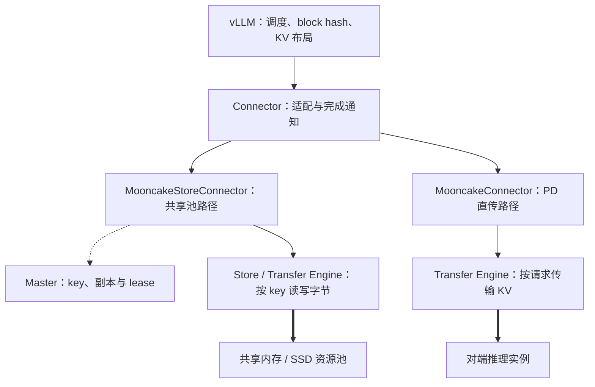
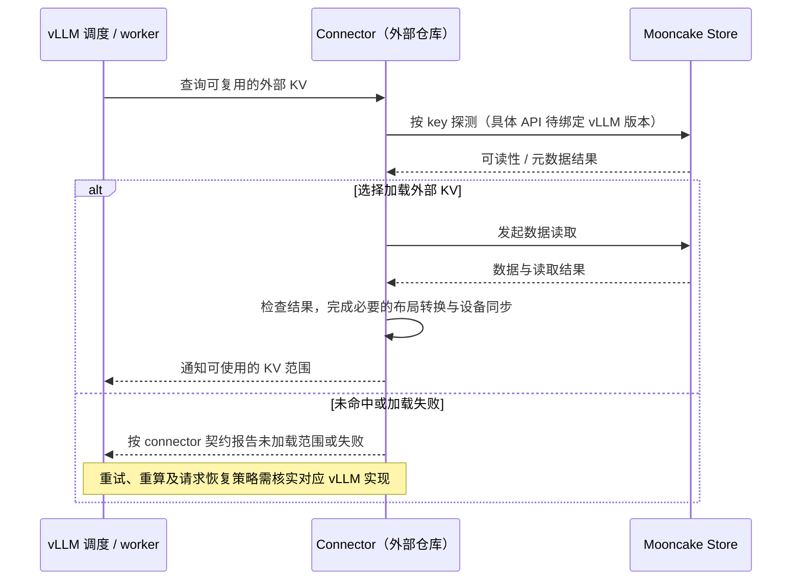

# 篇10 接入 vLLM：一次前缀命中如何减少 Prefill？

> 系列：《Mooncake KV Cache 源码解析》
> 版本锚点：`v0.3.13.post1`（commit `7197358`）
> 源码链接基座：`https://github.com/kvcache-ai/Mooncake/blob/v0.3.13.post1/`

> 阅读与验证约定见[系列指南](README.md)。本篇的源码行号沿用历史版本；图示为逻辑解释，引用测试不代表已执行。

## 10.1 具体问题

前九篇都在 Mooncake 内部。这一篇从推理框架的入口切进来，回答四个问题：

1. **接口**：vLLM 的 connector 到底调用 Mooncake 的哪些 API？传的是张量还是字节？
2. **命中**：一次前缀命中如何被判定？需要把整个 KV block 读回来才能知道命中吗？
3. **搬运**：命中的 KV 如何从 Store 进入推理引擎的 KV cache？可见性由谁保证？
4. **退化**：未命中、读失败、实例崩溃时，请求如何继续？

先说清一个边界：**connector 的实现不在 Mooncake 仓库，而在 vLLM 仓库**（V1 的 `MooncakeStoreConnector`、PD 的 `MooncakeConnector`）。本篇能追的是 Mooncake 这一侧的契约——Python 绑定、`real_client`、Master/TE 的行为——以及集成文档规定的部署方式。把"vLLM 的调度语义"当成 Mooncake 源码来引用，是这类文章最常见的错误。

还有两个术语要先对齐。**"前缀命中"命中的是 KV block，不是字符串前缀**：vLLM 把 prompt 切成固定 token 数的 block，按前缀链计算哈希，命中粒度因此是"从第 0 个 block 起连续命中了多少个"。**"减少 Prefill"不等于"跳过 Prefill"**：命中的 block 直接复用已有 KV，只有未命中的后缀需要前向计算；整段 prompt 都命中时，prefill 的计算量才降到接近零。

## 10.2 场景与版本

- **场景**：多个 vLLM 实例共享一个 Mooncake Store，把 KV block 卸载到 CPU/SSD，并在实例之间按块哈希复用；或者 Prefill/Decode 分离，KV 由 prefill 实例直传 decode 实例。
- **版本**：`v0.3.13.post1`。集成文档在 `docs/source/deployment/integrations/vllm/`；V1 推荐 `MooncakeStoreConnector`，V0（≤ vLLM 0.6.4.post1）用 `MooncakeStore`。Mooncake 侧入口是 `mooncake-integration/store/store_py.cpp`。
- **三种部署形态**：
  1. `kv_both`：单实例，Store 当本地 KV 池的扩展（`kv-cache-storage.md:78`）；
  2. `kv_producer` / `kv_consumer`：PD 分离，前者生成、后者消费（`kv-cache-storage.md:83`–`:128`）；
  3. `MultiConnector` 组合：PD 直传用 `MooncakeConnector`，共享池用 `MooncakeStoreConnector`，同一实例同时挂两者（`kv-cache-storage.md:91`–`:128`）。
- **配置**：`MOONCAKE_CONFIG_PATH` 指向 JSON，核心字段是 `metadata_server`、`master_server_address`、`global_segment_size`、`local_buffer_size`、`protocol`（`kv-cache-storage.md:56`–`:68`）。`protocol` 取 `rdma` 或 `tcp`（`:210`）。PD 侧另有 `VLLM_MOONCAKE_BOOTSTRAP_PORT`（默认 8998）和 `VLLM_MOONCAKE_ABORT_REQUEST_TIMEOUT`（默认 480s）（`disagg-prefill-decode.md:129`、`:133`）。
- **主路径**：vLLM connector → `batch_get_tensor_metadata_prefixes`（`store_py.cpp:743`）/ `get_tensor_into`（`:662`）/ `put_tensor_from`（`:1205`）→ `RealClient::get_into_ranges`（`real_client.cpp:4010`）/ `put_from` → Master + TE。

> **证据边界**：本篇未固定 vLLM commit，未验证外部 connector 调用链。下文张量 API、header 与 TP 分片代码展示 Mooncake 提供的能力，不代表某个 vLLM 版本一定使用这些接口。跨实例 key 兼容、哈希种子要求与失败回退均须结合具体 connector 版本核实。

## 10.3 Mooncake 侧接口路径（connector 实际调用待核实）

```
vLLM 请求
   │  scheduler 按 block hash 链查本地 prefix cache
   │  未命中 → connector 向 Mooncake Store 查/读
   ▼
Connector 接入示意（vLLM 实际 API 选择待核实）
   │
   ├─ 探测：batch_get_tensor_metadata_prefixes (store_py.cpp:743)
   │    └─ get_into_ranges(..., sizeof(TensorMetadata))   :775
   │         └─ RealClient::get_into_ranges (real_client.cpp:4010)
   │              └─ execute_ranged_read (real_client.cpp:3475)
   │                   └─ Master GetReplicaList + TE READ   ← 只读 header
   │
   ├─ 命中：get_tensor_into (store_py.cpp:662)
   │    └─ store_->get_into(key, buffer, size)          :678
   │         └─ RealClient::get_into (real_client.cpp:3758)
   │              └─ execute_ranged_read → Master lease + TE READ
   │
   └─ 回写：put_tensor_from (store_py.cpp:1205)
        ├─ ParseTensorMetadata(buffer, size)            :1220
        └─ store_->put_from(key, buffer, size, ReplicateConfig{})  :1226
             └─ Master PutStart / TE WRITE / PutEnd      ← 篇2
   ▼
KV block 进入 vLLM 的 paged KV cache
   ▼
命中前缀的 token 不再做 attention 前向 → 只算未命中后缀
```

### 10.3.1 职责边界：Store 共享缓存与 PD 直传



图示依据本仓库集成文档区分职责。两个 connector 的实际调用方式、buffer 布局与调度回调必须按 vLLM 的具体版本核实；不能用一个 Python 绑定函数的存在证明 connector 一定调用它。

### 10.3.2 Store 接入的逻辑时序与待核实边界



此图是共享 Store 的逻辑契约，不是已验证的 vLLM 函数调用链。读取完成、GPU 数据可用和 scheduler 允许复用可能是不同事件；PD 直传另有请求与握手生命周期。

## 10.4 三个关键代码片段

### 片段1：命中探测只读 header（`store_py.cpp:743`）

`batch_get_tensor_metadata_prefixes` 为每个 key 分配 `sizeof(TensorMetadata)` 的落点，用 ranged read 只取对象开头的那一段：

```cpp
// store_py.cpp:748
const size_t scratch_size = keys.size() * sizeof(TensorMetadata);
auto scratch = store_->allocate_client_buffer(scratch_size);
std::vector<void *> buffers{scratch->ptr()};
std::vector<std::vector<std::string>> all_keys{keys};
std::vector<std::vector<std::vector<size_t>>> all_dst_offsets(1);
std::vector<std::vector<std::vector<size_t>>> all_src_offsets(
    1, std::vector<std::vector<size_t>>(keys.size(), {0}));
std::vector<std::vector<std::vector<size_t>>> all_sizes(
    1, std::vector<std::vector<size_t>>(keys.size(),
                                        {sizeof(TensorMetadata)}));
...
results = store_->get_into_ranges(buffers, all_keys, all_dst_offsets,
                                  all_src_offsets, all_sizes, nullptr);  // :775
```

**关键点**：每个 key 只读 `sizeof(TensorMetadata)` 字节，源偏移固定为 0。这个固定偏移是 schema 保证的：`ValidateTensorMetadata` 要求 `data_offset >= sizeof(TensorMetadata)`（`integration_utils.h:335`），所以对象开头必然是完整 header，不会读到"半个头 + 一点数据"。命中判定因此是"**key 存在 + header 合法**"，不需要把整个 block 搬回来。`get_into_ranges` 走的是篇3 的 ranged read：Master 返回副本描述符与 lease，TE 只传请求的字节区间。**分析（推断）**：这是把"存在性查询"和"数据读取"解耦——查询走最短传输，确认命中后再发一次全量读；代价是命中后还需全量读取及相应元数据操作；具体 RPC 数受批量与元数据复用方式影响。收益是以较少字节检查可读性与格式，不能说它避免了读取不存在对象的完整数据。

注意这里没有单独的 `exists` API。原因是对象的存在性在分布式 Store 里不是稳定事实：查询返回"存在"，下一秒可能被淘汰。用"能读出合法 header"当判据，把存在性和可读性合并成一次有 lease 保护的操作，比 `exists` 更接近真实语义。**观点**：对 KV Cache 这种"读失败可以重算"的负载，这是正确的取舍——不值得为 `exists` 引入两阶段锁。

### 片段2：读回张量——GIL 之外的拷贝（`store_py.cpp:662`）

`get_tensor_into` 提供把对象读入调用方预分配 buffer 的能力；connector 是否采用该接口、buffer 是否为最终 GPU KV 落点，需要另外核实：

```cpp
// store_py.cpp:662
pybind11::object get_tensor_into(const std::string &key,
                                 uintptr_t buffer_ptr, size_t size) {
    if (!is_client_initialized()) { ... return pybind11::none(); }
    if (buffer_ptr == 0) { ... return pybind11::none(); }
    char *buffer = reinterpret_cast<char *>(buffer_ptr);

    int64_t total_length;
    {
        py::gil_scoped_release release_gil;      // :677
        total_length = store_->get_into(key, buffer, size);  // :678
    }
    return buffer_to_tensor(NULL, buffer, total_length);     // :681
}
```

**关键点**：`gil_scoped_release` 覆盖整个 `get_into`，传输期间不占 Python 解释器；多个 worker 才能并发发起读。`buffer_to_tensor`（`:167`）在返回前重新解析 header 并校验 `data_offset + data_bytes == total_length`，任何不一致都返回 `None` 而不是半个张量。失败时 `get_into` 返回负的错误码，`buffer_to_tensor` 走 `data_length < 0` 分支打日志并返回 `None`（`:198`–`:205`）。**这只能证明该绑定接口的错误返回被转换为 `None`；connector 是否重试、重算或终止请求，必须核对对应 vLLM 版本的实现。**

### 片段3：写入——buffer 里必须自带 header（`store_py.cpp:1205`）

写入不是"传一个裸张量"，而是"传一段以 `TensorMetadata` 开头的字节"：

```cpp
// store_py.cpp:1205
int put_tensor_from(const std::string &key, uintptr_t buffer_ptr, size_t size) {
    ...
    if (size < sizeof(TensorMetadata)) {
        return to_py_ret(ErrorCode::INVALID_PARAMS);
    }
    if (!ParseTensorMetadata(reinterpret_cast<const char *>(buffer), size)
             .has_value()) {
        return to_py_ret(ErrorCode::INVALID_PARAMS);   // :1223
    }
    py::gil_scoped_release release_gil;
    return store_->put_from(key, buffer, size, ReplicateConfig{});  // :1226
}
```

这个 header 是固定布局（`integration_utils.h:212`–`:223`）：

```cpp
struct TensorObjectHeader {
    uint32_t magic;        // 0x4d4f4f4e = "MOON"
    uint16_t version;      // 1
    uint16_t header_size;  // sizeof(TensorMetadata)
    int32_t dtype; int32_t ndim; uint32_t layout_kind; uint32_t reserved_flags;
    uint64_t data_offset;  // >= sizeof(TensorMetadata)
    uint64_t data_bytes;   // == total_length - data_offset
};
struct TensorMetadata {
    TensorObjectHeader header;
    TensorLayoutMetadata layout;   // global/local shape + 最多 4 个 LayoutAxis
};
```

**关键点**：`ValidateTensorMetadata`（`integration_utils.h:306`）校验 magic、version、`header_size`、dtype 范围、`ndim ≤ 8`、`data_offset` 落在 `[sizeof(TensorMetadata), total_length]`、`data_bytes` 与总长自洽，并反算 `numel * element_size` 是否等于 `data_bytes`。**所以 Mooncake 存的是"带自描述头的字节块"，不是 PyTorch 张量对象**；TP 场景下 `layout_kind = SHARD` 和 `LayoutAxis` 记录分片信息（`integration_utils.h:176`、`:208`）。**分析（推断）**：把 schema 放进数据本身，让 Store 完全不需要理解 KV Cache 的语义——它只按 key 存字节，跨版本/跨 TP 布局的兼容责任留在读写双方。代价是每个对象多一个 header，且任何字段错误都会让整次读退化成未命中。

## 10.5 命中语义：Mooncake 提供池，vLLM 提供哈希

把两侧职责分开看，链路才清楚：

| 环节 | 由谁负责 | 依据 |
|---|---|---|
| 切 block、算前缀链哈希 | vLLM scheduler | vLLM 侧实现，不在本仓库 |
| 块哈希 → Store key | connector | 文档只承诺"block-hash deduplication"（`kv-cache-storage.md:34`） |
| key 的分布式存储、副本、lease | Mooncake Master/TE | 篇2、篇3、篇8 |
| 探测命中、读回、写回 | connector + `store_py.cpp` | 本篇片段1–3 |
| 决定哪些 token 跳过前向 | vLLM scheduler | vLLM 侧实现 |

**关键点**：Mooncake 对"前缀"没有任何感知。它看到的是 connector 给的一串 key，值是一段带 `TensorMetadata` 头的字节。所谓"跨实例前缀缓存"，本质是**多个 vLLM 实例用相同的哈希算法算出相同的 key，于是命中同一个 Store 对象**。`kv-cache-storage.md:143` 的提醒正说明这一点：文档所述依赖 Python 哈希种子的 DP 部署需要固定 `PYTHONHASHSEED`（`:149`）；该要求是否适用于其他哈希算法或版本，应单独核实。

以下是共享缓存减少 Prefill 的逻辑过程，具体 API 选择与同步点仍需 vLLM 侧证据：

1. 请求进入 vLLM，scheduler 先查本地 prefix cache；
2. 本地没有的 block，connector 按块哈希向 Store 探测（片段1），只读 header；
3. 命中后经 connector 加载、完成必要转换并同步，再由调度器决定可复用的 KV 范围；
4. 计算完成后，新产生的 KV block 通过 connector 选定的写入接口回写 Store（片段3展示其中一种能力），供后续请求或其他实例复用；
5. **命中的 block 已有 K/V，attention 不再为这些 token 做前向**；prefill 只覆盖未命中的后缀。

**成本边界**：连续前缀复用的收益与可复用 token 数有关，但探测成本不一定与 prompt 长度无关。这里的批量接口按传入 key 数分配空间并读取 header；RPC 轮数、传输字节量和本地处理复杂度需要分别计算。是否遇到第一个 miss 就停止后续探测，应检查 connector 的实际调用方式。

这里刻意用 `get_tensor_into` 而不是 `get_tensor`：后者由绑定层 `get_buffer` 分配 `BufferHandle`，再包装成 Python 张量（`store_py.cpp:634`–`:638`）；前者把数据写进调用方预分配的地址；是否还需复制或布局转换，取决于调用方内存类型与 connector 实现。**分析（条件）**：如果目标 buffer 确实是可直接复用的最终布局，直接写入可减少额外分配与拷贝；代价是绑定层只能用 `size` 做上限，buffer 是否够大由调用方保证。**观点**：这是把"内存所有权"留在推理引擎侧的正确做法——Store 不该替框架决定 KV block 的内存布局。

Mooncake 在这里的另一个贡献是**容量与介质分层**：`kv_both` 下 block 可以下沉到本地 SSD（篇9），命中时再 promotion 回内存；PD 分离下 `MooncakeConnector` 用 RDMA 直传，文档给出的峰值是 142.25 GB/s（`disagg-prefill-decode.md:5`）。**这是两条不同的数据路径**：前者是"共享池 + 按 key 查"，后者是"点对点 + 按请求传"，`MultiConnector` 让同一实例同时具备两者。

## 10.6 异常与并发

### 未命中与读失败

未命中与加载失败需要分别处理。本节展示的 Python 绑定会把相应失败转换成 `None`（`store_py.cpp:198`–`:205`），但这不足以证明 vLLM 已实现透明回退。应核对 connector 如何报告未加载块、scheduler 是否重新安排计算，以及异步加载失败后是否会使用部分写入的 KV。重试与重算是上层策略，不能从绑定返回值推导为“无需重试”。

### 块哈希不一致

对文档所述依赖 Python 哈希种子的实现，跨进程未统一 `PYTHONHASHSEED` 可能使相同内容产生不兼容的 key，破坏跨实例复用（`kv-cache-storage.md:143`–`:149`）。应先检查实际哈希算法与命名空间，不能对所有版本断言“命中率归零”。

### TP / 分片布局

TP 场景下每个 rank 的 KV 形状不同。绑定层用 `put_tensor_with_tp_from` 把完整张量按 `split_dim` 切开，存成 `key_tp_<rank>`；读侧 `batch_get_tensor_with_tp_into` 按 rank 读回对应分片（`store_py.cpp:892`–`:918`、`:1318`–`:1360`）。header 里的 `layout_kind` 和 `LayoutAxis` 记录 global/local shape 与 shard 信息，`ValidateTensorMetadata` 会拒绝布局不自洽的对象。**分析（推断）**：把分片信息放进每个对象，而不是放在 key 命名约定里，是为了让"读到错 rank 的分片"在解析阶段就失败，而不是悄悄算错 attention。

### 实例崩溃与连接元数据

V1 的容错边界是"单实例崩溃可容忍"：实例间连接会被移除，其余实例作为普通 vLLM 继续服务（`kv-cache-storage.md:25`）。V0 则明确写着：实例异常退出可能污染连接元数据，需要重启 `mooncake_master` 再测（`:312`）。**这是 V1 相对 V0 的真实差异，不要笼统说"支持故障恢复"。**

### 请求中止与资源释放

PD 场景下 `VLLM_MOONCAKE_ABORT_REQUEST_TIMEOUT` 默认 480 秒（`disagg-prefill-decode.md:133`）：请求中止后超过这个时间，KV Cache 被自动释放，避免 decode 侧长期占着不再需要的数据。**关键点**：这是"请求生命周期"与"缓存生命周期"的接口——篇8 的 lease 保护的是传输窗口，这里保护的是请求窗口，两者不同层。

### 端口与同机部署

同节点跑 prefill 和 decode 时，`decode_url` 端口要与 `prefill_url` 至少差 50；若配成同一个 URL，`decode_url` 会自动加 100（`disagg-prefill-decode.md:204`、`:263`）。`VLLM_MOONCAKE_BOOTSTRAP_PORT` 则要求每个 worker 唯一（`:129`）。

### 性能预期

判断一次加载是否值得，可以先比较：`探测耗时 + KV 加载耗时 + 必要的布局转换与设备同步耗时 < 重算对应前缀的耗时`。对象大小、可复用前缀长度、介质、并发与有效带宽都会改变结果；需要按相同工作负载测量。

文档给出的对照是：相对 Redis 后端，2P2D、tp=2、RDMA 下平均 TTFT 改善约 32%（`kv-cache-storage.md:7`）；PD 直传峰值 142.25 GB/s，约 8×RoCE 的 71.1% 利用率（`disagg-prefill-decode.md:5`）。这两个数字来自不同实验，不能相互替代；缺少硬件、模型、负载、命中率、并发和软件版本条件时，只能作为原文报告值。没有消融实验，不能把 TTFT 改善确定归因于某次拷贝优化。

## 10.7 验证与结论

- **Python 绑定**：`mooncake-integration/store/store_py.cpp` 的 `batch_get_tensor_metadata_prefixes`(`L743`)、ranged 探测(`L748`–`L775`)、`get_tensor_into`(`L662`)、GIL 释放(`L677`)、`get_into`(`L678`)、`buffer_to_tensor`(`L167`)、失败分支(`L198`–`:205`)、`put_tensor_from`(`L1205`)、header 校验(`L1220`)、`put_from`(`L1226`)、`batch_get_tensor_with_tp_into`(`L892`)、`put_tensor_with_tp_from`(`L1318`)、pybind 注册(`L2492`/`L2530`)。
- **张量 wire format**：`mooncake-integration/integration_utils.h` 的 magic/version(`L171`–`:172`)、`TensorObjectHeader`(`L212`)、`TensorMetadata`(`L223`)、`ValidateTensorMetadata`(`L306`)、`ParseTensorMetadata`(`L383`)。
- **Store 侧**：`mooncake-store/include/real_client.h` 的 `get_into`(`L138`)、`get_into_ranges`(`L140`)、`put_from`(`L191`)；`src/real_client.cpp` 的 `execute_ranged_read`(`L3475`)、`get_into`(`L3758`)、`get_into_ranges`(`L4010`)。
- **集成文档**：`docs/source/deployment/integrations/vllm/kv-cache-storage.md` 的能力声明(`L5`)、TTFT 对照(`L7`)、V1 容错(`L25`)、块哈希前缀缓存(`L34`)、配置(`L56`–`:68`)、`kv_both`(`L78`)、XpYd(`L83`–`:128`)、DP 哈希种子(`L143`–`:149`)、`protocol`(`L210`)、V0 限制(`L312`)；`disagg-prefill-decode.md` 的带宽(`L5`)、角色(`L122`–`:124`)、`BOOTSTRAP_PORT`(`L129`)、`ABORT_REQUEST_TIMEOUT`(`L133`)、端口间隔(`L204`/`L263`)。
- **测试**：`mooncake-integration/tests/`、`python/tests/integration/`。注意 connector 本身在 vLLM 仓库，本 tag 无法引用其实现代码。

**结论**：vLLM 通过 connector 接入 Mooncake，但**两侧职责必须分开**——vLLM 负责切 block、算前缀链哈希、决定哪些 token 跳过前向；Mooncake 负责按 key 存字节、管副本与 lease、提供廉价探测。本文展示的 Mooncake 张量接口可组成“header 探测 → 全量读取”的路径，以及“带 header 的 buffer → put_from”的写入路径；实际 vLLM connector 是否采用这些接口，尚需固定版本核实。Mooncake 对"前缀"零感知，跨实例命中靠的是相同哈希算法产出相同 key；依赖 Python 哈希种子的实现还需统一相应种子。绑定层可以报告加载失败；是否退化为重算及如何保证失败后的正确性，需要对应 vLLM connector 与 scheduler 的证据。**前缀命中减少的是 prefill 的 token 数，不是 prefill 这个阶段本身**——整段命中才会接近跳过。从概念上，Store、TE 与推理请求可连接为以下链路；外部集成仍待具体版本证据：篇2/篇3 的 Put/Get，篇5–7 的传输，篇8/篇9 的生命周期与分层，最终都汇入这一次 block 级复用。

---

*系列完。从篇0 架构总览到篇10 接入 vLLM，11 篇覆盖 Mooncake KV Cache 的完整路径。*
