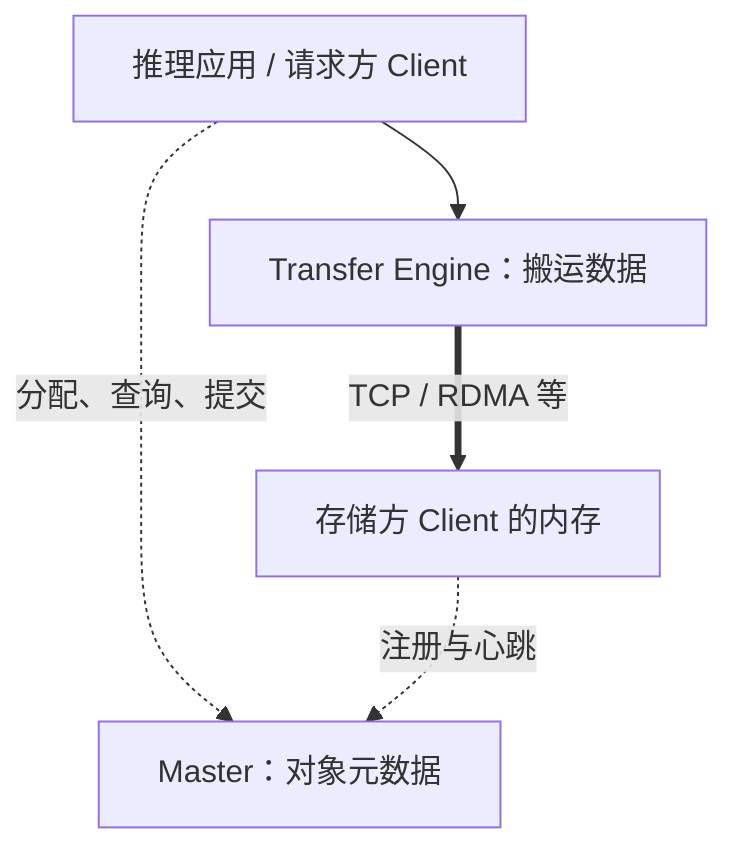

# 第1篇｜Mooncake 如何让多台机器共享 KV Cache？

**摘要：**从一次缓存读写出发，认识 Mooncake 的三个核心角色，以及元数据与数据为什么要走不同的路径。

一台推理服务器的显存装不下所有 KV Cache，能不能借用其他机器的内存？多个推理实例处理相似请求，能不能复用已经计算过的 KV？

这些问题背后，都有一个共同需求：**让原本属于单个推理进程的缓存，成为可以跨进程、跨机器访问的资源。**

Mooncake 为这件事提供了存储和传输能力。但要理解它，第一步是分清：谁决定数据放在哪里，谁真正搬运数据。

## Master 管位置，Client 持有数据

可以把 Mooncake Store 想成一个分布式仓库。

Master 负责维护目录：某个 key 对应哪些副本，副本位于哪个节点，是否已经写完，什么时候可以回收。

Client 则有两个角色。它既可以代表应用发起读写，也可以贡献一段本地内存，供其他 Client 存储对象。

因此，“客户端”不一定只是消费者。一个推理进程可以一边访问共享缓存，一边向资源池贡献容量；也可以只发请求，不提供存储。

实际搬运字节的是嵌入进程中的 Transfer Engine。它根据配置和运行条件，使用 TCP、RDMA 等后端完成传输。

**Master 维护的是数据的位置与状态，对象数据在 Client 之间传输。**

*配图1：逻辑架构，建议导出为纵向 PNG。*

*图注：虚线表示控制交互，粗线表示对象数据传输。Client 与 Transfer Engine 通常是进程中的库。*

## 一次写入，为什么需要两条路径？

假设 Client A 要写入一个对象。

它先向 Master 申请空间。Master 返回副本位置，A 再通过 Transfer Engine 把数据写过去。

数据传输完成后，A 还要通知 Master：这份副本已经写完，可以交给读方使用。

这个顺序解决了一个关键问题：**空间已经分配，不代表里面的数据已经完整。**

读取时也类似。Client B 先查询可读副本的位置，再发起数据读取。Master 参与定位和保护，Transfer Engine 负责传输。

元数据与数据分路，避免了所有大对象都经过同一个中间节点。但它也带来新的协调问题：目录中的状态，必须与实际数据的生命周期相匹配。

## 还有一种元数据，别和 Master 混淆

Transfer Engine 本身也需要连接信息，例如远端 segment 的描述与握手参数。

这类信息与 Store Master 管理的“key 对应哪些副本”属于不同层次。

使用服务模式时，可以通过独立 metadata server 管理连接元数据；使用 `P2PHANDSHAKE` 等配置时，则可以直接握手，不必额外部署独立 TE metadata server。

部署图上是否需要第四个进程，要看配置，不能只凭“TE 需要元数据”就判断一定需要独立服务。

## 分清缓存与持久化

把 KV Cache 放进共享池，并不自动意味着它具有数据库式的持久化保证。

内存副本、SSD 副本、Master 高可用，分别解决不同问题：

- 内存副本提供访问能力与一定的数据冗余。
- SSD 分层扩展容量，并改变数据保留方式。
- Master 高可用处理元数据服务的可用性。

这些能力需要分别配置、分别验证。

下一篇先认识对象、副本和内存段。只有分清这些概念，才能准确理解“写入成功”到底意味着什么。

**源码延伸：**原系列篇0；`mooncake-store`、`mooncake-transfer-engine`。版本基线为 `v0.3.13.post1`，本文为原理整理，未新增历史版本运行验证。

[源码解析版](../00-architecture-overview.md) · [系列目录与排版说明](README.md)

[下一篇](02-objects-and-replicas.md)
