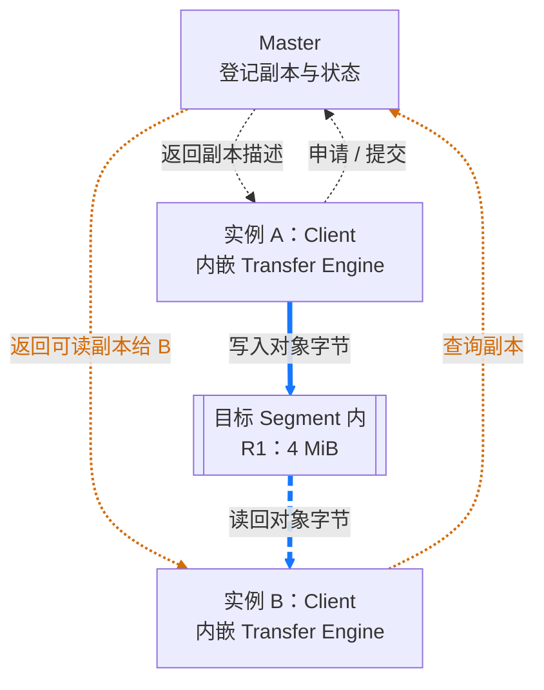

# 同样的 1024 个前缀 token，第二台推理实例还要重算吗？

**摘要：** 两次请求的前缀相同，且模型、tokenizer、缓存布局和命名空间兼容时，实例 B 具备复用这段 KV 的条件。B 还要查到可读副本、成功读取，再由推理框架接入。

实例 A 刚处理完一份文档，系统提示和文档一共 1024 个 token。随后，实例 B 收到另一个问题，前缀相同。两边的模型、tokenizer、缓存布局和命名空间都兼容时，B 从哪里找到 A 算好的 KV？

接下来只跟踪 A 写入的一个对象，key 记为 `K`，有效负载设为 **4 MiB**。1024 个 token 是请求场景，4 MiB 是系列里的示意对象大小。前缀具体占多少字节、分成几个对象以及命中多少，由模型和框架布局决定。

即使 A 在自己的进程里保留了前缀缓存，B 也未必够得着：两边可能不在一个进程，甚至不在一台机器上，显存和内存互不共享。

Mooncake 要解决的，就是让这段 KV 从“某个推理实例的私有状态”，变成其他实例也能找到并读取的共享数据。

这里跟的是两次请求间的前缀复用。当前请求从 Prefill 到 Decode 的 KV 交接，见[推理集成篇](11-kv-reuse-and-inference.md)。

## A 算过的 KV，B 为什么可能用不上？

真正卡住 B 的不是算力，是所有权和可见性。

A 算出的 KV 默认属于 A 的推理进程。请求结束后，它可以被释放，也可以留在 A 的本地前缀缓存里。但无论哪种情况，B 都没有一个入口去访问它。

要让 B 复用，得靠三个角色配合：

1. 推理框架识别可复用的 token 范围，定出这段前缀的缓存 key `K`；等数据到了，再判断哪些 KV 能给当前请求用。
2. Mooncake Store 按 `K` 记下对象、副本位置和可读状态，B 靠它查到该读哪一份数据。
3. Transfer Engine 把副本 R1 的字节搬进 B 指定的缓冲区。

Mooncake 提供 Store 和 Transfer Engine；识别前缀、生成 key、最终加载进推理引擎，仍由框架和 connector 完成。

## Master 管位置，Client 持有数据

可以把 Mooncake Store 想成一个分布式仓库。

Master 维护的是目录：某个 key 对应哪些副本，副本在哪个节点，写完没有，什么时候可以回收。

Client 的角色有两个。它既能代表应用发起读写，也能贡献一段本地内存，供其他 Client 存对象。

所以“客户端”不一定只是消费者。一个推理进程可以一边访问共享缓存，一边向资源池贡献容量；也可以只发请求，不提供存储。

实际搬运字节的，是嵌在进程里的 Transfer Engine。它根据配置和运行条件，选择 TCP、RDMA 等后端完成传输。

B 向谁查询，又从哪里读数据？先把 Master、A、B 和目标 Segment 中 R1 的位置摆清楚。

*配图1：A、B、Master 与 R1 的位置关系。*

<!-- 手机发布版配图由 figures/01-shared-kv-cache-fig1.dot 渲染；下方 Mermaid 保留作语义参考。 -->

*图注：R1 由 Master 分配，位于目标 Segment 内；对象字节由 Client 侧的 Transfer Engine 在 A、B 与 R1 之间搬运，Master 不在数据路径上。*

## 一次写、一次读：申请、搬运、提交、查询、加载

把 A 写、B 读串起来，一次复用可以分成五个动作：

1. 申请：A 向 Master 发起 `PutStart`，申请写入 key `K`。
2. 搬运：Master 分配副本 R1，A 通过 Transfer Engine 把数据写到 R1。
3. 提交：A 调用 `PutEnd`；Master 把 R1 从 `PROCESSING` 翻成 `COMPLETE` 后，其他 Client 才能在可读副本列表里发现它。
4. 查询：B 向 Master 查询 `K`，拿到 R1 的描述与读租约（lease）。
5. 加载：B 把 R1 中的 4 MiB 读入本地缓冲区，再由框架加载进 KV Cache。

第 5 步里，Transfer Engine 把字节送到 B 的缓冲区。布局是否兼容、KV 能否用于当前请求，由框架判断。外部加载省去对应 token 的 Prefill 计算，同时带来查询、传输和加载开销。[推理集成篇](11-kv-reuse-and-inference.md)会用首个 token 的等待时间（TTFT）比较这两笔成本。

这条顺序区分了两个容易混淆的时刻：空间分配出去，只是 Master 记了一笔账，数据未必已经写完整；A 把字节全部搬完，也不代表 B 马上可以读。

第 3 篇会把“搬运完成”与“提交可见”这两个时刻拆开；第 4 篇会解释读租约到期后，为什么读回字节仍可能被拒绝。

## 两类元数据，各管一层

Store Master 按 key 记录副本的位置、状态与读租约。Transfer Engine 使用连接信息和地址范围，把字节搬到指定缓冲区。

## 总结

一次复用可以串成：推理框架识别相同前缀并确定缓存 key `K`；A 已把 KV 写入 R1 并通过 `PutEnd` 提交副本；B 的 Client 向 Master 查询可读副本，再通过 Transfer Engine 从 R1 加载。控制流停在 Master 的目录上，数据流不经过 Master：Master 只告诉 B 去哪里读，KV 字节从副本所在的位置直接传到 B。

这里的共享池解决的是跨实例访问，不等于数据库式持久化。内存副本、SSD 副本和 Master 高可用是三套独立的配置，也要分别验证。

**源码延伸**：`mooncake-store`、`mooncake-transfer-engine`。版本基线为 `v0.3.13.post1`。

- [Client 初始化参数](https://github.com/kvcache-ai/Mooncake/blob/719735896c86b56fabec6cf3e825fb2ea640597a/mooncake-store/include/real_client.h#L85)
- [Store 设计：Master 不接管数据流](https://github.com/kvcache-ai/Mooncake/blob/719735896c86b56fabec6cf3e825fb2ea640597a/docs/source/design/store/mooncake-store.md#L76)
- [Transfer Engine 设计：Segment 抽象](https://github.com/kvcache-ai/Mooncake/blob/719735896c86b56fabec6cf3e825fb2ea640597a/docs/source/design/transfer-engine/index.md#L21)

[系列目录与排版说明](README.md)

[下一篇：同一个 key 可以对应多个副本，每个副本究竟占用哪段内存？](02-objects-and-replicas.md)
