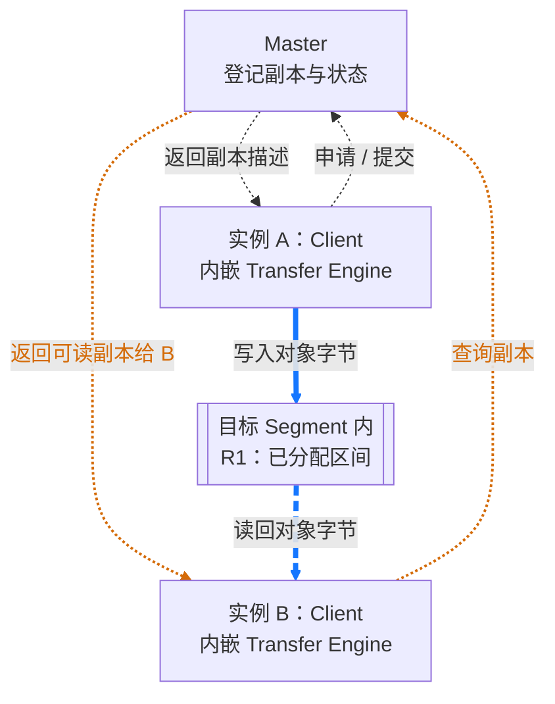

# 第1篇｜同样的 1,024 个前缀 token，第二台推理实例还要再算一遍吗？

**摘要：**推理实例 A 已经算过 1,024 个 token 的前缀，推理实例 B 的请求只有后文不同。模型、tokenizer、缓存布局和命名空间兼容时，B 可以加载这段 KV 而不重算；Mooncake 要让这份数据能被 B 找到并读取。

在 Mooncake 里，推理实例 A（下文简称实例 A）收到一个请求：前 1,024 个 token 是同一段系统提示和文档，后面接着问题 QA。A 完成 Prefill，把这 1,024 个 token 的 KV 以 key `K` 写入共享缓存。

过了一会儿，推理实例 B（下文简称实例 B）收到另一个请求：前 1,024 个 token 与 A 那次逐 token 相同，后续问题 QB 不同。模型、tokenizer、缓存布局和命名空间都兼容时，B 的框架可以认为这段前缀的 KV 与 A 算出的内容等价。如果 B 重新做一次 Prefill，这 1,024 个 token 的计算就重复了。

1,024 只是例子，用来说明“相同的 token 范围”。实际能否复用、按多大块命中，由推理框架的前缀匹配和缓存布局决定。

即使 A 在自己的进程里保留了前缀缓存，B 也未必能访问这份缓存：它们可能在不同的进程、不同的机器上，显存与内存都不共享。

Mooncake 要解决的，就是让这段 KV 从"某个推理实例的私有状态"变成"其他实例也能找到并读取的共享数据"。

这里说的是跨实例复用已写入共享池的前缀 KV；Prefill 实例把本轮请求的 KV 直接交给 Decode 实例，是另一种按请求协调的交接，留到第11篇。

## A 算过的 KV，B 为什么可能用不上？

问题不在计算本身，而在**所有权与可见性**。

A 算出的 KV 默认属于 A 的推理进程。请求结束后，它可以被释放，也可以留在 A 的本地前缀缓存里。但无论哪种情况，B 都没有一个入口去访问它。

要让 B 复用，三个角色各做一件事：

1. **推理框架**识别可复用的 token 范围，决定这段前缀的缓存 key `K`，并在数据到达后判断哪些 KV 能被当前请求使用。
2. **Mooncake Store** 按 `K` 记录对象、副本位置和可读状态，让 B 能查到该读哪一份数据。
3. **Transfer Engine** 把副本 R1 的字节搬进 B 指定的 buffer。

Mooncake 提供 Store 和 Transfer Engine；识别前缀、生成 key、最终加载进推理引擎，仍由框架和 connector 完成。

## Master 管位置，Client 持有数据

可以把 Mooncake Store 想成一个分布式仓库。

**Master 维护目录**：某个 key 对应哪些副本，副本位于哪个节点，是否已经写完，什么时候可以回收。

**Client 有两个角色**：它既可以代表应用发起读写，也可以贡献一段本地内存，供其他 Client 存储对象。

因此，"客户端"不一定只是消费者。一个推理进程可以一边访问共享缓存，一边向资源池贡献容量；也可以只发请求，不提供存储。

实际搬运字节的是嵌入进程中的 Transfer Engine。它根据配置和运行条件，使用 TCP、RDMA 等后端完成传输。

*配图1：A、B、Master 与 R1 的位置关系。*

*图注：R1 由 Master 分配，位于目标 Segment 内；对象字节由 Client 侧的 Transfer Engine 在 A、B 与 R1 之间搬运，Master 不在数据路径上。*

## 一次写、一次读：申请、搬运、提交、查询、加载

把 A 写、B 读串起来，一次复用可以分成五个动作：

1. **申请**：A 向 Master 发起 `PutStart`，申请写入 key `K`。
2. **搬运**：Master 分配副本 R1，A 通过 Transfer Engine 把数据写到 R1。
3. **提交**：A 调用 `PutEnd`，告诉 Master 这份副本已经写完、可以读。
4. **查询**：B 向 Master 查询 `K`，拿到 R1 的描述与读保护。
5. **加载**：B 从 R1 搬运数据，加载进自己的 KV cache。

第 5 步里，Transfer Engine 只负责把字节送到 B 的 buffer；布局是否兼容、这些 KV 能否被调度器用于当前请求，仍由框架判断。B 选择外部加载，是用一次网络搬运换掉一次 Prefill；是否划算取决于前缀长度、带宽、命中率与并发，第11篇会用 TTFT 展开。

这个顺序解决了一个关键问题：**空间已经分配，不代表里面的数据已经完整；数据已经搬完，也不代表读方可以使用。**

第3篇会把"搬运完成"与"提交可见"这两个时刻拆开；第4篇会解释读保护到期后，为什么读回字节仍可能被拒绝。

## 两类元数据，各管一层

Mooncake 里有两类元数据，容易混在一起：

- **Store Master** 管业务层：key 对应哪些副本、副本状态、位置与读保护。
- **Transfer Engine** 管传输层：连接信息与地址空间信息。

传输层的元数据可以由独立的 metadata service 管理，例如 etcd 或 HTTP 服务；也可以使用 `P2PHANDSHAKE` 这类配置直接握手，不必额外部署独立服务。

两类元数据服务于不同问题。看到"元数据服务"时，要先确认它指的是哪一层。

## 总结

一次复用可以串成：推理框架识别相同前缀并确定缓存 key `K`；A 已把 KV 写入 R1 并通过 `PutEnd` 提交副本；B 的 Client 向 Master 查询可读副本，再通过 Transfer Engine 从 R1 加载。控制流停在 Master 的目录上，数据流不经过 Master——**Master 告诉 B 去哪里读，KV 字节从副本所在位置传到 B。**

这里的共享池解决的是跨实例访问，不等于数据库式持久化。内存副本、SSD 副本与 Master 高可用分别配置、分别验证。

**源码延伸：**原系列篇0；`mooncake-store`、`mooncake-transfer-engine`。版本基线为 `v0.3.13.post1`。

- [Client 初始化参数](https://github.com/kvcache-ai/Mooncake/blob/719735896c86b56fabec6cf3e825fb2ea640597a/mooncake-store/include/real_client.h#L85)
- [Store 设计：Master 不接管数据流](https://github.com/kvcache-ai/Mooncake/blob/719735896c86b56fabec6cf3e825fb2ea640597a/docs/source/design/store/mooncake-store.md#L76)
- [Transfer Engine 设计：Segment 抽象](https://github.com/kvcache-ai/Mooncake/blob/719735896c86b56fabec6cf3e825fb2ea640597a/docs/source/design/transfer-engine/index.md#L21)

[源码解析版](../00-architecture-overview.md) · [系列目录与排版说明](README.md)

[下一篇：同一个 key 可以对应多个副本，每个副本究竟占用哪段内存？](02-objects-and-replicas.md)
