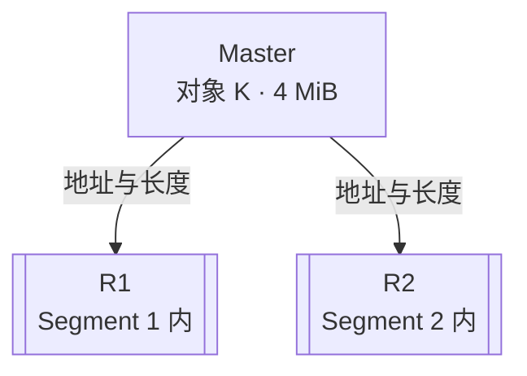
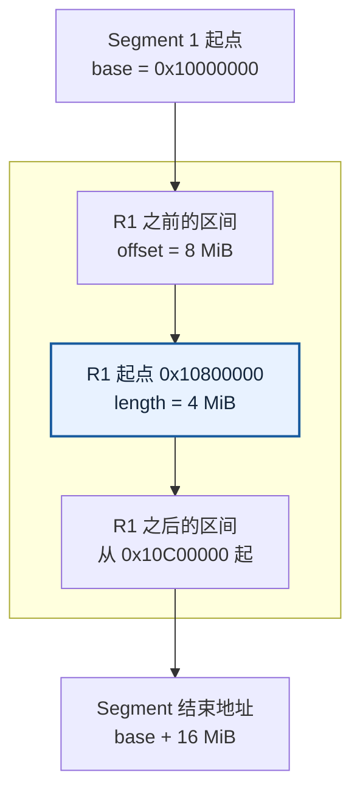

# 一个 KV Cache 对象，在 Mooncake 里到底怎么放？

**摘要：** key K 在 Master 里变成对象元数据，R1、R2 是同一对象的两个副本，各占一段已分配内存。对象说明存什么，副本说明有几份、在哪，Segment 说明空间从哪来，Slice 说明一次搬运按什么单位组织。

上篇中，实例 A 把前缀 KV 的一个分块写入 Store。继续跟踪其中 key 为 `K` 的 **4 MiB 对象**。这次假设它有两份内存副本，先看其中一份到底占用哪段地址。

从 A 调用 `Put` 的角度看，这只是“写一个对象”。但在 Mooncake 内部，这个动作经过了好几层结构：key 先变成元数据，元数据下面挂着副本，副本指向一段分配好的内存，传输时又被组织成 slice。

如果把这些结构都笼统理解为“一块内存”，后面的可见性、淘汰、SSD 下沉就会越来越难读。

它们各自回答一个具体问题：

- **对象**：存的是什么？
- **副本**：同一份数据有几份、在哪里？
- **Segment**：这段内存从哪来？
- **Slice**：这次搬运按什么单位组织？

4 MiB 是整个系列跟踪的单个对象的有效负载。整段前缀可能分成多个对象，分块和并行布局由框架决定。

## 一个 key，先变成对象元数据

应用通过 key 访问对象。新 key 的 `PutStart` 成功分配副本后，Master 为它建立 `ObjectMetadata`。

这份元数据记录对象的身份与生命周期信息：谁发起的写入、什么时候开始、对象多大、数据类型、读保护截止时间，以及副本列表。

Master 在运行时维护这份对象元数据。客户端查询时拿到的是序列化的副本描述和租约信息。

## R1、R2：同一对象的两个副本

同一个对象可以有多个副本。为了说清楚，本篇把两份内存副本记作 `R1`、`R2`。

`R1`、`R2` 可能位于不同存储节点，各自占据一段分配好的内存。它们的内容相同，但地址不同，状态也可能不一致——一个已经 `COMPLETE`，另一个仍在 `PROCESSING`。

*配图1：key K 的元数据与两份副本范围。*

*图注：Master 为对象 K 维护独立的副本条目。R1、R2 各存一份 4 MiB，分别记录位置和状态。*

**对象是否存在，与某一份内存副本是否存在，并不是同一件事。**

内存副本被淘汰后，如果仍有可读的磁盘副本，对象仍可能被读取。后面的 SSD 篇用 R3 表示这份独立的磁盘副本。

## Segment 提供空间，副本只占其中一段

存储节点向集群贡献一段连续内存，Master 侧把它登记为一个 Store Segment：起点、大小、传输端点等。

以普通主机内存为例，假设 Segment 1 的起点 `base = 0x10000000`，总长 16 MiB。分配器给 R1 的起点距 `base` 有 8 MiB，也就是 `offset = 8 MiB`。R1 的有效范围长 4 MiB。

*配图2：沿地址增大的方向看 Segment 1。*

*图注：R1 的起点是 `base + offset`，结束地址是 `base + offset + length`，结束地址本身不属于 R1。三个区间在地址上首尾相接。图中长度未按比例绘制，前后两段的占用情况省略。*

图里的 `offset` 用来说明副本在段内的位置。这里的内存副本描述携带 `buffer_address_`、`size_` 和传输端点等信息。客户端在这条路径上可以从副本地址 `0x10800000` 发起搬运。

Store 与 Transfer Engine 都会出现 Segment 概念，但语境不同。

- **Store Segment** 是 Master 侧的分配与注册记录，关心“这段空间归谁、还剩多少”。
- **Transfer Engine 侧的 Segment** 是传输侧的地址空间抽象，通常每个进程一个，内部再划分缓冲区。

阅读源码或配置时，要先确认讨论的是哪一层，不能只凭名字把它们直接等同。

## Slice 是搬运单位

Store 的 `Slice` 是指针加长度。假设 A 用两段各 2 MiB 的本地缓冲区表示 K，`PutStart` 会把长度相加，向 Master 申请 4 MiB 对象的副本空间。

在远程内存搬运路径上，第一段写到 R1 的起点，第二段从 **副本起点 + 2 MiB** 开始写。这里的 2 MiB 是对象内偏移，图中的 8 MiB 是副本相对 Segment 的偏移。Transfer Engine 后端还可能把每个请求继续切分。

回到两个具体问题：

**只回收 R1，K 还可读吗？** 只要 K 还有另一个可读副本——例如 R2 已经 `COMPLETE`，或存在有效的磁盘副本——B 仍可能读到 K。只有 R1 是最后一份可读副本时，回收它才会让对象进入不可读或清理流程。因此，“R1 的空间被回收”和“K 被删除”不是同一个动作。

**一次传输拆成多个 slice，副本数量会变吗？** 不会。slice 是这次搬运的组织单位，不是副本。Store 调用层可能把范围切成多个 slice，传输后端也可能再拆，副本仍是 R1、R2 这些独立的数据位置。

## 空间什么时候能释放？

这比“地址在哪里”更重要。

内存副本持有 `AllocatedBuffer`。副本被删除时，`AllocatedBuffer` 析构，通过弱引用找到所属分配器，把空间归还。

这条链上有几个边界：

- 分配器可以比 `AllocatedBuffer` 先失效，例如 Segment 被卸载。此时析构不再归还，因为分配器自身已经不在了。
- 副本上的占用计数用于约束特定后台操作和回收。对象元数据直接持有副本，副本持有分配句柄。
- 客户端拿到的描述符可能仍被在途任务使用，释放空间时要考虑这个时间差。

读租约（lease）约束普通删除与淘汰。细节见[读租约篇](04-get-and-lease.md)与[淘汰篇](09-cache-eviction.md)。

## 总结

Master 用 `ObjectMetadata` 记录对象 K。每份 4 MiB 副本占用一个 Segment 内的区间，起点和结束地址都能由 `base`、`offset`、`length` 算出。Slice 只影响传输如何组织，副本数量仍按独立存放的位置计。

判断可读性和回收时，要记住两条边界：对象存在不等于某份副本存在，R1 的空间被回收也不等于 K 被删除；内存副本之外还可能有磁盘副本，但本篇主线仍看 R1、R2。

**源码延伸**：`ObjectMetadata`、`Replica`、`AllocatedBuffer`、`Segment`。版本基线为 `v0.3.13.post1`。

- [ObjectMetadata](https://github.com/kvcache-ai/Mooncake/blob/719735896c86b56fabec6cf3e825fb2ea640597a/mooncake-store/include/master_service.h#L1031)
- [Replica](https://github.com/kvcache-ai/Mooncake/blob/719735896c86b56fabec6cf3e825fb2ea640597a/mooncake-store/include/replica.h#L203) · [AllocatedBuffer](https://github.com/kvcache-ai/Mooncake/blob/719735896c86b56fabec6cf3e825fb2ea640597a/mooncake-store/include/allocator.h#L39) · [Segment](https://github.com/kvcache-ai/Mooncake/blob/719735896c86b56fabec6cf3e825fb2ea640597a/mooncake-store/include/types.h#L433)
- [PutStart 汇总 Slice 长度](https://github.com/kvcache-ai/Mooncake/blob/719735896c86b56fabec6cf3e825fb2ea640597a/mooncake-store/src/master_client.cpp#L578-L591) · [内存搬运的地址推进](https://github.com/kvcache-ai/Mooncake/blob/719735896c86b56fabec6cf3e825fb2ea640597a/mooncake-store/src/transfer_task.cpp#L1090-L1106)

[系列目录与排版说明](README.md)

[上一篇](01-shared-kv-cache.md) · [下一篇](03-put-visibility.md)
