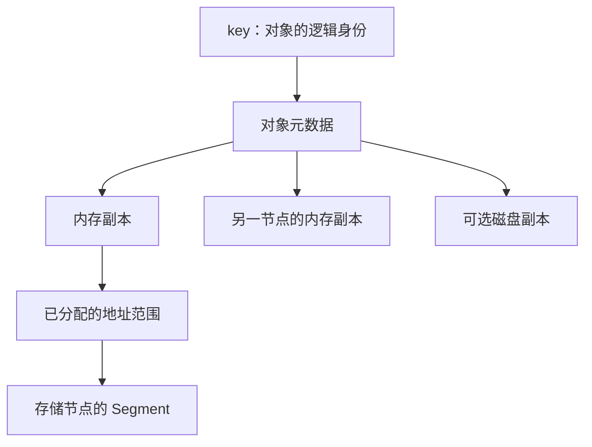
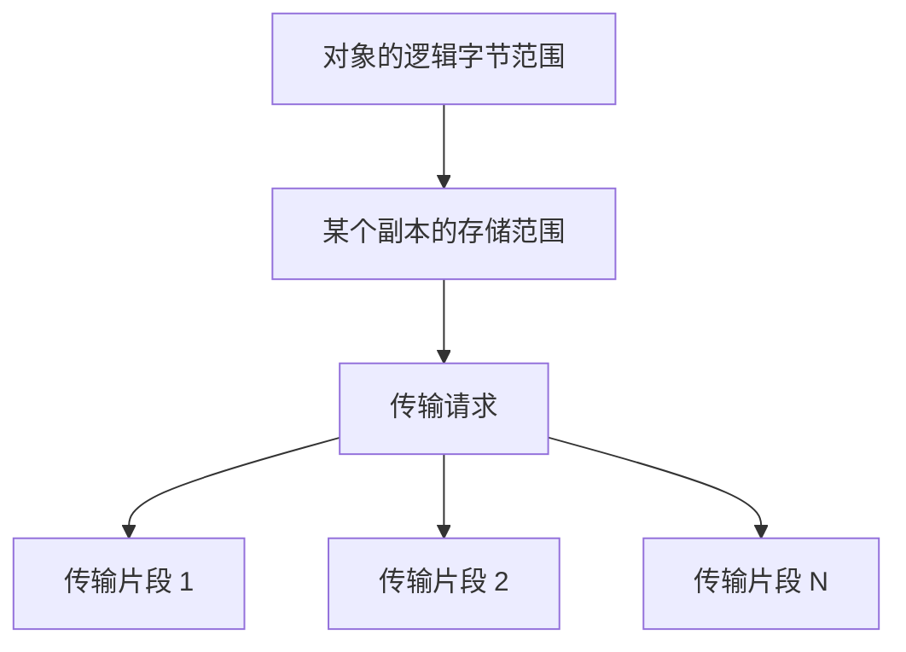

# 第2篇｜对象、副本、Segment、Slice：Mooncake 的数据到底怎么放？

**摘要：**一次 Put 写入的是对象，真正参与网络传输的却可能是多个 slice。它们之间是什么关系？

读 Mooncake 源码时，很容易遇到四个词：对象、副本、segment 和 slice。

如果把它们都理解为“一块内存”，后面的分配、传输和回收就会越来越难读。

它们分别回答不同的问题：存的是什么，有几份，放在哪里，以及怎样搬过去。

## 对象是逻辑身份，副本是存储实例

应用通过 key 访问对象。

Master 为对象维护元数据，包括大小、创建者、读保护时间，以及副本列表。

同一个对象可以有多个副本。副本可能位于不同节点，也可能采用不同介质，例如内存或本地磁盘。

因此，**对象是否存在，与某一份内存副本是否存在，并不是同一件事。**

内存副本被淘汰后，如果磁盘副本仍然有效，对象仍可能被读取。

*配图1：对象与存储的关系。*

*图注：多个副本可以属于同一个对象；Segment 提供资源范围，不等于一个对象。*

## Segment 是资源范围，不是业务对象

存储节点向集群提供一段内存资源。分配器再从中划出范围，交给具体副本使用。

对象通常不会独占整个 segment。

一次读取需要的是副本描述：地址、长度、传输端点等信息。描述信息让 Client 知道如何访问数据，但不意味着 Client 拥有远端内存。

这里还有一个容易忽略的层次：Store 与 Transfer Engine 都会涉及 segment 概念。阅读源码时，需要确认当前讨论的是哪一层的资源和描述，不能只凭名字把它们直接等同。

## Slice 是搬运单位

一个较大的对象，可能被分成多个片段传输。

Store 层可以组织自己的 slice，传输后端也可能为了长度限制、调度或并行处理，再做进一步拆分。

所以，不能假设：

> 一个对象对应一个请求，一个请求对应一个网络操作。

实际关系可能是一对多，而且不同层次的切分目的并不相同。

*配图2：从逻辑对象到传输片段。*

*图注：这是逻辑映射，不表示 Store slice 与后端 slice 固定一一对应。*

## 谁负责释放这块空间？

这比“地址在哪里”更重要。

本地对象可以通过所有权和析构完成资源回收；远端读写还涉及描述符、在途任务和时间窗口。

引用计数可以表达某个副本正在被后台任务使用，读 lease 可以保护普通读取窗口，但它们不是同一种机制。

判断资源能否释放时，需要同时追踪：

- 谁持有分配结果。
- 哪些任务仍可能访问数据。
- 哪些保护条件尚未解除。

带着这些概念再看 Put，就能把“申请空间”“写入字节”和“发布可读副本”区分开。

**源码延伸：**原系列篇4；`ObjectMetadata`、`Replica`、`AllocatedBuffer`。版本基线为 `v0.3.13.post1`。

[源码解析版](../04-core-data-structures.md) · [系列目录与排版说明](README.md)

[上一篇](01-shared-kv-cache.md) · [下一篇](03-put-visibility.md)
