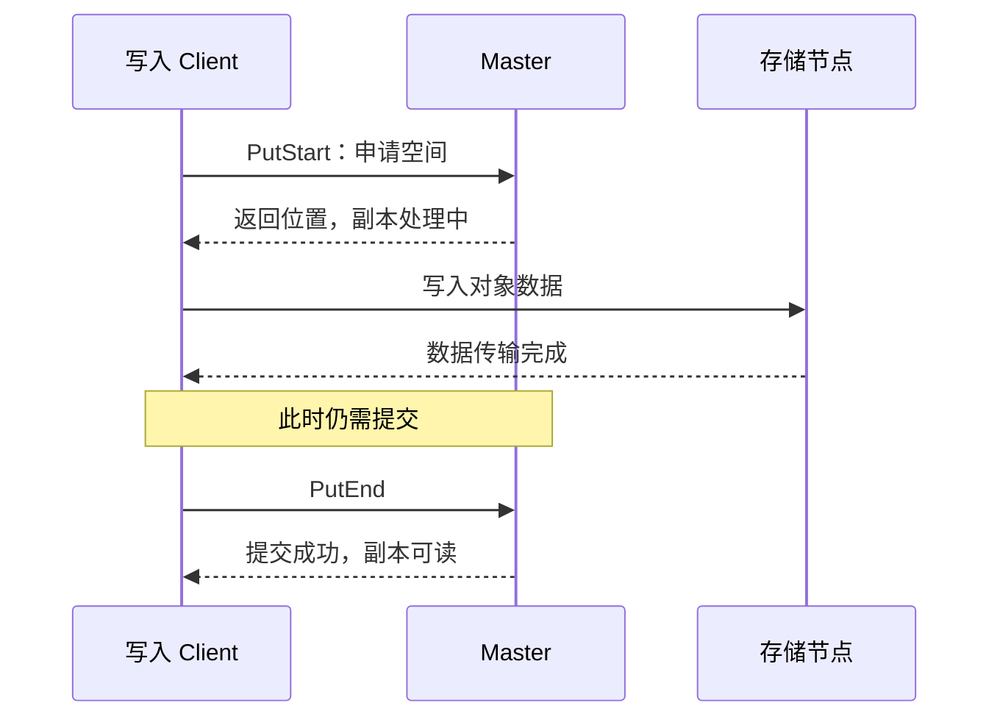

# 第3篇｜数据写完了，为什么 Mooncake 还不能让别人读？

**摘要：**一次 Put 至少有两个重要时刻：数据传输完成，以及副本变得可见。它们为什么不能合并？

假设你正在向远端写入一个大对象。

前半部分已经到达，后半部分还在传输。此时另一个 Client 查询相同的 key，应该读到什么？

如果系统只看“空间已经分配”，就可能把一份尚未写完的数据交出去。

Mooncake 的写入流程需要解决的，首先就是这个可见性问题。

## 先申请，再搬运，最后提交

默认的新对象写入路径可以分成三个动作：

1. `PutStart`：申请副本空间。
2. 数据传输：把字节写入目标地址。
3. `PutEnd`：提交写入结果。

在申请成功后，副本处于处理中。它已经有地址，但不能据此作为可读副本交给普通 Get。

传输完成后，客户端调用 `PutEnd`。Master 接受提交，副本才进入完成状态。

**网络操作完成，解决“数据是否搬完”；元数据提交，解决“读方能否使用”。**

*配图1：Put 的两个完成点。*

*图注：图示只区分“数据搬完”与“元数据提交”两个时刻；副本数量与失败策略取决于配置。*

## 为什么失败后还需要撤销？

空间申请成功，后续传输仍可能失败。

客户端可能遇到连接异常、资源不足，或者部分副本写入失败。系统不能把所有申请过的位置都标记为成功。

失败处理需要结合当前副本策略，决定哪些副本可以提交，哪些未完成副本需要撤销。

这意味着“Put 成功”的强度依赖配置。讨论它时，应说清楚副本数量和失败策略，而不是笼统地理解为“所有期望副本都在”。

这里的分阶段写入，也不应直接等同于数据库的两阶段提交协议。流程相似，不代表具备完全相同的事务保证。

## 客户端突然崩溃，谁来收尾？

更麻烦的情况是：Client 完成了 `PutStart`，却在提交或撤销之前崩溃。

此时留下的是未完成对象。它占着资源，也可能阻挡后续同 key 写入。

Master 需要依靠超时与清理机制，让这些对象不至于永久占用空间。超时顶替与实际回收还可能发生在不同时间，不能认为客户端消失后，资源就立刻恢复可用。

还有另一种不确定性：Master 已经接受 `PutEnd`，但响应在网络中丢失。

对客户端来说，这次操作超时了；对服务端来说，它可能已经完成。

**超时只能说明客户端没拿到结果，不能证明服务端没有执行。**

## 重试之前，先理解同 key 语义

原系列分析的普通 Put 路径，对已存在 key 采用“保留已有内容”的处理方式，不能把重试当成覆盖写。

如果业务要替换内容，应确认是否需要 `Upsert` 等其他接口，并核对相应并发语义。

理解写入可见性后，下一个问题是：读方拿到副本地址，如何确认最终读回的数据仍然可以使用？

**源码延伸：**原系列篇2；`Client::Put`、`PutStart`、`PutEnd`、`PutRevoke`。版本基线为 `v0.3.13.post1`。

[源码解析版](../02-put-path.md) · [系列目录与排版说明](README.md)

[上一篇](02-objects-and-replicas.md) · [下一篇](04-get-and-lease.md)
