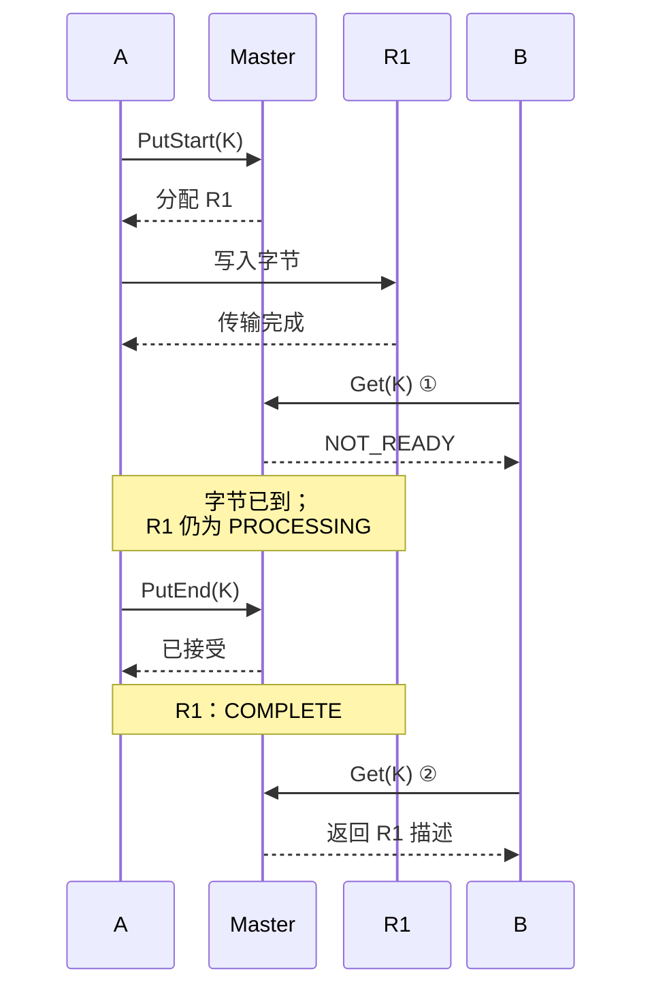

# 第3篇｜字节已经写完，为什么另一个 Client 还读不到？

**摘要：**A 的字节已经写完，B 仍可能查不到可读副本。数据搬完与副本提交，为什么是两个时刻？

实例 A 正在把前缀 KV 写入共享缓存，key 是 `K`。

数据已经开始通过网络搬运，另一台机器上的实例 B 恰好查询同一个 key。此时 B 应该读到什么？

如果系统只看"空间已经分配"，就可能把一份尚未写完的数据交出去。如果只看"字节已经到达"，又可能忽略提交这一步。

本篇讨论**普通新对象 Put**，不混入覆盖写。沿着 `Client::Put` 走一遍，看清数据搬完、副本提交、读方可见这三个时刻为什么不能合并。

## 先申请，再搬运，最后提交

一次 Put 可以拆成三个动作：

1. `PutStart`：向 Master 申请副本空间。
2. 数据传输：把字节写入目标地址。
3. `PutEnd`：提交写入结果，让副本变得可读。

`PutStart` 返回的不是"稍后告诉你"，而是**已经分配好的副本描述**：地址、长度、传输端点。此时副本已经进入 Master 的元数据表，但状态是 `PROCESSING`。

接下来，A 通过 Transfer Engine 把切片写到目标副本。传输返回成功，只说明字节到了远端内存段，**不说明这份副本可以被读**。

真正打开可见性的是 `PutEnd`。Master 把目标副本从 `PROCESSING` 翻成 `COMPLETE`。这是首次写入的正常路径：传输完成、`PutEnd` 成功，`Client::Put` 才返回成功。

同 key 已存在时还有另一条路径：`PutStart` 返回 `OBJECT_ALREADY_EXISTS`，`Client::Put` 在传输开始前就把它当成功返回。本文后面会把这两条路径分开。

*配图1：B 在 PutEnd 前后各查询一次。*

*图注：B 第一次查询在 PutEnd 前，得到 `REPLICA_IS_NOT_READY`；Master 接受 PutEnd 后，第二次查询才返回 R1 描述。黄色状态条标出传输完成到 PutEnd 的间隔。*

把这条路径压成四个时刻：

1. A 从 Master 拿到 R1，状态 `PROCESSING`；
2. A 把字节写到 R1；
3. Master 接受 `PutEnd`，R1 变成 `COMPLETE`；
4. B 查询 K，拿到可读副本描述。

B 在第 3 步之前查询，看到的是"对象存在，但没有可读副本"；在第 3 步之后查询，才可能拿到 R1。

## 可读副本是过滤出来的

B 第一次查询时，对象其实已经存在——`PutStart` 就把它插进了元数据表。但 Master 返回的不是"对象不存在"，而是 `REPLICA_IS_NOT_READY`。

原因在 `GetReplicaList`：它遍历副本，只把通过 `IsReplicaReadable` 的副本放进返回列表。

`IsReplicaReadable` 要求三件事：

- 副本状态是 `COMPLETE`；
- 内存或 NoF 句柄仍然有效；
- 传输端点没有被标记为失效。

`PROCESSING` 在第一步就被排除。所以"对象查得到"和"副本读得到"是两件事。

如果整个副本列表为空，Master 还会再分一次：

- 所有副本都是 `REMOVED`：返回 `OBJECT_NOT_FOUND`，让调用方放弃；
- 仍有未完成或不可用副本：返回 `REPLICA_IS_NOT_READY`，值得短暂重试。

**分析：**这两个错误码的区别，直接决定上层该不该重试。把 `REPLICA_IS_NOT_READY` 当成对象不存在而放弃，会错过马上就能读到的数据。

## 同 key 再写：已有状态决定返回值与可见性

普通 Put 遇到已存在的 key，判断发生在 `PutStart`。只要已有 `COMPLETE` 副本，或者仍在 discard 超时内，Master 就返回 `OBJECT_ALREADY_EXISTS`。`Client::Put` 对这个错误直接返回成功，不再进入后续的数据传输。

这个提前返回有两种常见来源，写方看到的结果相似，读方看到的状态却不同。

### 上次 PutEnd 已执行，响应丢失

第一次写入的 `PutEnd` 已经在 Master 执行，响应却在返回途中丢失。对 A 来说，这次调用超时；对 Master 来说，R1 已经是 `COMPLETE`。

A 重试同一个 key 的 Put。`PutStart` 发现已有 `COMPLETE` 副本，返回 `OBJECT_ALREADY_EXISTS`；`Client::Put` 把它当成功返回。这次重试传入的 buffer 不参与传输，已有内容也不变。

B 此时查询 K，能拿到 R1 的描述。A 看到的"重试成功"表示"对象已存在"，不是"这次覆盖写成功"。

### 上次写入仍停在 PROCESSING

第一个写方完成 `PutStart` 后停住，没有执行 `PutEnd` 或 `PutRevoke`。Master 里 K 仍然存在，R1 停在 `PROCESSING`。

在 discard 窗口内，另一个写方对 K 发起 Put：`PutStart` 返回 `OBJECT_ALREADY_EXISTS`，`Client::Put` 同样当成功返回。第二个写方传入的 buffer 不会写入，R1 仍不可读。B 查询 K，得到的是 `REPLICA_IS_NOT_READY`。

超过 discard 窗口后，新的 `PutStart` 才能顶替旧对象，并重新分配副本。旧副本先移入 `discarded_replicas_`，等到 release 超时才真正释放。顶替不是复用旧空间。

**无对象（首次写入正常路径）**
- 写方：`PutStart` 返回副本描述；传输后 `PutEnd` 成功，`Client::Put` 返回成功。
- 本次 buffer：写入。
- 读方：`PutEnd` 前得到 `REPLICA_IS_NOT_READY`；之后返回副本描述。

**已有 `COMPLETE` 副本（含 `PutEnd` 成功但响应丢失）**
- 写方：`OBJECT_ALREADY_EXISTS`；`Client::Put` 返回成功。
- 本次 buffer：不写入，已有内容不变。
- 读方：返回副本描述。

**`PROCESSING`，未超过 discard（默认 30 秒）**
- 写方：`OBJECT_ALREADY_EXISTS`；`Client::Put` 返回成功。
- 本次 buffer：不写入，原 `PROCESSING` 仍不可读。
- 读方：得到 `REPLICA_IS_NOT_READY`。

**`PROCESSING`，超过 discard（默认 30 秒）**
- 写方：`PutStart` 顶替并返回新副本描述；传输后 `PutEnd` 成功则返回成功。
- 本次 buffer：写入新分配的副本；旧副本进入 `discarded_replicas_`。
- 读方：新 `PutEnd` 前得到 `REPLICA_IS_NOT_READY`；之后返回新副本描述。

两个超时都从 `PutStart` 写入的 `metadata.put_start_time` 起算：

- `put_start_discard_timeout_sec`（默认 30 秒）：超时前，同 key 的新 `PutStart` 返回 `OBJECT_ALREADY_EXISTS`；超时后，新 `PutStart` 才能顶替旧对象。
- `put_start_release_timeout_sec`（默认 600 秒）：旧 `PROCESSING` 副本被顶替后先移入 `discarded_replicas_`，到 `put_start_time + 600 秒` 才真正释放。

提前返回的路径不会调用 `TransferWrite`；若启用 object checksum，本地仍可能计算一次校验值，但它不会写入共享副本。

这些分支只改变成功时分配哪些副本，不改变"key 已存在"的判断。覆盖语义属于 `Upsert`：它会按已有对象的情况走不同分支，包括同尺寸更新和不同尺寸的丢弃后重分配。把 Put 重试当成覆盖写，是这里最容易犯的错。

## 提交决策：默认全部成功，双副本可降级

空间申请成功，后续传输仍可能失败。客户端不能把所有申请过的位置都标记为成功，也不能把已完成的一侧一起撤销。

`Client::Put` 在传输结束后调用 `DetermineFinalizeDecision`，由它决定 `PutEnd` 与 `PutRevoke` 分别作用于哪一类副本。

默认可靠模式下，条件是严格的：

- 分配到的副本数量满足配置；
- **已分配副本的传输全部成功**。

两者都满足才 `PutEnd(ALL)`；否则 `PutRevoke(ALL)`，本次 Put 失败。

双副本模式 `FLEXIBLE_DUAL_REPLICA` 放宽了要求：

- 内存与 NoF 两侧都成功：`PutEnd(ALL)`；
- 只有内存成功：`PutEnd(MEMORY)` + `PutRevoke(NOF_SSD)`；
- 只有 NoF 成功：`PutEnd(NOF_SSD)` + `PutRevoke(MEMORY)`；
- 两侧都失败：`PutRevoke(ALL)`。

所以同一条"Put 成功"，在不同配置下强度不同。默认路径要求分配到的副本全部成功；双副本模式只要求一侧成功。调用方若依赖副本数，应当读配置或指标，而不是假设。

`PutRevoke` 本身也有限制：它只撤销仍处于 `PROCESSING` 的目标副本。如果目标类别里已经有非 `PROCESSING` 的副本（例如 `COMPLETE`），Master 返回 `INVALID_WRITE`，而不是误删已完成的数据。这正好要求调用方"提交成功的那一类，撤销失败的那一类"。

## 总结

对普通新对象 Put，写方的提交时刻是 `PutEnd`：在此之前，字节即使已经传到 R1，副本仍是 `PROCESSING`，`GetReplicaList` 不会返回它；`PutEnd` 成功后，R1 变成 `COMPLETE`，读方才可能拿到副本描述。

同 key 再次 Put 是另一条路径。只要已有 `COMPLETE` 副本或仍在 discard 窗口内，`PutStart` 返回 `OBJECT_ALREADY_EXISTS`，`Client::Put` 直接当成功返回，本次 buffer 不写入。看到"Put 成功"，要区分它表示"首次提交成功"还是"对象已存在"。

**源码延伸：**原系列篇2；`Client::Put`、`PutStart`、`PutEnd`、`PutRevoke`、`GetReplicaList`、`IsReplicaReadable`。版本基线为 `v0.3.13.post1`。

- [Client::Put](https://github.com/kvcache-ai/Mooncake/blob/719735896c86b56fabec6cf3e825fb2ea640597a/mooncake-store/src/client_service.cpp#L1853) · [对已存在 key 的提前返回](https://github.com/kvcache-ai/Mooncake/blob/719735896c86b56fabec6cf3e825fb2ea640597a/mooncake-store/src/client_service.cpp#L1887)
- [PutStart](https://github.com/kvcache-ai/Mooncake/blob/719735896c86b56fabec6cf3e825fb2ea640597a/mooncake-store/src/master_service.cpp#L4292) · [PutEnd](https://github.com/kvcache-ai/Mooncake/blob/719735896c86b56fabec6cf3e825fb2ea640597a/mooncake-store/src/master_service.cpp#L4509) · [PutRevoke](https://github.com/kvcache-ai/Mooncake/blob/719735896c86b56fabec6cf3e825fb2ea640597a/mooncake-store/src/master_service.cpp#L4776)
- [GetReplicaList](https://github.com/kvcache-ai/Mooncake/blob/719735896c86b56fabec6cf3e825fb2ea640597a/mooncake-store/src/master_service.cpp#L3626) · [IsReplicaReadable](https://github.com/kvcache-ai/Mooncake/blob/719735896c86b56fabec6cf3e825fb2ea640597a/mooncake-store/src/master_service.cpp#L3546)
- [discard / release 超时默认值](https://github.com/kvcache-ai/Mooncake/blob/719735896c86b56fabec6cf3e825fb2ea640597a/mooncake-store/include/types.h#L119)

[源码解析版](../02-put-path.md) · [系列目录与排版说明](README.md)

[上一篇](02-objects-and-replicas.md) · [下一篇](04-get-and-lease.md)
