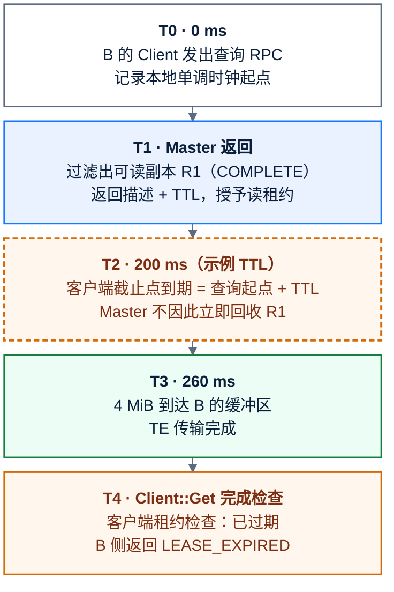

# KV 已经读回本地，为什么还会返回 LEASE_EXPIRED？

**摘要：** 实例 B 读回 4 MiB 字节时，客户端记录的租约截止时间已经过去。`Client::Get` 会在传输后检查租约，并拒绝这次结果。R1 是否已回收，要到 Master 侧确认。

实例 B 需要加载示意对象 `K`。Master 返回可读副本列表，B 选中内存副本 R1。网络排队拉长了这次读取，等完整的 4 MiB 都到了本地缓冲区，`Client::Get` 却返回 `LEASE_EXPIRED`。B 还能用这份缓冲区吗？

## 查询耗时也占用读租约窗口

Master 在返回可读副本列表时为对象授予读租约，响应中含有租约时长（TTL）。租约有效期间，普通 `Remove` 和淘汰受这层保护。例如，未指定强制删除的 `Remove` 可能返回 `OBJECT_HAS_LEASE`。

客户端在发出查询 RPC **之前**记录本地单调时钟。收到响应后，客户端用「查询起点 + TTL」算出自己的截止时间。这样，查询 RPC 的等待也算在客户端可用窗口内。客户端的时间线和 Master 的实际回收时刻要分别观察。

*配图1：客户端接收 4 MiB 时，本地截止时间已过去。图中 TTL 是示例值。*

*图注：截止点由 B 的查询起点加 TTL 算出，图中 TTL 是示例值；即使 4 MiB 完整到达，`Client::Get` 的租约检查仍会返回 `LEASE_EXPIRED`。Master 是否已经回收 R1 需要另查，不能由这个错误推出。*

## 查询返回的位置，由客户端选择

Master 在查询时过滤副本，并返回候选位置。直接调用 `Client::Get` 时，函数取列表中的第一个副本状态为 `COMPLETE` 的副本。部分 `RealClient` 入口会先用 `SelectBestReplica` 选出一个候选，再把筛过的描述交给 `Client::Get`。

在本篇的远端内存场景里，如果查询同时返回 R1 和 R2，启用远端内存评分时可以从两者中选分数更低的一份。未启用时，`SelectBestReplica` 选第一个远端内存候选。打分只发生在没有本地候选的分支，也只作用于候选内存副本。

选定 R1 后，客户端才发起数据传输。预先分配的缓冲区容量不足 4 MiB 时，全量 `TransferRead` 会返回 `INVALID_PARAMS`。部分 `RealClient` 入口对设备缓冲区还需要主机暂存，是否中转取决于入口、设备和路径。

## 完成检查按什么顺序报错？

对普通全量 `Client::Get`，只看函数最终交给调用方的结果，有三道关口：

1. **传输返回错误**。例如 R1 的端点在查询之后失效，查询成功过的描述也可能无法继续使用。调用方应记录返回的传输错误，缓冲区可能已写入部分字节。这里的 `Get` 不会在失败后循环尝试 R2。
2. **可选校验失败**。启用对象校验且响应携带期望校验值时，读方计算收到的数据的校验值。值不匹配返回 `CHECKSUM_MISMATCH`。校验步骤本身出错，也会先把错误交给调用方。
3. **读租约过期**。只有前面通过，才会返回 `LEASE_EXPIRED`。传输之后的校验时间也会占用窗口，因此传输刚好在截止前结束，调用仍有可能因租约过期失败。

在示例中，B 走到第 3 步。Master 可能仍持有 R1。租约经过截止时间不会立即触发副本释放，也无法据此判断数据损坏。使用旧描述直接重试无法获得新的租约。若调用方决定重试，应重新查询 `K`，拿新的候选与租约，再按剩余请求预算决定读取 R1、R2 或由上层重新计算前缀。

## 先确认错误来自查询还是读取

**查不到或暂时不可读。** Master 以 `OBJECT_NOT_FOUND` 表示当前没有可返回的对象，以 `REPLICA_IS_NOT_READY` 表示对象有副本记录，但目前没有副本通过可读过滤，例如写入仍在 `PROCESSING`。读取函数收到的列表中若没有副本状态为 `COMPLETE` 的候选，也可能返回 `INVALID_REPLICA`。

**拿到描述后失败。** 保留查询耗时、选中的副本和读取返回值。若接口直接返回 `ErrorCode`，可以分开记录传输、校验和租约错误；若用 `get_buffer_internal` 一类返回指针的路径，多种失败都可能变成空指针，需要结合对应层的日志或指标。

**走的是磁盘读取。** 在 `v0.3.13.post1` 的 `RealClient::get_buffer_internal` 中，若选中 `LOCAL_DISK`，全量读取直接调用 offload 路径，成功后执行适用的校验并返回缓冲区。该分支没有进入 `Client::Get` 的租约检查。这个入口的 `DISK` 路径仍调用 `Client::Get`。排查 SSD 时，先核实副本类型和入口，再判断适用哪一种检查顺序。

## 总结

B 从 R1 搬完 4 MiB 后，还要通过适用的校验和租约检查，`Client::Get` 才会接受结果。`LEASE_EXPIRED` 指向一次超出客户端读取窗口的尝试，Master 的回收状态需要另查。遇到错误时，先分清查询、传输与完成检查，再决定是否重新查询、换副本或交给上层重算。

**源码延伸**（`v0.3.13.post1`）

- [Client::Query 的本地计时](https://github.com/kvcache-ai/Mooncake/blob/719735896c86b56fabec6cf3e825fb2ea640597a/mooncake-store/src/client_service.cpp#L1211) · [Master 授予读租约](https://github.com/kvcache-ai/Mooncake/blob/719735896c86b56fabec6cf3e825fb2ea640597a/mooncake-store/src/master_service.cpp#L3682)
- [Client::Get 的完成检查](https://github.com/kvcache-ai/Mooncake/blob/719735896c86b56fabec6cf3e825fb2ea640597a/mooncake-store/src/client_service.cpp#L1390) · [SelectBestReplica](https://github.com/kvcache-ai/Mooncake/blob/719735896c86b56fabec6cf3e825fb2ea640597a/mooncake-store/include/replica_selection.h#L123)
- [TransferRead 过滤过小的缓冲区](https://github.com/kvcache-ai/Mooncake/blob/719735896c86b56fabec6cf3e825fb2ea640597a/mooncake-store/src/client_service.cpp#L4497) · [RealClient 的 LOCAL_DISK 全量分支](https://github.com/kvcache-ai/Mooncake/blob/719735896c86b56fabec6cf3e825fb2ea640597a/mooncake-store/src/real_client.cpp#L2874)
- [GetReplicaList](https://github.com/kvcache-ai/Mooncake/blob/719735896c86b56fabec6cf3e825fb2ea640597a/mooncake-store/src/master_service.cpp#L3626) · [普通 Remove 的租约检查](https://github.com/kvcache-ai/Mooncake/blob/719735896c86b56fabec6cf3e825fb2ea640597a/mooncake-store/src/master_service.cpp#L6416)

[系列目录与排版说明](README.md) · [源码阅读番外](05-source-reading.md)

[上一篇](03-put-visibility.md) · [下一篇](06-transfer-lifecycle.md)
