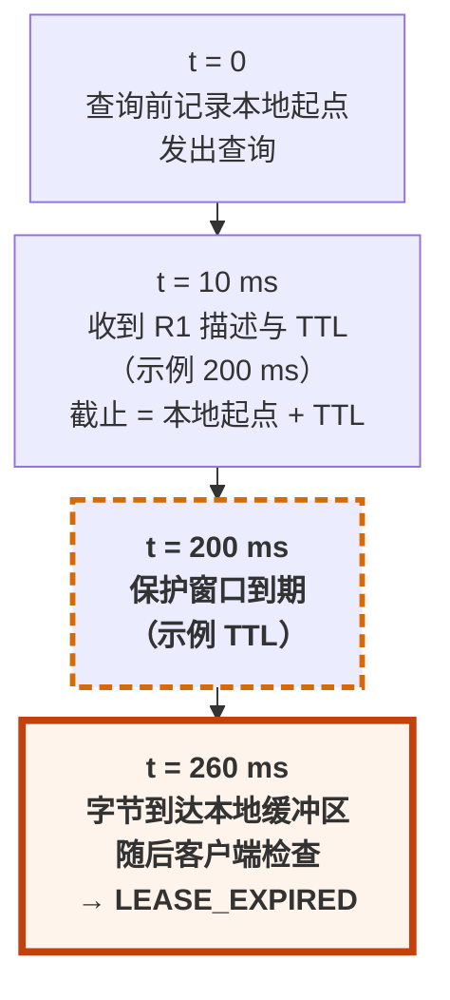

# KV 已经读回本地，为什么还会返回 LEASE_EXPIRED？

**摘要：**推理实例 B 从 R1 读回字节时，客户端记录的租约截止时间已经过去；`Client::Get` 在传输后检查租约，返回 `LEASE_EXPIRED` 并拒绝这次结果。R1 是否回收，仍由 Master 侧决定。

实例 B 的请求命中前缀 key `K`，向 Master 查询后拿到可读副本列表和一份读租约（lease）；列表里带着 R1 的副本描述。客户端选中 R1，开始从 R1 读取这段 KV。

传输比预期慢。等字节全部到达本地缓冲区，租约已经过期。数据到了本地，结果仍被拒绝：`Client::Get` 把租约检查排在传输之后，先搬完，再判断这次读取是否还在承诺窗口内。

## 一次慢读的时间线

读方拿到副本描述后，系统不能立刻把这段空间交给其他对象，否则读方可能读到已被复用的数据。读租约给出一段有边界的读取窗口：在这段时间内，这份副本不会被正常删除或淘汰。

Master 在返回可读副本列表时授予租约，并在响应里带上 TTL。客户端计时不是从收到响应开始：它在发出查询 RPC 之前先取一次本地 `steady_clock` 起点，收到响应后用 `start_time + lease_ttl_ms` 算出截止时间。查询 RPC 本身的耗时，也占用了客户端的可用窗口。

下面按相对时间展开这次慢读。假设租约 TTL 是 200 ms——这个数值只用于示意，不是默认配置：

*配图 1：一次跨过租约到期的读取时间线。*

*图注：橙色虚线框是 200 ms 的租约到期点；260 ms 时字节才到达本地缓冲区，随后客户端检查租约并返回 `LEASE_EXPIRED`。*

时间线里有两个不同的时刻：200 ms 是租约到期，260 ms 是传输完成。到期点由客户端记录的起点加上 Master 给出的 TTL 算出；传输何时完成，由本地读取决定。最后做检查的是客户端：`Client::Get` 先 `TransferRead`（或 `ReadDfsReplica`），再按需校验（checksum），最后检查租约。字节到得再完整，也不能跳过这次检查。

这条路径是“尽力读 + 事后否决”：先完成传输，再判断这次读取是否仍在承诺窗口内。

**分析：**好处是实现简单，不需要在传输前阻塞等待；代价是租约过期时已经浪费了一次带宽。对 KV Cache 这种“读失败可以重算”的场景，这个取舍是成立的。

## 已定位、已搬完、可接受

回到 B 这次读取，按发生顺序可以拆成四步：

1. **查询**：B 向 Master 查询 key `K`，拿到可读副本列表和租约。这时 B 只有 R1 的描述，还没有数据。
2. **选择**：客户端从列表里挑一个副本。Master 只过滤可读副本，不替客户端选。
3. **搬运**：Transfer Engine 按副本介质和目标缓冲区选择路径，把字节从 R1 搬到 B 的本地缓冲区。
4. **检查**：传输返回后，`Client::Get` 检查传输结果、可选校验和租约。三项都通过，才把结果交给调用方。

用三个时刻概括：查询后已定位，传输后已搬完，检查通过才可接受。慢读出问题，通常卡在“已搬完”和“可接受”之间。

Master 只过滤并返回可读副本列表，不替客户端选副本。选择发生在客户端：

- `Client::Get` 内部调用 `FindFirstCompleteReplica`，取列表中第一个 `COMPLETE` 副本；
- `RealClient` 的 ranged 路径在进入 `Client::Get` 之前，用 `SelectBestReplica` 先选一次，再把副本列表裁成只剩选中的那一个。

`SelectBestReplica` 会跳过非 `COMPLETE` 副本，优先级是：本地 MEMORY → 本地 NOF_SSD → 远端 MEMORY（可评分）→ 远端 NOF_SSD → LOCAL_DISK → DFS → DISK。

搬运方式则取决于介质和目标：

- **MEMORY，目标缓冲区在主机且可直读**：交给 Transfer Engine 直接读到目标缓冲区。
- **MEMORY，目标缓冲区在 GPU 等设备上**：先落到主机暂存，再复制过去。
- **LOCAL_DISK**：存储节点执行 offload 读取。
- **DISK / DFS**：先读进临时缓冲区，再分散拷入目标缓冲区。

“直读目标缓冲区”通常表示避免额外的应用层中转，**不是对所有后端、所有设备的零拷贝承诺**。TCP、RDMA、GPU 路径内部是否拷贝，要按实际后端判断。

## 字节到了缓冲区，不等于读取被接受

260 ms 时，B 的本地缓冲区里已经有一份完整数据。但 `Client::Get` 还要回答三个问题：

- 传输是否成功返回？磁盘读取或 `TransferRead` 可能报错，即使缓冲区里已经写入部分字节。
- 可选校验是否通过？
- 检查时租约是否仍然有效？

只有三项都通过，`Client::Get` 才把这份数据当作可用结果。`LEASE_EXPIRED` 说明第三项失败：这次读取不再受租约保护，客户端应拒绝结果。它不说明 R1 的空间已经被回收。

租约到期只代表保护窗口结束，不代表对象立刻被删除。有效期内的租约阻止普通 `Remove` 和淘汰路径回收副本；删除侧遇到 `OBJECT_HAS_LEASE`，就是这层保护的证据。

实际回收还要经过淘汰、引用计数和后台任务。所以 `LEASE_EXPIRED` 与“空间已回收”是两件事：

- `LEASE_EXPIRED`：这次读取的结果不再受承诺保护，客户端应拒绝使用；
- 空间已回收：对象真的被删除或复用了。

前者是读方看到的错误，后者是资源侧的动作。中间隔着完整的回收判断。

**一个例外：`LOCAL_DISK` 全量 offload。** `v0.3.13.post1` 中，`RealClient::get_buffer_internal` 的 `LOCAL_DISK` 全量 offload 分支直接调用 `batch_get_into_offload_object_internal`。这条路径之后只做校验，不调用 `IsLeaseExpired`，因此不经过 `Client::Get` 的同一处租约检查。

同一实现里的 `DISK` 副本仍走 `Client::Get`，会经过检查。这个例外只属于那条 offload 路径，不能外推到所有磁盘读取。

## 错误分三段保留

把错误按阶段分开，上层才能决定是重试、换副本，还是重算。

**查询阶段**

- `OBJECT_NOT_FOUND`：对象不存在，或所有副本都已 `REMOVED`。应当放弃。
- `REPLICA_IS_NOT_READY`：对象存在，但暂时没有可用副本。值得短暂重试。

**选择阶段**

- `INVALID_REPLICA`：列表里没有选到 `COMPLETE` 副本。

**搬运与完成检查**

在 `Client::Get` 中，顺序是：先 `TransferRead`（或 `ReadDfsReplica`），再可选校验，最后检查租约。传输失败直接返回后端错误；校验不符返回 `CHECKSUM_MISMATCH`；只有前两者都通过，才可能返回 `LEASE_EXPIRED`。

- `INVALID_PARAMS`：在按容量传入目标缓冲区的读取路径中，缓冲区小于对象大小会返回该错误；系统不会截断读取，避免调用方误以为读全了。
- 传输错误：保留后端返回的具体错误，不要统一成“读取失败”。
- `LEASE_EXPIRED`：字节可能已经读到，但结果不再受保护。按可重试错误处理，而不是数据损坏。
- `CHECKSUM_MISMATCH`：仅在启用校验且期望值不符时出现。该校验默认关闭，不要写成默认路径。

错误分类越准确，越容易判断问题发生在查询、选择、搬运还是完成检查阶段。这次读取返回错误后，是否重试这次读取、换一个副本，还是让推理请求重算前缀，由调用方或推理框架决定；`Client::Get` 只把对应阶段的错误交回去。

## 总结

经 `Client::Get` 的读取，接受结果的条件是：传输成功、可选校验通过、租约未过期。字节到达本地缓冲区只是第一个条件；`LEASE_EXPIRED` 表示这次结果不再受租约保护，不等于数据损坏，也不能说明 R1 空间已经回收。R1 是否已经回收，要看 Master 侧的副本状态和回收流程。

`LOCAL_DISK` 全量 offload 分支是明确例外：它走 `batch_get_into_offload_object_internal`，之后只做校验，不经过同一处租约检查。因此，这条结论不能外推到所有磁盘读取。

**源码延伸：**`Client::Get`、`Client::Query`、`QueryResult::IsLeaseExpired`、`SelectBestReplica`、`GetReplicaList`、`RealClient::get_buffer_internal`。

- [Client::Get](https://github.com/kvcache-ai/Mooncake/blob/719735896c86b56fabec6cf3e825fb2ea640597a/mooncake-store/src/client_service.cpp#L1352) · [IsLeaseExpired](https://github.com/kvcache-ai/Mooncake/blob/719735896c86b56fabec6cf3e825fb2ea640597a/mooncake-store/include/client_service.h#L60)
- [Client::Query（读租约起点）](https://github.com/kvcache-ai/Mooncake/blob/719735896c86b56fabec6cf3e825fb2ea640597a/mooncake-store/src/client_service.cpp#L1211)
- [SelectBestReplica](https://github.com/kvcache-ai/Mooncake/blob/719735896c86b56fabec6cf3e825fb2ea640597a/mooncake-store/include/replica_selection.h#L123)
- [GetReplicaList](https://github.com/kvcache-ai/Mooncake/blob/719735896c86b56fabec6cf3e825fb2ea640597a/mooncake-store/src/master_service.cpp#L3626) · [RealClient::get_buffer_internal（LOCAL_DISK 分支）](https://github.com/kvcache-ai/Mooncake/blob/719735896c86b56fabec6cf3e825fb2ea640597a/mooncake-store/src/real_client.cpp#L2815)

[系列目录与排版说明](README.md)

[上一篇](03-put-visibility.md) · [下一篇](05-source-reading.md)
