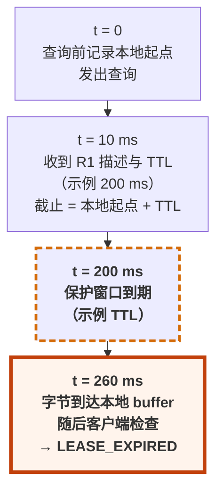

# KV 已经读回本地，这次 Get 为什么还会返回 LEASE_EXPIRED？

**摘要：**推理实例 B 从 R1 读回了字节，这次 Get 仍可能失败。定位、搬完、可接受，是三个不同时刻。

在 Mooncake 里，推理实例 B（下文简称实例 B）查询 key `K`，Master 返回 R1 的副本描述与一段读保护。

B 开始从 R1 搬运数据。传输很慢，跨过了 lease 的截止时间。字节最终全部到达本地 buffer。

这时候，这次 Get 算成功吗？

答案取决于一个容易被忽略的顺序：**数据搬完在前，结果检查在后。** 本篇只跟 B 的这一次慢读，把它拆成"已定位、已搬完、可接受"三个时刻，说明为什么读回字节不等于可以接受结果。后面的 `LOCAL_DISK` offload 分支是一个明确的例外。

## 一次慢读的时间线

读方拿到副本描述后，系统不能马上把对应空间用于其他对象，否则读方可能访问到已被复用的数据。

Lease 提供的正是这个有边界的读取窗口。它保护的不只是地址，还包括"在这段时间内，这份数据不会被正常删除或淘汰"。

Master 在返回可读副本列表时授予 lease，并在响应里带上 TTL。客户端不是直接使用 Master 的时间：它在发出查询 RPC 之前先取一次本地 `steady_clock` 起点，收到响应后用 `start_time + lease_ttl_ms` 算出截止时间。因此查询 RPC 本身的耗时也计入客户端的可用窗口；TTL 不是从响应到达才开始计时。

按相对时间展开这次慢读。假设 lease TTL 是 200ms——这个数值只用于示意，不是默认配置：

*配图1：一次跨过 lease 到期的读取时间线。*

*图注：橙色虚线框是 200 ms 到期点，最后一项是 260 ms 的完成点；字节到达在前，客户端检查在后。*

这里说的"事后检查"有明确范围。`v0.3.13.post1` 中，`RealClient::get_buffer_internal` 的 `LOCAL_DISK` 全量 offload 分支直接调用 `batch_get_into_offload_object_internal`，之后只做 checksum，不调用 `IsLeaseExpired`，因此不经过 `Client::Get` 的同一处事后检查。同一实现里的 `DISK` 副本仍走 `Client::Get`，会经过检查。所以例外属于那条 offload 路径，不能外推到所有磁盘读取。

这条路径采用"尽力读 + 事后否决"：先完成传输，再判断这次读取是否仍在承诺窗口内。

**分析：**好处是实现简单，不需要在传输前阻塞等待；代价是 lease 过期时已经浪费了一次带宽。对 KV Cache 这种"读失败可以重算"的场景，这个取舍是成立的。

## 已定位、已搬完、可接受

把一次 Get 压缩成四个阶段，会更容易定位问题出在哪：

1. **查询**：从 Master 拿到可读副本列表与 lease。
2. **选择**：客户端在列表里挑一个副本。
3. **搬运**：按副本介质和目标 buffer 选择传输方式。
4. **检查**：传输结果、可选校验、lease 全部通过，才接受结果；这是经 `Client::Get` 的路径，`LOCAL_DISK` offload 例外见上。

**Master 只过滤并返回可读副本列表，不替客户端选副本。** 选择发生在客户端：

- `Client::Get` 内部调用 `FindFirstCompleteReplica`，取列表中第一个 `COMPLETE` 副本；
- `RealClient` 的 ranged 路径在进入 `Client::Get` 之前，用 `SelectBestReplica` 先选一次，再把副本列表裁成只剩选中的那一个。

`SelectBestReplica` 会跳过非 `COMPLETE` 副本，优先级是：本地 MEMORY → 本地 NOF_SSD → 远端 MEMORY（可评分）→ 远端 NOF_SSD → LOCAL_DISK → DFS → DISK。

搬运方式则取决于介质和目标：

**MEMORY（目标 buffer 在主机且可直读）**：交给 Transfer Engine 读到目标 buffer。

**MEMORY（目标 buffer 在 GPU 等设备）**：主机暂存后再复制到目标。

**LOCAL_DISK**：存储节点执行 offload 读取。

**DISK / DFS**：临时 buffer 后再 scatter。

"直读目标 buffer"通常表示避免额外的应用层中转，**不是对所有后端、所有设备的零拷贝承诺**。TCP、RDMA、GPU 路径内部是否拷贝，要按实际后端判断。

## 字节到了 buffer，不等于 Get 接受

一次慢读结束后，有三个结果需要分开：

- **字节是否到了本地 buffer**：TransportRead 或磁盘读取已经返回，数据可能完整地落在 buffer 里。
- **Get 是否接受这次结果**：只有在传输成功、可选 checksum 通过、lease 未过期时，`Client::Get` 才把它当作可用结果。
- **R1 的空间是否已被回收**：这是 Master 侧的资源动作，不由这次 Get 的返回码直接决定。

lease 到期只代表**保护窗口结束**，不代表对象立刻被删除。有效期内的 lease 会阻止普通 `Remove` 与淘汰路径回收这份对象；删除侧遇到的 `OBJECT_HAS_LEASE` 就是这一保护的证据。

但实际回收还要经过淘汰、引用计数、后台任务等一系列判断。所以不要把两件事混为一谈：

- `LEASE_EXPIRED`：这次读取的结果不再受承诺保护，客户端应拒绝使用；
- 空间已回收：对象真的被删除或复用了。

前者是读方看到的错误，后者是资源侧的动作。中间隔着完整的回收判断。

## 错误分三段保留

把错误按阶段分开，上层才能决定是重试、换副本，还是重算。

**查询阶段**

- `OBJECT_NOT_FOUND`：对象不存在，或所有副本都已 `REMOVED`。应当放弃。
- `REPLICA_IS_NOT_READY`：对象存在，但暂时没有可用副本。值得短暂重试。

**选择阶段**

- `INVALID_REPLICA`：列表里没有选到 `COMPLETE` 副本。

**搬运与完成检查**

在 `Client::Get` 中，顺序是：先 `TransferRead`（或 `ReadDfsReplica`），再可选 checksum，最后检查 lease。传输失败直接返回后端错误；checksum 不符返回 `CHECKSUM_MISMATCH`；只有前两者都通过，才可能返回 `LEASE_EXPIRED`。

- `INVALID_PARAMS`：在按容量传入目标 buffer 的读取路径中，buffer 小于对象大小会返回该错误；系统不会截断读取，避免调用方误以为读全了。
- 传输错误：保留后端返回的具体错误，不要统一成"Get 失败"。
- `LEASE_EXPIRED`：字节可能已经读到，但结果不再受保护。按可重试错误处理，而不是数据损坏。
- `CHECKSUM_MISMATCH`：仅在启用 checksum 且期望值不符时出现。该校验默认关闭，不要写成默认路径。

错误分类越准确，越容易判断问题发生在查询、选择、搬运还是完成检查阶段。这次 Get 返回错误后，是否重试这次读取、换一个副本，还是让推理请求重算前缀，由调用方或推理框架决定；`Client::Get` 只把对应阶段的错误交回去。

## 总结

经 `Client::Get` 的读取，接受结果的条件是：传输成功、可选 checksum 通过、lease 未过期。字节到达本地 buffer 只是第一个条件；`LEASE_EXPIRED` 表示这次结果不再受读保护，不等于数据损坏，也不等于 R1 空间已经回收。

`LOCAL_DISK` 全量 offload 分支是明确例外：它走 `batch_get_into_offload_object_internal`，之后只做 checksum，不经过同一处 lease 检查。因此，这条结论不能外推到所有磁盘读取。

**源码延伸：**`Client::Get`、`Client::Query`、`QueryResult::IsLeaseExpired`、`SelectBestReplica`、`GetReplicaList`、`RealClient::get_buffer_internal`。

- [Client::Get](https://github.com/kvcache-ai/Mooncake/blob/719735896c86b56fabec6cf3e825fb2ea640597a/mooncake-store/src/client_service.cpp#L1352) · [IsLeaseExpired](https://github.com/kvcache-ai/Mooncake/blob/719735896c86b56fabec6cf3e825fb2ea640597a/mooncake-store/include/client_service.h#L60)
- [Client::Query（lease 起点）](https://github.com/kvcache-ai/Mooncake/blob/719735896c86b56fabec6cf3e825fb2ea640597a/mooncake-store/src/client_service.cpp#L1211)
- [SelectBestReplica](https://github.com/kvcache-ai/Mooncake/blob/719735896c86b56fabec6cf3e825fb2ea640597a/mooncake-store/include/replica_selection.h#L123)
- [GetReplicaList](https://github.com/kvcache-ai/Mooncake/blob/719735896c86b56fabec6cf3e825fb2ea640597a/mooncake-store/src/master_service.cpp#L3626) · [RealClient::get_buffer_internal（LOCAL_DISK 分支）](https://github.com/kvcache-ai/Mooncake/blob/719735896c86b56fabec6cf3e825fb2ea640597a/mooncake-store/src/real_client.cpp#L2815)

[系列目录与排版说明](README.md)

[上一篇](03-put-visibility.md) · [下一篇](05-source-reading.md)
