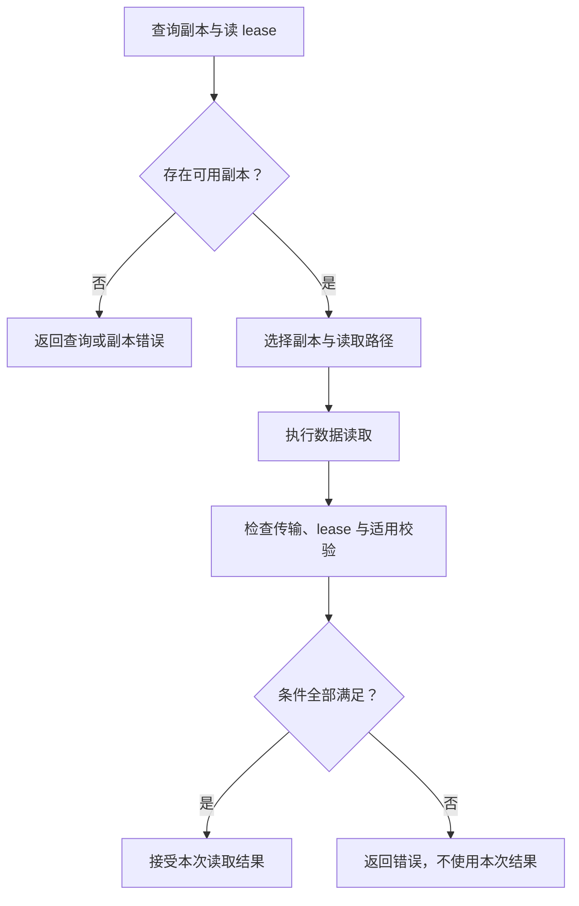
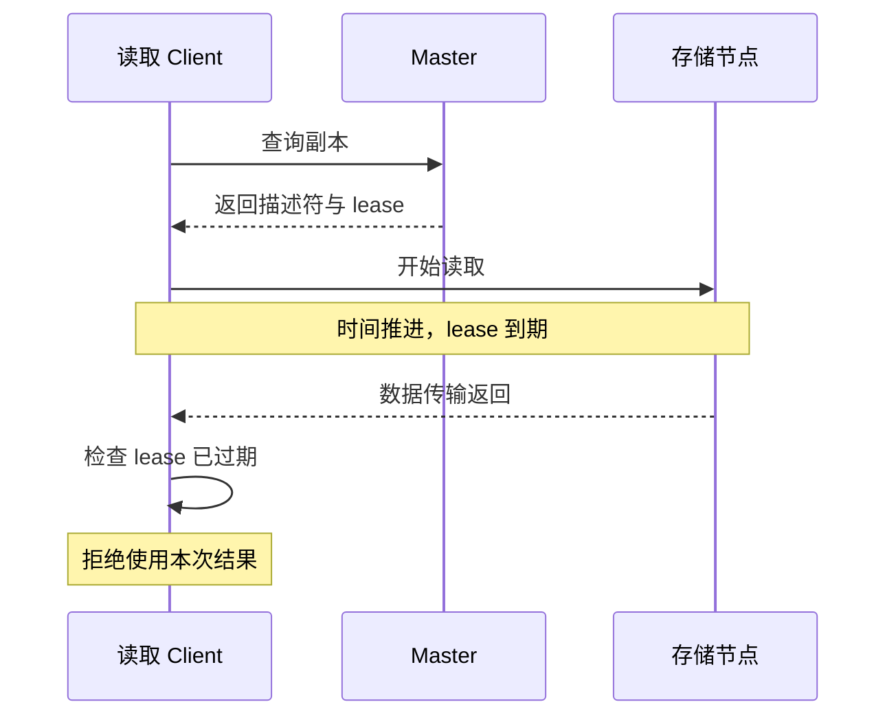

# 第4篇｜读回了字节，不代表 Get 成功：理解 Mooncake 的读取保护

**摘要：**Get 不只是找到地址并读内存。副本选择、传输结果和 lease 检查，共同决定一次读取能否被接受。

远端地址已经拿到了，网络传输也结束了，Get 就一定成功了吗？

在分布式缓存中，答案仍然取决于数据在读取期间受到了什么保护。

地址只是访问入口，并不是永久有效的承诺。

## 先找副本，再决定怎样读

一次 Get 首先查询对象元数据，获得副本信息与相应读保护。

接下来，Client 选择可读副本。选择会考虑状态、本地性及相关评分，而不是随便挑一个地址。

搬运方式还取决于介质和目标 buffer。

内存副本可以通过 Transfer Engine 读取；某些设备目标需要经过主机暂存；磁盘副本则有对应的存储读取路径。

*配图1：Get 的逻辑流程。*

这里的“直接读到目标 buffer”，通常表示避免额外的应用层中转。它不自动证明 TCP、RDMA、GPU 等所有路径内部都没有拷贝。

## Lease 保护的是一段时间

读方获得副本描述后，系统不能马上把对应空间用于其他对象，否则读方可能访问到已被复用的数据。

Lease 提供的是一个有边界的读取窗口。

在普通保护路径下，有效 lease 会阻止相应删除或淘汰。但节点故障、强制操作等场景需要单独讨论，不能把它扩大为无条件保证。

尤其要注意：**lease 到期与空间立即回收，是两件不同的事。**

到期意味着原来的时间承诺结束了，后续是否回收还要经过相应判断。

## 为什么读完还要再检查？

设想一次传输非常慢，开始时 lease 有效，结束时已经过期。

虽然字节读回来了，客户端却不能继续假设整次读取都处于承诺窗口内。

因此，完成判断需要包含 lease 检查。对这种情况，系统可以拒绝本次读取结果，而不是把它当成普通成功。

*配图2：跨过到期时间的读取。*

## 错误应当保留区别

对象不存在、副本未就绪、目标 buffer 太小、传输失败、lease 过期，含义并不相同。

上层可以决定重试或重算，但不能仅凭“缓存失败可以重算”就抹平所有错误。

错误分类越准确，越容易判断问题发生在查询、选择、传输还是完成检查阶段。

下一篇回到源码入口，看看怎样用这套思路追一条读写链路。

**源码延伸：**原系列篇3；`SelectBestReplica`、`execute_ranged_read`、lease 与 checksum 检查。版本基线为 `v0.3.13.post1`。

[源码解析版](../03-get-path.md) · [系列目录与排版说明](README.md)

[上一篇](03-put-visibility.md) · [下一篇](05-source-reading.md)
