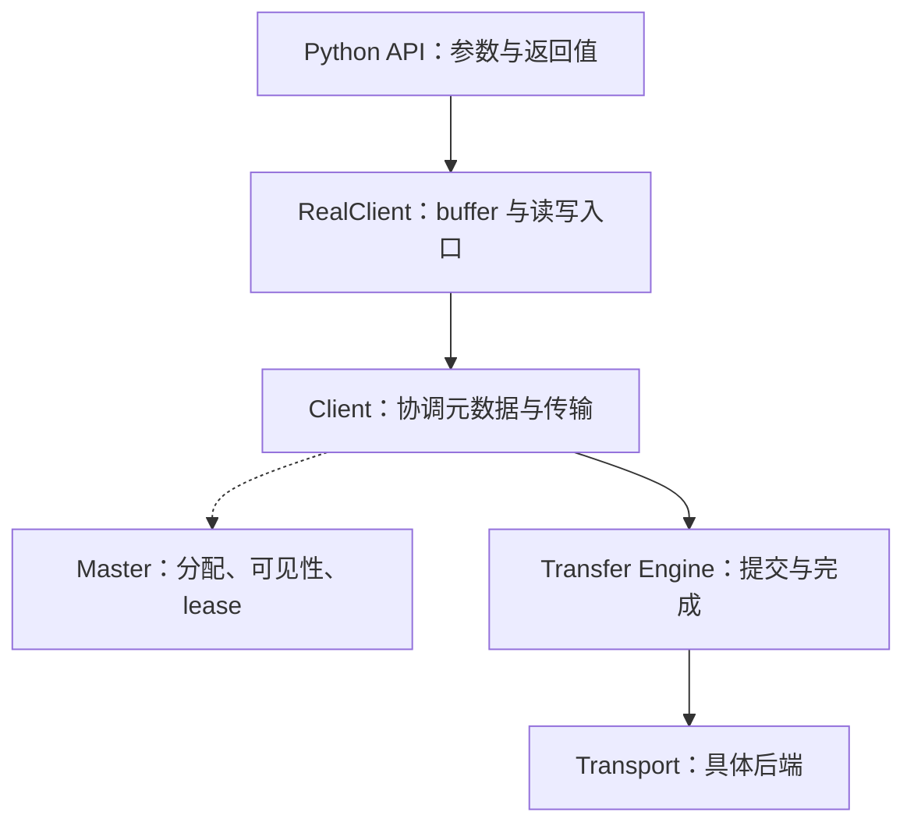

# 第5篇｜读 Mooncake 源码，从哪里开始才不容易迷路？

**摘要：**沿着一次请求读代码，通常比从目录第一页开始读更有效。关键是找到入口、控制决策和完成条件。

打开一个大型基础设施仓库，最大的困难往往不是某段代码看不懂，而是不知道应该先看哪一段。

Mooncake 同时包含存储、传输、Python 绑定和多种硬件后端。顺着目录逐个读，很容易在建立整体认识前，就陷入实现细节。

更有效的方法，是先选一个明确问题。

例如：

> 调用方写入一个对象后，另一个 Client 为什么能够读到它？

## 先找到应用看得见的入口

Python 用户可以从绑定层开始。

这里主要观察参数如何转换、调用哪个 C++ 接口、错误如何返回，以及等待传输时是否释放 GIL。

接着进入 RealClient，关注 buffer、读取范围、slice 等面向接口的组织方式。

再往下看 Client，识别元数据交互与数据传输分别在哪里发生。

*配图1：推荐的阅读层次。*

*图注：这是逻辑阅读层次，不表示每个接口都严格经过全部节点。*

## 追调用链时，只记录三个问题

第一个问题是：谁作决定？

例如空间分配、可读状态和读保护，属于元数据与控制逻辑。

第二个问题是：谁搬数据？

找到 Transfer Engine 入口后，再根据需要进入 TCP、RDMA 等后端。

第三个问题是：调用方凭什么返回成功？

这一步最容易被忽略。很多人追到提交函数就停了，但真正的语义藏在等待、检查和错误处理里。

**入口告诉你做什么，完成条件告诉你做成了什么。**

## 不要把接口名字当成全部语义

`Put`、`Get`、`submitTransfer` 都是容易理解的名字，但名字不会自动说明：

- 是否覆盖已有内容。
- 是否等待全部副本。
- 返回时数据是否可见。
- 失败后是否仍有工作在执行。
- 调用方能否马上释放 buffer。

这些问题需要从分支、状态和资源生命周期中找答案。

阅读时可以建立一张简短笔记：输入是什么，改变什么状态，成功条件是什么，失败由谁清理。

## 测试用于验证理解

源码看完后，再去找对应测试。

有价值的验证，不只是“正常 Put/Get 能通过”，还包括未完成副本、过期 lease、部分提交失败和重复操作。

列出测试文件并不等于已经证明结论。应该进一步找到具体用例，确认它覆盖的配置与断言。

还要固定版本。当前 main 能编译通过，不能证明历史 tag 的行为完全相同。

下一篇进入传输层。我们会看到，提交一个任务与真正完成它，中间还隔着一整套生命周期。

**源码延伸：**原系列篇1；`mooncake-integration`、`real_client`、`client_service`、Transfer Engine 接口。版本基线为 `v0.3.13.post1`。

[源码解析版](../01-source-navigation.md) · [系列目录与排版说明](README.md)

[上一篇](04-get-and-lease.md) · [下一篇](06-transfer-lifecycle.md)
