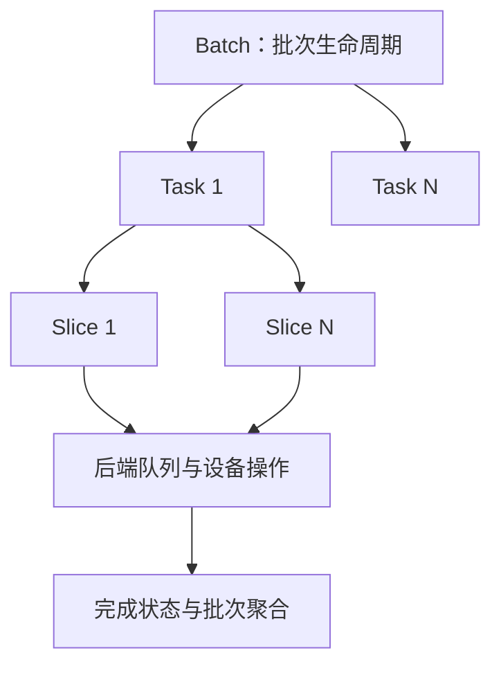
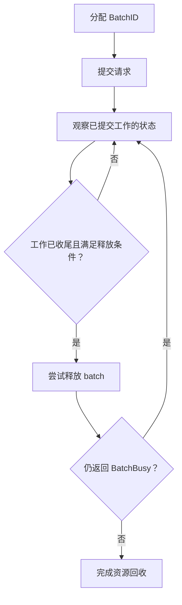

# 第6篇｜Transfer Engine 返回成功，数据就传完了吗？

**摘要：**分配、提交、观察完成、释放，是四个不同动作。部分提交失败尤其考验调用方的资源管理。

调用一次传输接口，收到成功返回，随后释放源 buffer。

这段逻辑看起来很自然，但如果接口采用异步执行，它就可能过早释放仍被后端使用的数据。

理解 Transfer Engine，首先要区分两种成功：

**请求被接受，与传输已经完成。**

## Batch、Task、Slice 是不同层次

调用方通常以 batch 管理一组工作。

内部可能包含多个 task，而一个 task 又可能拆成多个 slice。具体后端负责把这些片段交给网络或设备执行。

这种分层让接口能够批量组织请求，也让后端有机会根据地址、长度和路径进行调度。

但它同时意味着：单个片段完成，不代表整个请求结束；某个请求失败，也不代表批次内所有工作已经停止。

*配图1：传输任务层级。*

## 提交成功，只能说明提交阶段成功

后端接受请求后，工作可能仍在队列里。

不能统一断言此时所有 WR 都已下发，更不能认为远端数据已经完成更新。

调用方需要通过相应状态接口观察完成，并处理失败、超时与部分结果。

不同后端推进完成的方式也不同。RDMA 可以由后台 worker 轮询 CQ；某些异步设备路径则需要状态查询参与检查。

因此，“必须轮询”要说清楚是谁在轮询、轮询什么，而不是把所有后端都归为同一种行为。

## 部分提交失败，不能直接丢弃批次

假设一组请求涉及多个后端。

前一个后端已经接受工作，后一个后端提交失败。接口返回错误，并不意味着先前接受的工作已自动撤销。

此时调用方仍需要让已提交的工作收尾，保持相关请求描述和数据 buffer 的有效性。

**错误已被报告，与设备已经停止访问，是两个状态。**

*配图2：安全收尾的逻辑流程。*

*图注：这是生命周期示意，具体接口与终态判定须按对应版本和后端核实。*

## 要分别管理三种生命周期

请求描述的生命周期、数据 buffer 的生命周期、batch 资源的生命周期，不一定完全相同。

读代码时，应追踪后端是否持有引用或指针，以及最后一次可能访问发生在什么时候。

这也是为什么传输层问题经常表现为偶现错误：正常情况下工作结束得快，错误路径或压力场景却会暴露过早释放。

下一篇继续向下，看看 RDMA 如何把这些传输片段变成 WR，并从 CQE 中获得完成结果。

**源码延伸：**原系列篇5；`allocateBatchID`、`submitTransfer`、状态查询与 `freeBatchID`。版本基线为 `v0.3.13.post1`。

[源码解析版](../05-transfer-engine-task-lifecycle.md) · [系列目录与排版说明](README.md)

[上一篇](05-source-reading.md) · [下一篇](07-rdma-data-path.md)
