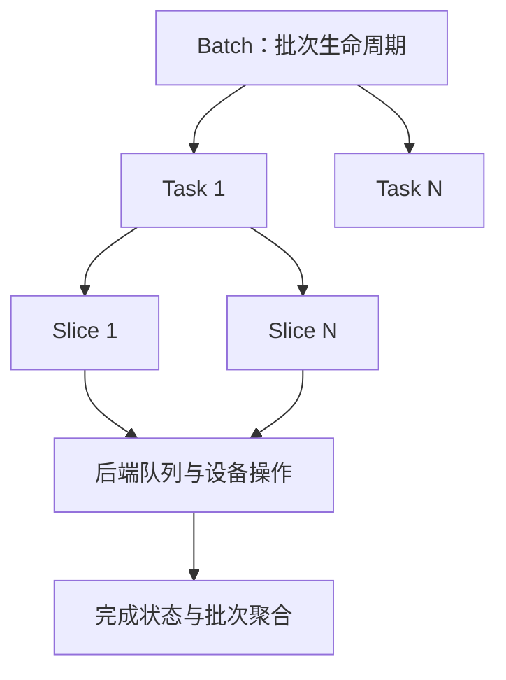

# Transfer Engine 返回成功，数据就传完了吗？

**摘要：**一个 batch 跨两个后端提交，第一个后端已接收，第二个提交失败。哪些工作还在进行？调用方最早什么时候能释放资源？

在 Mooncake 里，调用一次 Transfer Engine 的传输接口，收到成功返回，随后释放源 buffer。

这段逻辑看起来很自然，但如果接口采用异步执行，它就可能过早释放仍被后端使用的数据。

理解 Transfer Engine，首先要区分两种成功：

**请求被接受，与传输已经完成。**

## 一个 batch 里有三种层次

调用方通常以 batch 管理一组工作。

内部可能包含多个 task，而一个 task 又可能拆成多个 slice。具体后端负责把这些片段交给网络或设备执行。

*配图1：传输任务层级。*

*图注：层级只表示组织关系；不同后端对 slice 的拆分与完成聚合方式可能不同。*

这种分层让接口能够批量组织请求，也让后端有机会根据地址、长度和路径进行调度。但它同时意味着：单个片段完成，不代表整个请求结束；某个请求失败，也不代表批次内所有工作已经停止。

## 一个跨两个后端的 batch

假设一个 batch 有 3 个请求，提交时按 transport 分成两组：前两个请求进入后端 A，第三个请求进入后端 B。

`MultiTransport::submitTransfer` 先按请求建立 task，再按 transport 分组提交。后端 A 接受了前两个请求的工作；后端 B 在提交第三个请求时返回错误。

这里有两个时间点不能合并：

- **后端 A 接受工作**：task 已经进入后端队列或设备路径，但不代表数据传输完成。
- **后端 B 返回错误**：这是提交阶段的错误，不代表后端 A 已经接受的工作被撤销。

`submitTransfer` 不会因为后端 B 失败就停止处理其他分组，也不会回头取消后端 A 已接收的 task。它继续尝试剩余分组，最后返回一个非 OK 状态。

## 错误什么时候返回，调用方还能看到什么

错误是在遍历完各 transport 分组后聚合返回的，不是在第一个后端失败的那一刻立刻返回。因此，调用方收到错误时，其他分组可能已经被提交。

调用方能观察到的状态有粒度限制：

- `getTransferStatus(batch_id, task_id)` 按 task 返回 `WAITING`、`COMPLETED`、`FAILED`、`TIMEOUT` 和 `transferred_bytes`；
- `getBatchTransferStatus` 把多个 task 聚合成 `WAITING`、`COMPLETED`、`FAILED`。

这些不是每个 WR 的中间状态。调用方可以看到 task 级别是否到达终态，但不能据此推断某个具体设备操作何时停止。

## 最早什么时候可以释放

释放条件比"接口返回错误"更严格：`freeBatchID` 遍历 batch 的 task，只有所有 task 的 `is_finished` 都为真，才删除 `BatchDesc` 并返回 `Status::OK`；否则返回 `Status::BatchBusy`，消息是 `BatchID cannot be freed until all tasks are done`。

`BatchBusy` 只表示"还有工作没结束"，不是另一种完成状态。

把收尾阶段和返回结果分开看：

1. `allocateBatchID` 分配 batch；
2. `submitTransfer` 提交，可能跨多个后端；
3. 查询 task 状态，确认是否都已到达终态；
4. 尝试 `freeBatchID`。

`freeBatchID` 的三种结果：

- `Status::OK`：所有 task 已结束，`BatchDesc` 已释放。
- `Status::BatchBusy`：仍有 task 未结束，batch 仍存在；继续管理，不能释放请求描述与 buffer。
- 其他错误：释放未完成，batch 仍存在；不能把它当成已回收。

因此，最早的安全释放点是：所有已提交 task 都到达终态，且 `freeBatchID` 返回 `OK`。如果返回 `BatchBusy` 或其他错误，batch 仍然存在，调用方还要继续管理它。

## 三种生命周期落到这条路径

请求描述、数据 buffer、batch 资源的生命周期，不一定完全相同。仍以这个跨后端的 batch 为例：

- **请求描述**：task 里的 `request` 指向调用方传入的 `TransferRequest` 向量元素（`task.request = &entries[i]`），不是深拷贝。`getTransferStatus` 仍会通过该指针读取请求长度，所以调用方必须让该向量在原位保持有效，直到 batch 被释放。后端 B 提交失败，不会让这个要求消失。
- **数据 buffer**：`Slice` 保存本地地址、长度和远端地址；本地 buffer 必须保持注册且不被释放，直到传输完成。后端 A 已接收的工作可能仍会访问它，不能因为整体返回错误就提前释放。
- **BatchID**：类型是 `uint64_t`；`MultiTransport` 把新建的 `BatchDesc*` 转成这个整数返回，`freeBatchID` 再转回指针。调用方只能把它当不透明句柄。只有 `freeBatchID` 返回 `OK` 才删除 `BatchDesc`；返回 `BatchBusy` 或其他错误时，batch 仍然存在。

这三个对象不一定同时释放。释放 batch 只处理 batch 资源；数据 buffer 是否还能被后端访问，要单独判断。数据到达也不代表请求描述可以立刻废弃。

## 错误已报告，设备可能仍在访问

接口返回错误，说明调用方已经知道"这次提交没有全部成功"。它不说明后端 A 已经停止访问请求描述或数据 buffer。

读代码时，应追踪后端是否持有引用或指针，以及最后一次可能访问发生在什么时候。这也是为什么传输层问题经常表现为偶现错误：正常情况下工作结束得快，错误路径或压力场景却会暴露过早释放。

## 总结

`submitTransfer` 返回成功，只表示请求已被接受；某个 transport 失败后返回错误，也不表示其他已接收的 task 已经停止。调用方最早的安全释放点是：所有已提交 task 都到达终态，且 `freeBatchID` 返回 `Status::OK`。

`BatchBusy` 或其他错误都表示 batch 仍存在；此时请求描述、数据 buffer 和 BatchID 还要继续管理。错误已报告，设备可能仍在访问，这正是过早释放会变成偶现问题的原因。

**源码延伸：**`allocateBatchID`、`submitTransfer`、状态查询与 `freeBatchID`。版本基线为 `v0.3.13.post1`。

- [TransferEngine::freeBatchID](https://github.com/kvcache-ai/Mooncake/blob/719735896c86b56fabec6cf3e825fb2ea640597a/mooncake-transfer-engine/include/transfer_engine.h#L213) · [Status::BatchBusy](https://github.com/kvcache-ai/Mooncake/blob/719735896c86b56fabec6cf3e825fb2ea640597a/mooncake-transfer-engine/include/common/base/status.h#L175) · [BatchID 类型](https://github.com/kvcache-ai/Mooncake/blob/719735896c86b56fabec6cf3e825fb2ea640597a/mooncake-transfer-engine/include/transport/transport.h#L53)
- [MultiTransport::submitTransfer](https://github.com/kvcache-ai/Mooncake/blob/719735896c86b56fabec6cf3e825fb2ea640597a/mooncake-transfer-engine/src/multi_transport.cpp#L130) · [MultiTransport::freeBatchID](https://github.com/kvcache-ai/Mooncake/blob/719735896c86b56fabec6cf3e825fb2ea640597a/mooncake-transfer-engine/src/multi_transport.cpp#L108)
- [MultiTransport::getBatchTransferStatus](https://github.com/kvcache-ai/Mooncake/blob/719735896c86b56fabec6cf3e825fb2ea640597a/mooncake-transfer-engine/src/multi_transport.cpp#L363)

[系列目录与排版说明](README.md)

[上一篇](05-source-reading.md) · [下一篇](07-rdma-data-path.md)
