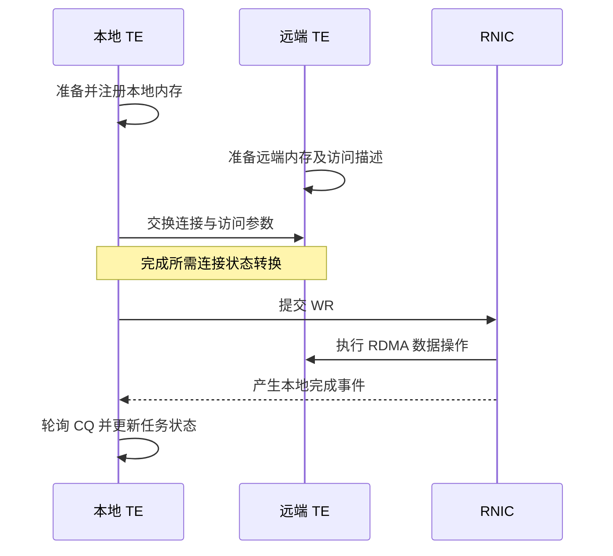

# 第7篇｜一次 RDMA 传输，究竟经历了什么？

**摘要：**从内存注册到完成队列，串起 RDMA 数据路径，并区分连接建立、请求提交和传输完成。

RDMA 常被概括成“网卡直接访问远端内存”。

这句话描述了数据路径，却省略了大量前提：访问哪块内存，凭什么允许访问，用哪条连接，以及怎样知道操作完成。

在真正搬运字节之前，系统必须先把这些条件准备好。

## 地址可见，不代表网卡可以访问

普通指针只对进程的软件逻辑有意义。

RDMA 还需要内存注册等准备工作，让网卡能够按规定访问相应范围。访问描述中会涉及地址、长度以及本地或远端访问凭据。

因此，遇到地址相关错误时，不能只检查“指针是不是非空”，还要看这段范围是否已注册、使用了哪张网卡，以及描述是否仍然有效。

## 先建立连接，再复用连接

远端信息需要通过配置的元数据与握手机制交换。

QP 也需要完成相应状态转换，才能执行后续数据操作。

这些准备通常可以复用。不能把每个数据请求都理解成重新注册内存、重新建立全部连接。

*配图1：准备阶段与数据阶段。*

*图注：握手与元数据交换方式依配置而异，图中省略了独立 metadata server。*

## WR 下发与 CQE 回收

WR 描述希望网卡执行的工作。

请求提交后，系统通过 CQ 中的完成事件了解结果，再把结果映射回对应 slice 和 task。

这就形成一条流水线：

待发送片段 → 路径与连接检查 → WR 提交 → 网卡执行 → CQE 回收 → 上层状态更新。

如果不把这些阶段分开，很容易把“尚未提交”“已经提交但未完成”“完成事件未被处理”都看成同一种卡住。

## 资源不够，不一定是故障

QP 或 CQ 相关额度不足时，后端可能暂缓提交，让片段留在队列等待。

这是背压，与连接失效或数据操作错误不同。

前者需要等待资源，后者可能需要更换路径、重建连接或报告失败。错误分类直接影响重试方式。

还要注意：RDMA 的完成结果属于传输层。它不能替代 Store 的对象提交。

Put 的数据传输结束后，仍需要由上层完成相应可见性操作。

## “零拷贝”也有范围

RDMA 可以减少传统网络栈中的部分 CPU 搬运，但应用是否存在 staging、GPU 与主机之间是否复制，取决于整条路径。

介绍性能时，最好说明省掉的是哪一次拷贝，而不是把“用了 RDMA”当成全路径没有拷贝的证明。

下一篇讨论另一组影响传输效率的条件：多网卡与 NUMA 拓扑。

**源码延伸：**原系列篇6；RDMA transport、endpoint、worker pool、WR/CQE 处理。版本基线为 `v0.3.13.post1`。

[源码解析版](../06-rdma-data-path.md) · [系列目录与排版说明](README.md)

[上一篇](06-transfer-lifecycle.md) · [下一篇](08-multi-nic-numa.md)
