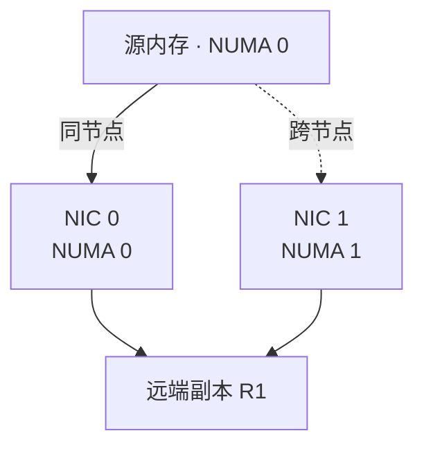

# 双网卡跑 Mooncake，RDMA 流量到底走了哪张卡？

**摘要：** 源缓冲区位于 NUMA 0，拓扑上 NIC 0 离它更近。Mooncake 选卡时还要检查内存注册和远端连接条件。本文沿源码追踪一次写入，并给出一组尚未实测的 CPU 主机对照实验。

推理实例 A 准备把 **4 MiB 对象 `K`** 写入远端 R1。发送进程绑定在本地 NUMA 0 的 CPU 上，源缓冲区也在 NUMA 0。NIC 0 与源内存同节点，NIC 1 挂在 NUMA 1。假设两张卡的网络都能到达远端。

实际由哪张卡提交 WR？先看拓扑和内存注册，再看谁能完成连接并发送。

## 场景：源缓冲区只在 NUMA 0

拓扑上，NUMA 0 的内存离 NIC 0 更近；NIC 1 读取这段源内存时需要跨 NUMA 节点。

*配图1：源缓冲区与两张网卡的 NUMA 位置。*

*图注：两张网卡是示意拓扑中的候选。实际 WR 由哪张卡提交，还要结合设备选择记录与端口计数确认。*

## 先选 transport，再选 HCA

路径选择可以分两层理解。

第一层是 `MultiTransport::selectTransport`，通常按目标段描述的协议选择 transport。启用多协议支持且目标段公开多个协议时，还会结合目标地址和设备 IPC 的同机条件选路。

第二层在 RDMA 内部，再选具体 HCA 或 rail。对本地发送端，`RdmaTransport` 会按源缓冲区的地址和长度，在本地段描述的拓扑里调用 `selectDevice`；对远端，worker 通过目标段描述选择 HCA、检查对应 `rkey` 的索引，并在选中的 rail 暂停使用时尝试其他候选。

RDMA 内部调整 rail 时，请求仍由 RDMA 后端处理。要确认部署是否提供 TCP 路径，需要查看所启用的 transport 和该请求的目标段描述。

## 更近的 NIC，不一定在可选集合里

本地 `selectDevice` 先按源缓冲区的地址范围找到覆盖它的注册缓冲区，再在本地拓扑的 preferred/avail HCA 列表里选择。拓扑发现会按 NUMA 节点和 PCI 距离计算每个位置的偏好，所以 NUMA 0 的源缓冲区通常会把 NIC 0 放进 preferred 集合。

但“更近”只说明它更可能在候选集合里，不能推出它一定被选中，也不能推出只有它可选：

- preferred 集合可能有多个 HCA，首次选择在 preferred 内随机或轮询，不是每次严格取距离最近的一张；
- 如果某张 HCA 没有覆盖源地址的注册缓冲区，或它的 context 不 active，它不会被选中；
- 远端还要有与设备索引对应的 `rkey` 和可用 rail。选不出来时，worker 可以重新取段描述再试一次，仍找不到匹配时会将 slice 记为失败。

因此，看到拓扑图上 NIC 0 更近，只能说明它更可能在候选集合里。它不能单独证明这次传输实际走了 NIC 0。

## 运行时故障会改变可选集合

启动时，`Topology::discover` 筛掉打不开或没有活动端口的 HCA。`resolve` 建立设备索引，拓扑随段描述发布。

运行时，把两类故障分开判断。若 worker 判定本地 RNIC 故障，它会在有可用候选时尝试把 slice 交给另一张本地卡。若走远端或默认错误处理，则保留本地 context，再查远端段描述并重选路径。遇到故障先查本地还是远端路径，以及当时还有哪些候选。

在已发布拓扑刷新成功后，失效的 context 会从对端可选集合移除。设备列表的槽位保留，已有的 lkey/rkey 数组仍能按原设备索引查找。

## 用 CPU 主机内存做一组可控实验

下面是一个实验设计，不依赖 GPU，也不需要推理框架。本文尚未实测，因此不给测量结果。

最小对照只改变一个变量：允许使用的本地 HCA。其余条件固定：

- 一台双 NUMA 主机，发送进程绑定 NUMA 0 的 CPU，源缓冲区分配在 NUMA 0；
- NIC 0 在 NUMA 0，NIC 1 在 NUMA 1；
- 远端 R1 所在 Store Segment、传输方向（A 写入 R1）、4 MiB 大小、并发度和连接参数保持一致；
- 每次传输前后读取本地两个端口的计数增量，并记录实际选中的本地 HCA（如果有设备选择记录）。

开始比较前，先确认源内存的实际落点。不要只凭分配代码的意图；用分配器记录或系统提供的 NUMA 落点信息确认这段源区间确实在 NUMA 0，再开始比较。

四组实验：

1. 两张网卡都允许，源缓冲区在 NUMA 0；
2. 只允许 NIC 0，源缓冲区仍在 NUMA 0；
3. 只允许 NIC 1，源缓冲区仍在 NUMA 0；
4. 源缓冲区改到 NUMA 1，再重复第 1 组。

这些观察分别支持什么：

- 设备选择记录显示 NIC 0，且只有 NIC 0 的端口计数增加：支持这次传输走了 NIC 0；
- 限制到 NIC 1 后传输直接失败：先查该 HCA 是否有覆盖源地址的注册缓冲区、context 是否 active，而不是直接归因于跨 NUMA 慢；
- 只看到“NIC 0 拓扑更近”，但端口计数没有变化：不能证明流量经过 NIC 0；
- 限制到 NIC 1 后吞吐下降，只能说明这组参数下 NIC 1 的路径更慢；不能直接外推到其他传输大小或并发度。

本地发送端看发送字节或包计数，远端看对应接收计数。先确认驱动的计数单位，并留一段空闲基线，区分其他流量。

如果两个端口在同一窗口内都有增量，把并发降到一次传输，再核对请求与 slice 的设备选择记录和重试日志。同一个 task 也可能在片段级换卡。

如果连端口计数都拿不到，这组实验只能作为设计，不能替代实际测量。只有选卡证据时，结论限定在选卡行为；吞吐和延迟差异需要相应的测量数据。

## 总结

先从拓扑看哪张卡更近，再核对源地址注册、本地 context 与远端 rkey/rail，确认哪些路径可用。实际由哪张卡提交 WR，要靠设备选择记录和端口计数增量确认。

最小对照只改“允许使用的本地 HCA”，其余条件固定；确认源内存落点后，再用发送/接收计数交叉验证。本文尚未实测，没有给出吞吐或延迟结论；只有选卡证据时，结论也只限于这次选卡行为。

**源码延伸**　版本基线为 `v0.3.13.post1`。

- [MultiTransport::selectTransport](https://github.com/kvcache-ai/Mooncake/blob/719735896c86b56fabec6cf3e825fb2ea640597a/mooncake-transfer-engine/src/multi_transport.cpp#L581) · [Topology::discover](https://github.com/kvcache-ai/Mooncake/blob/719735896c86b56fabec6cf3e825fb2ea640597a/mooncake-transfer-engine/src/topology.cpp#L625) · [Topology::resolve](https://github.com/kvcache-ai/Mooncake/blob/719735896c86b56fabec6cf3e825fb2ea640597a/mooncake-transfer-engine/src/topology.cpp#L794)
- [Topology::selectDevice](https://github.com/kvcache-ai/Mooncake/blob/719735896c86b56fabec6cf3e825fb2ea640597a/mooncake-transfer-engine/src/topology.cpp#L761) · [RdmaTransport::selectDevice](https://github.com/kvcache-ai/Mooncake/blob/719735896c86b56fabec6cf3e825fb2ea640597a/mooncake-transfer-engine/src/transport/rdma_transport/rdma_transport.cpp#L1155)
- [WorkerPool::selectPeerDevice](https://github.com/kvcache-ai/Mooncake/blob/719735896c86b56fabec6cf3e825fb2ea640597a/mooncake-transfer-engine/src/transport/rdma_transport/worker_pool.cpp#L52)

- [重新取远端段描述](https://github.com/kvcache-ai/Mooncake/blob/719735896c86b56fabec6cf3e825fb2ea640597a/mooncake-transfer-engine/src/transport/rdma_transport/worker_pool.cpp#L196) · [运行时重新分派](https://github.com/kvcache-ai/Mooncake/blob/719735896c86b56fabec6cf3e825fb2ea640597a/mooncake-transfer-engine/src/transport/rdma_transport/worker_pool.cpp#L759) · [发布拓扑更新](https://github.com/kvcache-ai/Mooncake/blob/719735896c86b56fabec6cf3e825fb2ea640597a/mooncake-transfer-engine/src/transport/rdma_transport/worker_pool.cpp#L1197)

[系列目录与排版说明](README.md)

[上一篇](07-rdma-data-path.md) · [下一篇](09-cache-eviction.md)
