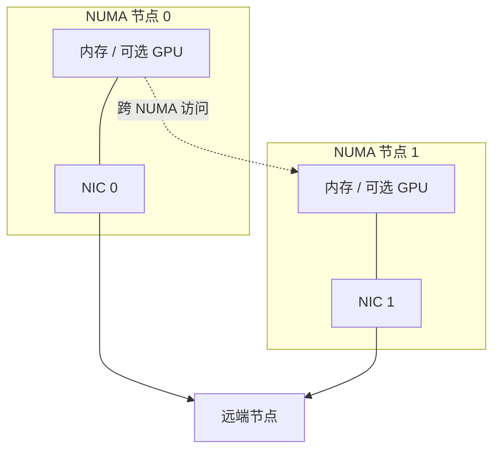
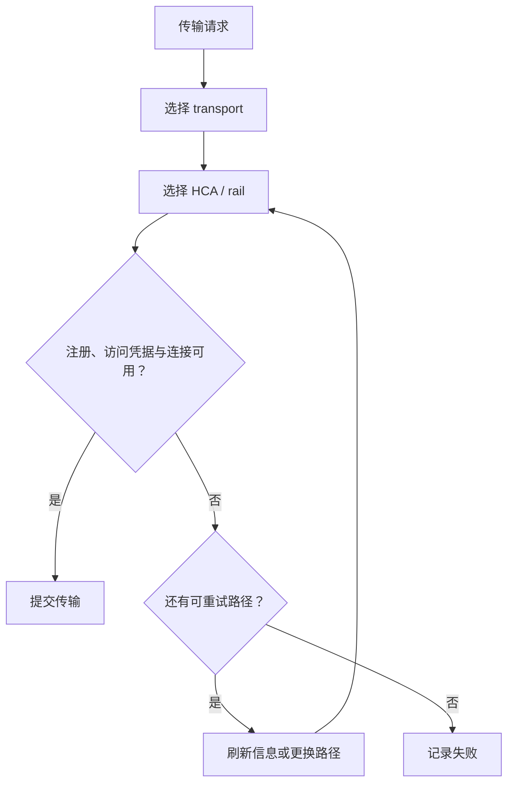

# 第8篇｜网卡越多就越快？Mooncake 如何面对 NUMA 和多网卡

**摘要：**带宽不仅取决于有多少张网卡，还取决于内存在哪里、哪张网卡可以访问，以及故障后是否有可替代路径。

两台服务器配置相同数量的高速网卡，跑出的吞吐却可能不同。

原因不一定在网络本身。

数据从哪块内存出发，经过哪条 PCIe 路径，是否跨 NUMA 节点，都会影响实际传输。

多网卡带来的首先是更多选择，而不是自动获得线性增长。

## 亲和关系决定优先路径

服务器内部并不是一个访问成本完全相同的平面。

某块内存、某个 GPU 与某张 NIC，可能具有更好的拓扑亲和关系。相反，跨 NUMA 的访问可能引入额外成本。

Mooncake 的路径选择需要利用发现的拓扑信息，但拓扑只是决策条件之一，还要结合地址注册与设备可用性。

*配图1：NUMA 亲和关系示意。*

*图注：连线表示概念上的亲和与访问关系，不代表具体机器的 PCIe 布线。*

## 先选传输后端，再选具体路径

路径选择可以分两层理解。

第一层判断适合使用哪种 transport，考虑协议、设备类型与同机条件等因素。

第二层在选定后端内部，选择具体 HCA 或 rail。

这两层不能混为一谈。RDMA 内部换一条 rail，并不等于系统已经切换成 TCP。

同样，也不能假设任何 RDMA 故障都有自动 TCP 兜底。

*配图2：两层路由。*

## 运行时故障，不能只靠启动时发现

启动时可用的 NIC，运行中也可能失效。

系统需要根据错误更新可用状态，并在适当条件下刷新对外发布的拓扑，让后续选择避开坏路径。

这里存在一个实现细节：设备索引可能关联多组注册信息和上下文。

移除不可用设备时，如果直接压缩数组，原来的索引就可能指向另一张网卡。因此，可用集合的变化与索引稳定性需要分别处理。

## 调优先观察路径，再调整参数

吞吐不足时，可以先确认：

- 实际选择了哪张 NIC。
- 数据位于哪个 NUMA 节点。
- 是否发生主机或设备暂存。
- 是否频繁重试、刷新描述或更换 rail。

这些证据比直接提高并行度更有帮助。

拓扑图能够解释可能的成本，却不能单独证明损失了多少带宽。量化结论仍需要相同负载下的测量。

下一篇把视角从网络移回缓存：空间快满时，系统到底允许回收什么？

**源码延伸：**原系列篇7；Topology、MultiTransport、HCA 与 rail 选择。版本基线为 `v0.3.13.post1`。

[源码解析版](../07-multi-nic-numa.md) · [系列目录与排版说明](README.md)

[上一篇](07-rdma-data-path.md) · [下一篇](09-cache-eviction.md)
