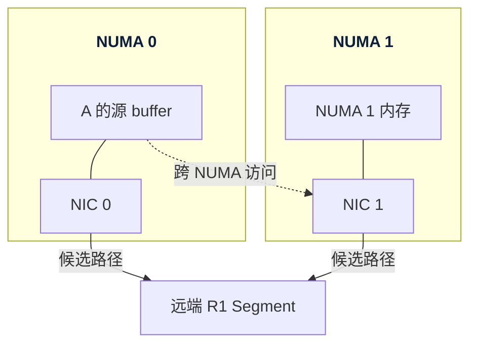

# 双网卡跑 Mooncake，RDMA 流量到底走了哪张卡？

**摘要：**拓扑上更近、当下可选、实际使用，是三个不同答案。用一台双 NUMA、双网卡主机跟一次传输，并用只改本地 HCA 的最小对照验证选路。

一台服务器上有两个 NUMA 节点，每个节点各挂一张 RDMA 网卡。推理实例 A（下文简称实例 A）的发送进程绑定在 NUMA 0 的 CPU 上，源 buffer 也分配在 NUMA 0；两张网卡都能连到远端同一个 R1 Segment。

A 发起一次主机内存到 R1 的传输。哪张网卡在拓扑上更近？哪张在注册和连接条件下真的可选？最后实际用了哪张？

多网卡带来的首先是更多选择，而不是自动获得线性增长。

## 场景：源 buffer 只在 NUMA 0

拓扑上，NUMA 0 的内存离 NIC 0 更近；NIC 1 在 NUMA 1，跨节点访问要经过更长的 PCIe/UPI 路径。

*配图1：源 buffer 与两张网卡的 NUMA 位置。*

*图注：发送进程与源 buffer 均在 NUMA 0，NIC 0 同节点、NIC 1 跨 NUMA；实线箭头是两张 NIC 到 R1 的候选路径。本文尚未实测，不标实际选中路径。*

这只是"更近"的答案，不是"一定用它"的答案。真正选择时，Mooncake 还要看源地址落在哪段注册内存里、哪些 HCA 的 context 可用、远端是否有对应的 rkey 和 rail。

## 先选 transport，再选 HCA

路径选择可以分两层理解。

第一层是 `MultiTransport::selectTransport`，按段描述里的协议、请求目标地址和同机条件选择 transport。跨机 RDMA 与 TCP 的切换发生在这一层。

第二层在 RDMA 内部，再选具体 HCA 或 rail。对本地发送端，`RdmaTransport` 会按源 buffer 的地址和长度，在本地段描述的拓扑里调用 `selectDevice`；对远端，`WorkerPool::selectPeerDevice` 会按目标段描述选择远端 HCA、校验 rkey，并在 rail 不可用时尝试其他 device_id。

这两层不能混为一谈。RDMA 内部换一条 rail，只改变 RDMA 路径，系统仍然是 RDMA；同样，也不能假设任何 RDMA 故障都有自动 TCP 兜底。

## 更近的 NIC，不一定在可选集合里

本地 `selectDevice` 先按源 buffer 的地址范围找到覆盖它的注册 buffer，再在本地拓扑的 preferred/avail HCA 列表里选择。拓扑发现会按 NUMA 节点和 PCI 距离计算每个位置的偏好，所以 NUMA 0 的源 buffer 通常会把 NIC 0 放进 preferred 集合。

但"更近"只说明它更可能在候选集合里，不能推出它一定被选中，也不能推出只有它可选：

- preferred 集合可能有多个 HCA，首次选择在 preferred 内随机或轮询，不是每次严格取距离最近的一张；
- 如果某张 HCA 没有覆盖源地址的注册 buffer，或它的 context 不 active，它不会被选中；
- 远端还要有可用的 rkey 和 rail；`selectPeerDevice` 校验失败时会换 device_id 或标记失败。

因此，看到拓扑图上 NIC 0 更近，只能说明它更可能在候选集合里。它不能单独证明这次传输实际走了 NIC 0。

## 运行时故障会改变可选集合

启动时可用的 NIC，运行中也可能失效。

`Topology::discover` 在启动时检查设备可访问、能打开、且至少有一个 active port，`resolve` 把 HCA 名映射成稳定索引，随后把拓扑随段描述发布。运行中某个 context 失效时，worker 会重试其他设备；本地拓扑刷新会把 inactive context 从对端可见的矩阵里移除。

设备索引还有一个实现约束：RDMA transport 的 lkey/rkey 数组和 context 数组按索引存储。移除不可用设备时不能压缩数组，否则原来的索引会指向另一张网卡。这属于"可选集合如何变化"的细节，不是拓扑更近的证明。

## 用 CPU 主机内存做一组可控实验

下面是一个实验设计，不依赖 GPU，也不需要推理框架。本文尚未实测，因此不给测量结果。

最小对照只改变一个变量：允许使用的本地 HCA。其余条件固定：

- 一台双 NUMA 主机，发送进程绑定 NUMA 0 的 CPU，源 buffer 分配在 NUMA 0；
- NIC 0 在 NUMA 0，NIC 1 在 NUMA 1；
- 远端 R1 Segment、传输方向（A 写入 R1）、大小、并发度和连接参数保持一致；
- 每次传输前后读取本地两个端口的计数增量，并记录实际选中的本地 HCA（如果有设备选择记录）。

开始比较前，先确认源内存的实际落点。不要只凭分配代码的意图；用分配器记录或系统提供的 NUMA 落点信息确认这段源区间确实在 NUMA 0，再开始比较。

四组实验：

1. 两张网卡都允许，源 buffer 在 NUMA 0；
2. 只允许 NIC 0，源 buffer 仍在 NUMA 0；
3. 只允许 NIC 1，源 buffer 仍在 NUMA 0；
4. 源 buffer 改到 NUMA 1，再重复第 1 组。

这些观察分别支持什么：

- 设备选择记录显示 NIC 0，且只有 NIC 0 的端口计数增加：支持这次传输走了 NIC 0；
- 限制到 NIC 1 后传输直接失败：先查该 HCA 是否有覆盖源地址的注册 buffer、context 是否 active，而不是直接归因于跨 NUMA 慢；
- 只看到"NIC 0 拓扑更近"，但端口计数没有变化：不能证明流量经过 NIC 0；
- 限制到 NIC 1 后吞吐下降，只能说明这组参数下 NIC 1 的路径更慢；不能直接外推到其他传输大小或并发度。

计数器要按方向读：本地发送端看各端口发送字节/包计数，远端看对应接收计数；不同驱动的计数宽度和单位可能不同。比较前先留一段基线，避开其他 Client、后台任务或重试带来的背景流量。如果两个端口在同一窗口内都有增量，仅凭总数无法区分"多个并发请求各走一张卡""失败重试换卡"和"一次传输实际选路"，还需要按请求或 task 的设备选择记录、重试日志，以及把并发降到单次传输后再复测。

如果连端口计数都拿不到，这组实验只能作为设计，不能替代实际测量。只有选卡证据时，结论限定在选卡行为；吞吐和延迟差异需要相应的测量数据。

## 总结

这次传输要先回答三个不同问题：拓扑上哪张 HCA 更近；注册 buffer、context 与远端 rkey/rail 让哪些 HCA 进入可选集合；实际 WR 由哪张 HCA 提交。前两个问题靠拓扑和配置判断，第三个问题要靠设备选择记录与端口计数增量确认。

最小对照只改"允许使用的本地 HCA"，其余条件固定；确认源内存落点后，再用发送/接收计数交叉验证。本文尚未实测，没有给出吞吐或延迟结论；只有选卡证据时，结论也只限于这次选卡行为。

**源码延伸：**原系列篇7；Topology、MultiTransport、HCA 与 rail 选择。版本基线为 `v0.3.13.post1`。

- [MultiTransport::selectTransport](https://github.com/kvcache-ai/Mooncake/blob/719735896c86b56fabec6cf3e825fb2ea640597a/mooncake-transfer-engine/src/multi_transport.cpp#L581) · [Topology::discover](https://github.com/kvcache-ai/Mooncake/blob/719735896c86b56fabec6cf3e825fb2ea640597a/mooncake-transfer-engine/src/topology.cpp#L625) · [Topology::resolve](https://github.com/kvcache-ai/Mooncake/blob/719735896c86b56fabec6cf3e825fb2ea640597a/mooncake-transfer-engine/src/topology.cpp#L794)
- [Topology::selectDevice](https://github.com/kvcache-ai/Mooncake/blob/719735896c86b56fabec6cf3e825fb2ea640597a/mooncake-transfer-engine/src/topology.cpp#L761) · [RdmaTransport::selectDevice](https://github.com/kvcache-ai/Mooncake/blob/719735896c86b56fabec6cf3e825fb2ea640597a/mooncake-transfer-engine/src/transport/rdma_transport/rdma_transport.cpp#L1155)
- [WorkerPool::selectPeerDevice](https://github.com/kvcache-ai/Mooncake/blob/719735896c86b56fabec6cf3e825fb2ea640597a/mooncake-transfer-engine/src/transport/rdma_transport/worker_pool.cpp#L52)

[源码解析版](../07-multi-nic-numa.md) · [系列目录与排版说明](README.md)

[上一篇](07-rdma-data-path.md) · [下一篇](09-cache-eviction.md)
