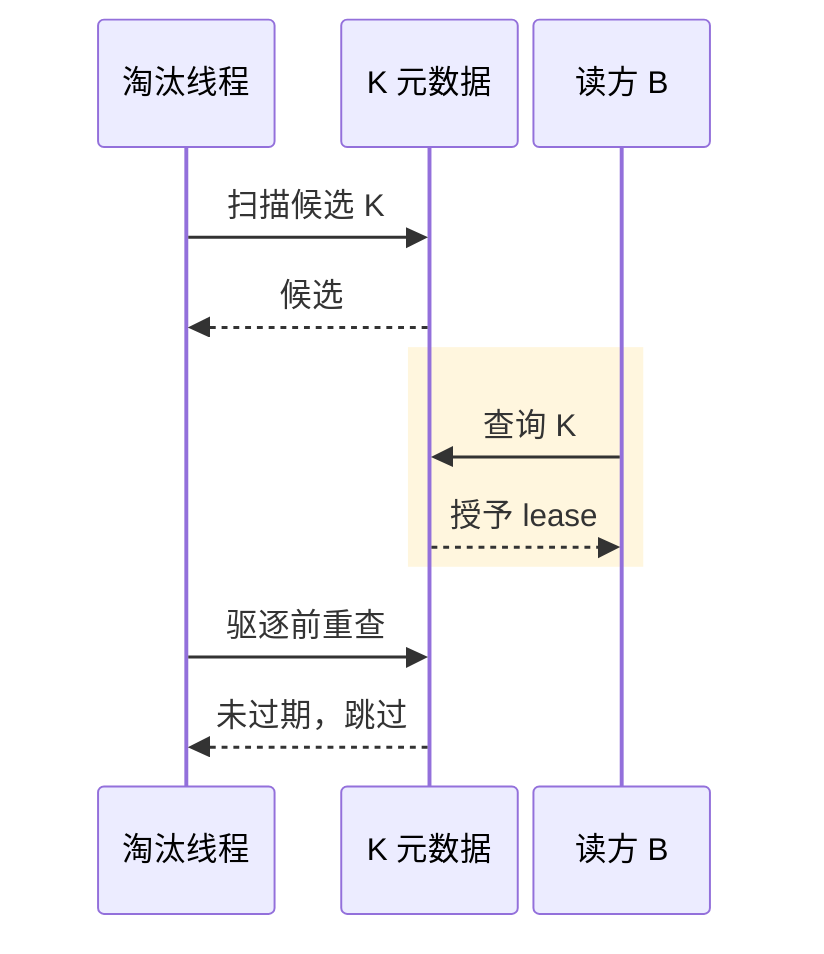

# 已经选中要淘汰的 KV，为什么又被跳过了？

**摘要：**淘汰线程先扫描出候选，读方随后查询同一个缓存 key 并拿到 lease，真正驱逐前还要重检。lease、hard pin、soft pin、后台引用各保护什么？

Mooncake 的缓存接近满载时，最直观的策略是找一些旧对象删除。

但在分布式系统中，"旧"不代表"现在没人使用"。

某个对象可能刚被查询，读方还没有开始传输；也可能正在作为 SSD 下沉任务的源副本。淘汰必须处理这些正在发生的事情。

## 从一次候选扫描说起

淘汰线程做 census 时扫描到 key `K`：它的 lease 已经过期，持有可淘汰的 MEMORY 副本，也不是 hard pin。K 因此进入候选池。

在候选池里，K 的时间戳比较老，排在较前的位置。按这个快照，它像是一个合适的回收对象。

但 census 和真正驱逐是两阶段。中间可能插入新的读取：

1. 读方推理实例 B（下文简称 B）查询 K，Master 授予读 lease，把 K 的 lease 截止时间推到 `now + 10 秒`（默认 TTL）；
2. B 拿到副本描述，准备从 R1 搬运数据；
3. 淘汰线程按候选顺序处理到 K，在真正驱逐前重新查表、重新检查 lease 和可淘汰性；
4. K 的 lease 尚未过期，本次普通淘汰跳过它。

如果没有第 3 步的重检，淘汰线程就会按旧快照删掉一个刚刚承诺给 B 的读取窗口。

*配图1：候选扫描之后插入一次读取。*

*图注：淘汰线程先扫描出候选；浅黄区标出候选扫描之后插入的读取，读方查询 K 并获得 10s lease。真正驱逐前重新检查，lease 未过期，于是跳过 K。候选只记录 key 与时间戳，重检是正确性的一部分。*

census 只把"lease 已过期、有可淘汰副本、非 hard pin"的对象放进候选池；soft pin 对象走另一轮处理。候选只记录 key 和时间戳，不持有迭代器。这些条件在驱逐时都可能变化，所以重检是正确性的一部分。

## 四种保护，各管一件事

**读 lease**
- 保护：普通读取的时间窗口；Master 承诺窗口内不主动删除。
- 改变回收结果：新读取把截止时间推到 `now + TTL`；到期后保护结束，但不代表立即回收。

**hard pin**
- 保护：对象的强保留标记，创建后不可变。
- 改变回收结果：census 第一关就跳过；不会因时间到期自动解除。

**soft pin**
- 保护：写入方承诺的一段优先保护期，默认 30 分钟。
- 改变回收结果：默认配置允许淘汰 soft-pinned 对象；第一轮不足时才在第二轮处理。

**后台引用计数**
- 保护：offload、复制、提升等任务把某个副本当作源。
- 改变回收结果：`refcnt > 0` 的 MEMORY 副本不可淘汰；任务结束并 `dec_refcnt` 后才可能回收。

读 lease 默认 10 秒，它只是"时间窗内的不删除承诺"，不是互斥锁，也不是数据有效期。读操作本身**不增加**副本的 `refcnt`；读路径完全靠 lease 保护。

hard pin 与 soft pin 也不能混为一谈。hard pin 直接阻止淘汰；soft pin 表达的是"暂时别删"，默认 30 分钟，仍可能在容量压力下被淘汰，具体取决于 `allow_evict_soft_pinned_objects` 的配置。

这些条件可能共同影响淘汰，但它们并不是同一把锁。判断一个对象能不能回收，要分别看 lease、pin、副本状态和后台引用。

## 淘汰副本，不一定删除对象

淘汰只移除 MEMORY 副本。`evict_replicas` 弹出 `refcnt == 0` 的 MEMORY 副本并释放内存，但只要对象还有一个 LOCAL_DISK/DFS 副本，`metadata.IsValid()` 仍为真，元数据不会被删。

所以"内存用量下降"与"这个 key 再也读不到"不能画等号。只有最后一个有效副本也被移除，才进一步涉及 `EraseMetadata`。

元数据清理也不只是从 map 中删除一个 key。它可能需要取消未完成的 offload 任务、释放引用、更新容量统计，避免留下孤儿任务。

## 下沉和淘汰如何配合？

有些策略会先把对象加入下沉任务，并保护作为源的副本；入队失败后，是跳过还是强制回收，还要看配置。

`try_evict_or_offload` 在开启 `offload_on_evict_` 且对象还没有 LOCAL_DISK 副本时，先从可淘汰的 MEMORY 副本里挑一个推到卸载队列并 `inc_refcnt` 钉住，再淘汰其余冗余内存副本。如果入队失败且没有 `offload_force_evict_`，它返回 0、本轮跳过——这是"宁可少腾空间，也不静默丢数据"的默认语义。

因此，"触发淘汰"不等于"立即释放空间"。保护条件、任务队列与策略都会影响本轮结果。

这也解释了为什么容量压力可能反映到写入延迟上：写入需要空间，而空间回收本身需要协调。

## 总结

淘汰是两阶段：census 先按 lease、可淘汰副本和 hard pin 选出候选；真正驱逐前再查表、重检 lease 与可淘汰性。候选只是快照，重检是正确性的一部分。

读 lease、hard pin、soft pin 和后台引用计数保护的不是同一件事。淘汰 MEMORY 副本也不等于删除对象：只要还有 LOCAL_DISK/DFS 副本，元数据仍可能有效；触发淘汰也不等于立即释放空间。下沉如何完成、内存副本何时回收，见第10篇。

**源码延伸：**lease、pin、census、驱逐重检与元数据清理。版本基线为 `v0.3.13.post1`。

- [GetReplicaList / 读 lease](https://github.com/kvcache-ai/Mooncake/blob/719735896c86b56fabec6cf3e825fb2ea640597a/mooncake-store/src/master_service.cpp#L3626) · [GrantReadLease](https://github.com/kvcache-ai/Mooncake/blob/719735896c86b56fabec6cf3e825fb2ea640597a/mooncake-store/include/master_service.h#L1322)
- [BatchEvict census](https://github.com/kvcache-ai/Mooncake/blob/719735896c86b56fabec6cf3e825fb2ea640597a/mooncake-store/src/master_service.cpp#L9954) · [驱逐前重检](https://github.com/kvcache-ai/Mooncake/blob/719735896c86b56fabec6cf3e825fb2ea640597a/mooncake-store/src/master_service.cpp#L10530) · [IsEvictableMemoryReplica](https://github.com/kvcache-ai/Mooncake/blob/719735896c86b56fabec6cf3e825fb2ea640597a/mooncake-store/src/master_service.cpp#L3570)
- [EraseMetadata](https://github.com/kvcache-ai/Mooncake/blob/719735896c86b56fabec6cf3e825fb2ea640597a/mooncake-store/src/master_service.cpp#L10550) · [默认参数（10s / 30min / allow_evict）](https://github.com/kvcache-ai/Mooncake/blob/719735896c86b56fabec6cf3e825fb2ea640597a/mooncake-store/conf/master.json#L10)

[系列目录与排版说明](README.md)

[上一篇](08-multi-nic-numa.md) · [下一篇](10-ssd-tiering.md)
