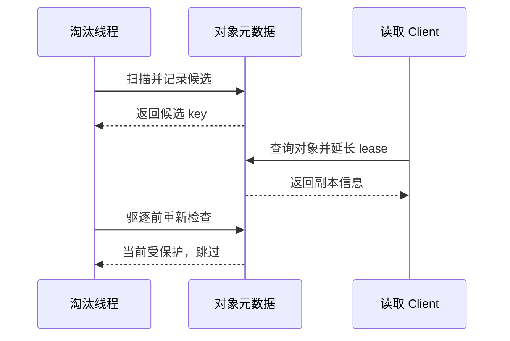

# 第9篇｜缓存满了，哪些对象能删？理解 Lease、Pin 与淘汰

**摘要：**淘汰不是简单找出最老对象。读保护、在途任务和副本介质，都影响最终能回收多少空间。

缓存接近满载时，最直观的策略是找一些旧对象删除。

但在分布式系统中，“旧”不代表“现在没人使用”。

某个对象可能刚被查询，读方还没有开始传输；也可能正在作为 SSD 下沉任务的源副本。

淘汰必须处理这些正在发生的事情。

## 几种保护机制，各管一件事

Read lease 保护普通读取的时间窗口。

Pin 表达额外的保留策略，其中 hard pin 与可过期的 soft pin 也不能混为一谈。

Hard pin 直接阻止淘汰。Soft pin 则只在 TTL 内提供优先保护，默认 30 分钟；它表达的是“暂时别删”，不是永久保留。因此，soft-pinned 对象仍可能在容量压力下被淘汰，具体取决于是否允许淘汰 soft pin 的配置。

副本引用计数则可以表示后台任务正在使用它，例如复制、下沉或提升过程。

这些条件可能共同影响淘汰，但它们并不是同一把锁。

**理解每种保护的目的，比记住一个“不可删除”判断更重要。**

## 候选扫描，只是第一步

系统可以先扫描对象，收集时间戳和状态，再选出候选集合。

问题在于，扫描结束后，世界还在变化。

一个候选对象可能被新的请求读取，lease 随之延长；也可能已经被其他线程删除或改变副本状态。

因此，真正驱逐前需要重新查找并检查。

*配图1：候选与授权的区别。*

*图注：进入候选名单，不代表之后可以无条件删除。*

## 淘汰副本，不一定删除对象

如果对象同时具有内存与磁盘副本，回收内存副本后，逻辑对象仍可能有效。

这就是为什么“内存用量下降”与“这个 key 再也读不到”不能画等号。

只有在相应路径下，最后一个有效副本也被移除，才进一步涉及对象元数据清理。

元数据清理也不只是从 map 中删除一个 key。它可能需要取消后台任务、释放引用、更新容量统计，避免留下孤儿任务。

## 下沉和淘汰如何配合？

有些策略会先把对象加入下沉任务，并保护作为源的副本；入队失败后，是跳过还是强制回收，还要看配置。

因此，“触发淘汰”不等于“立即释放空间”。保护条件、任务队列与策略都会影响本轮结果。

这也解释了为什么容量压力可能反映到写入延迟上：写入需要空间，而空间回收本身需要协调。

下沉如何完成、内存副本何时回收，留到下一篇展开。

**源码延伸：**原系列篇8；lease、pin、census、驱逐重检与元数据清理。版本基线为 `v0.3.13.post1`。

[源码解析版](../08-cache-lifecycle.md) · [系列目录与排版说明](README.md)

[上一篇](08-multi-nic-numa.md) · [下一篇](10-ssd-tiering.md)
