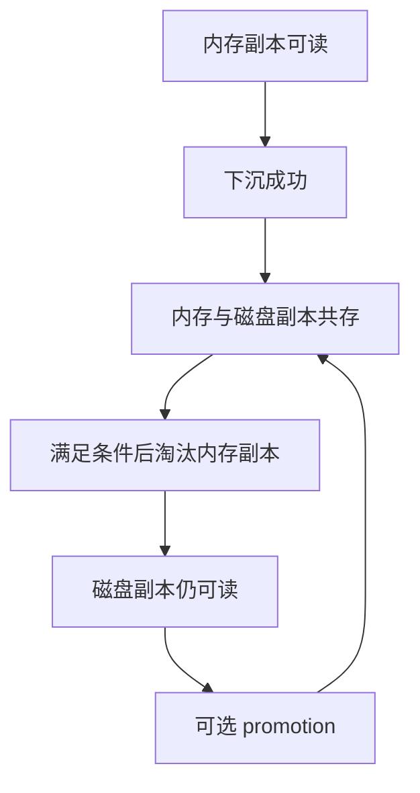
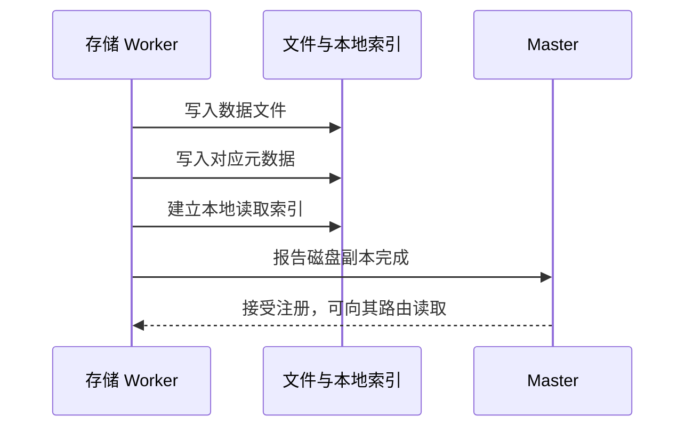

# 第10篇｜写进 SSD 就安全了吗？Mooncake 分层缓存的三个完成点

**摘要：**文件写完、本地可读、Master 可路由，是三个不同阶段。SSD 分层不仅是换一种介质，还引入了提交与恢复问题。

内存容量有限，SSD 更便宜，把冷数据下沉到磁盘似乎很自然。

但在分布式缓存里，完成文件写入只是其中一步。

其他节点要读到这份副本，还需要本地索引能够定位它，Master 也必须知道它已经可用。

## 下沉通常是增加副本

先区分三个动作。

下沉：把数据写入 SSD，并建立相应磁盘副本。

淘汰：在满足条件时回收某份副本，常见目标是内存空间。

提升：需要时重新建立内存副本。

因此，正常下沉完成后，可能出现内存与磁盘副本共存的阶段。

**下沉不等于立即删除内存，磁盘命中也不等于每次都必须提升。**

*配图1：副本组合变化。*

## 为什么本地索引要先准备好？

当 Master 开始把读取请求指向某个节点时，这个节点必须已经能够定位数据。

如果先向 Master 报告成功，再补本地索引，就会出现“目录说能读，存储节点却找不到”的窗口。

因此，下沉链路需要协调：

数据文件 → 元数据文件 → 本地对象索引 → Master 副本注册。

*配图2：从落盘到集群可见。*

*图注：图示省略后端相关的数据同步动作；同步强度需要另外核实。*

## 通知失败后，数据可能已经存在

文件和索引准备好后，通知 Master 仍可能失败。

这会形成一种不一致：节点本地有数据，集群目录却不知道。

相应失败路径需要回滚或恢复机制。回滚时，还可能需要等待已经开始的本地读取，不能直接删除仍被使用的资源。

重启恢复则需要检查文件与元数据的配对关系，识别有效 bucket，并清理不完整产物。

但本地扫描恢复索引，与重新向 Master 注册，是不同层次的动作。

## 文件存在，不足以证明掉电持久性

进程重启、机器掉电、磁盘故障，是不同的验证场景。

数据文件写完，不表示缓存已经刷到稳定介质；使用 O_DIRECT，也不自动等价于完整的掉电持久化保证。

还需要核对数据、元数据文件、目录以及底层设备的同步行为。

对于可重算 KV Cache，这些取舍可以根据成本决定，但文章和系统都应准确说明承诺。

下一篇进入推理框架侧，讨论共享缓存什么时候能真正减少计算。

**源码延伸：**原系列篇9；FileStorage、存储后端、offload、promotion 与重新注册。版本基线为 `v0.3.13.post1`。

[源码解析版](../09-ssd-tiering.md) · [系列目录与排版说明](README.md)

[上一篇](09-cache-eviction.md) · [下一篇](11-kv-reuse-and-inference.md)
