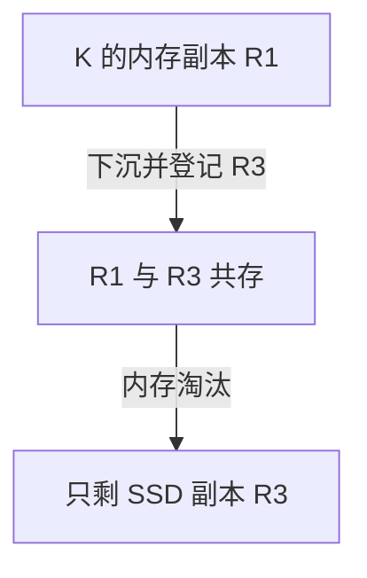
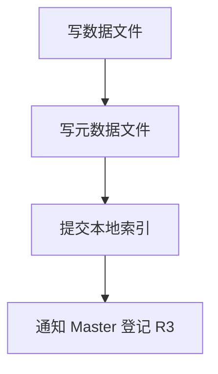

# KV Cache 已经写进 SSD，为什么其他节点还可能读不到？

**摘要：** 4 MiB 对象 K 已写进本地 SSD，磁盘节点也建立了索引。登记通知超时后，Master 是否记录了这份副本仍待确认。即使查到了副本，读回还要经过磁盘 I/O 和数据传输。

上一轮淘汰留下了作为下沉源的内存副本 R1。现在，存储节点把 K 写进 SSD，准备把这份 LOCAL_DISK 副本记为 R3。数据文件和本地索引都已就绪，通知 Master 的 RPC 却超时了。

要解释 B 为什么还能从 R1 读到 K，或者为什么查到了 R3 却读不回数据，先顺着 R3 的三个位置看一遍：文件、本地索引、Master 目录。本篇限定在 `v0.3.13.post1` 的 bucket 后端。

## 先增加 R3，再决定是否回收 R1

下沉为 K 建立磁盘副本。登记完成后，R1 和 R3 可以共存。R1 等到引用和租约等保护条件允许时，才参与后续内存淘汰。

假如后来只剩 R3，读请求可以走磁盘路径。系统在满足提升条件时还可以为 K 重新建立内存副本。

*配图1：K 从仅有内存副本，到新增 R3，再到仅有 SSD 副本。*

*图注：磁盘副本 R3 登记后，内存副本才进入这条示意路径的后续回收阶段。*

## 登记前，磁盘节点先提交索引

bucket 可以容纳多个对象。每个 bucket 有一个 `<bucket_id>.bucket` 数据文件和一个 `<bucket_id>.meta` 索引文件，写入顺序是数据在前、元数据在后。K 的 4 MiB 是对象大小，bucket 还可能包含其他对象及索引开销。

`BatchOffload` 写完文件后，先提交本地索引，再通过 `NotifyOffloadSuccess` 上报。开始登记前，`BatchLoad` 已有按 K 定位 bucket、偏移和长度所需的本地索引。

*配图2：写入、本地索引和 Master 登记的顺序。*

*图注：发出登记通知时，本地索引已经提交。RPC 超时留下的是 Master 侧结果待确认。*

## 写失败、通知超时、读回失败分别看哪里

**写失败，先看 bucket 文件。** 数据写入出错或长度不符时，写入返回错误。元数据文件写入失败时，后端尝试删除刚写好的数据文件。下沉工作线程会把这类失败的任务用 `data_size = -1` 上报。Master 收到这个失败确认（NACK）后，清理尚在的任务并释放源副本引用，跳过新增磁盘副本。

**通知超时，先查 Master 目录。** 超时可能发生在 Master 执行前，也可能发生在登记成功、响应返回前。其他 Client 是否能查到 R3 取决于目录里有没有这次记录。RPC 的批量返回也不是逐 key 收据。Master 按条目处理，代码中有跳过和拒绝的分支，所以排查 K 时要核对 K 的副本清单。

**目录有 R3，先到持盘节点查读回。** 该节点先按 key 找索引并打开 bucket 文件，再把数据读进缓冲区。索引缺失会在 `BatchLoad` 返回 `INVALID_KEY`，打开文件失败会传出错误，读到的字节不足则返回 `FILE_READ_FAIL`。SSD 读入缓冲区后，远端读方还要通过 Transfer Engine 搬运数据，传输失败有自己的返回路径。

如果 R1 或 R2 仍然可用，R3 的异常只说明这一份副本的状态。B 能否完成这次 Get，还要看它拿到的副本列表和所走的读路径。

## 回滚和重新登记分别作用于哪一层

**回滚先切断本地新读取。** `complete_handler` 返回非 OK 后，`RollbackCommittedBucket` 先移除本地索引，再等待已进入 I/O 的读请求结束。等待超时会先保留磁盘文件。正常等到读请求退出后，才清理文件。

**响应丢失有一个待验证的竞态。** 源码注释按“Master 未被通知”解释本地回滚。若 Master 已登记 R3 后响应丢失，回滚可能留下仍被目录列出的副本，而持盘节点已经找不到索引。随后发送的 NACK 清的是下沉任务和引用，并不撤销已登记的 R3。这是基于代码顺序的推断，仍需注入响应丢失验证。

**重启先重建索引，再上报可恢复项。** `BucketStorageBackend::Init` 扫描 `.meta`，检查对应数据文件和元数据，再重建本地索引。没有有效元数据的孤儿 `.bucket` 会进入清理流程。外层 `FileStorage::Init` 在 LOCAL_DISK 路径挂载磁盘段，再扫描并向 Master 上报保留的条目。磁盘上已清理的 bucket 不在这次上报范围。

**心跳发现磁盘段丢失，也会尝试重新登记。** `OffloadObjectHeartbeat` 返回 `SEGMENT_NOT_FOUND` 时，存储节点尝试重新挂载。重新挂载和重试心跳成功后，可异步扫描并调用 `ReRegisterOffloadedObjects` 上报。这个触发条件和单次登记 RPC 超时不同。

## 掉电恢复还要检查同步顺序

在这个版本的 bucket 写入路径里，io_uring 分支先完成数据写入，再调用 `datasync`，成功后才写元数据。非 io_uring 分支检查 `vector_write` 的长度后写元数据，该分支没有显式的数据文件同步。

两条路径证明的范围不同。评估机器掉电后的承诺，还要检查元数据文件和目录是否同步，以及文件系统和设备如何处理缓存。进程重启时能扫描到文件，只能说明当时存在可用于重建索引的记录。

## 总结

K 的 R3 从落盘到可读要经过本地索引、Master 登记、磁盘节点读取和远端搬运。通知超时时先核对目录是否登记了 R3，再去持盘节点确认它是否仍能定位并读取 K。R3 的读回失败与 K 是否还有可用内存副本，是两项不同的判断。

下一篇把同一个 K 带回推理流程，计算一次 SSD 副本读回还剩多少工作。

**源码延伸（`v0.3.13.post1`）**

- [本地索引提交和通知](https://github.com/kvcache-ai/Mooncake/blob/719735896c86b56fabec6cf3e825fb2ea640597a/mooncake-store/src/storage_backend.cpp#L1809) · [本地回滚](https://github.com/kvcache-ai/Mooncake/blob/719735896c86b56fabec6cf3e825fb2ea640597a/mooncake-store/src/storage_backend.cpp#L2764)
- [工作线程上报 NACK](https://github.com/kvcache-ai/Mooncake/blob/719735896c86b56fabec6cf3e825fb2ea640597a/mooncake-store/src/file_storage.cpp#L545) · [Master 逐项处理登记与 NACK](https://github.com/kvcache-ai/Mooncake/blob/719735896c86b56fabec6cf3e825fb2ea640597a/mooncake-store/src/master_service.cpp#L7365)
- [磁盘读取](https://github.com/kvcache-ai/Mooncake/blob/719735896c86b56fabec6cf3e825fb2ea640597a/mooncake-store/src/storage_backend.cpp#L1901) · [远端搬运](https://github.com/kvcache-ai/Mooncake/blob/719735896c86b56fabec6cf3e825fb2ea640597a/mooncake-store/src/real_client.cpp#L6898)
- [数据文件写入与同步](https://github.com/kvcache-ai/Mooncake/blob/719735896c86b56fabec6cf3e825fb2ea640597a/mooncake-store/src/storage_backend.cpp#L2665)
- [后端恢复索引](https://github.com/kvcache-ai/Mooncake/blob/719735896c86b56fabec6cf3e825fb2ea640597a/mooncake-store/src/storage_backend.cpp#L2104) · [启动时扫描并上报](https://github.com/kvcache-ai/Mooncake/blob/719735896c86b56fabec6cf3e825fb2ea640597a/mooncake-store/src/file_storage.cpp#L186) · [心跳触发重新登记](https://github.com/kvcache-ai/Mooncake/blob/719735896c86b56fabec6cf3e825fb2ea640597a/mooncake-store/src/file_storage.cpp#L703)

[系列目录与排版说明](README.md)

[上一篇](09-cache-eviction.md) · [下一篇](11-kv-reuse-and-inference.md)
