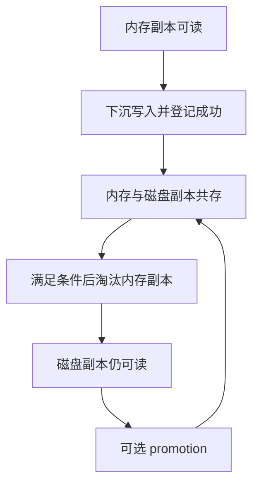
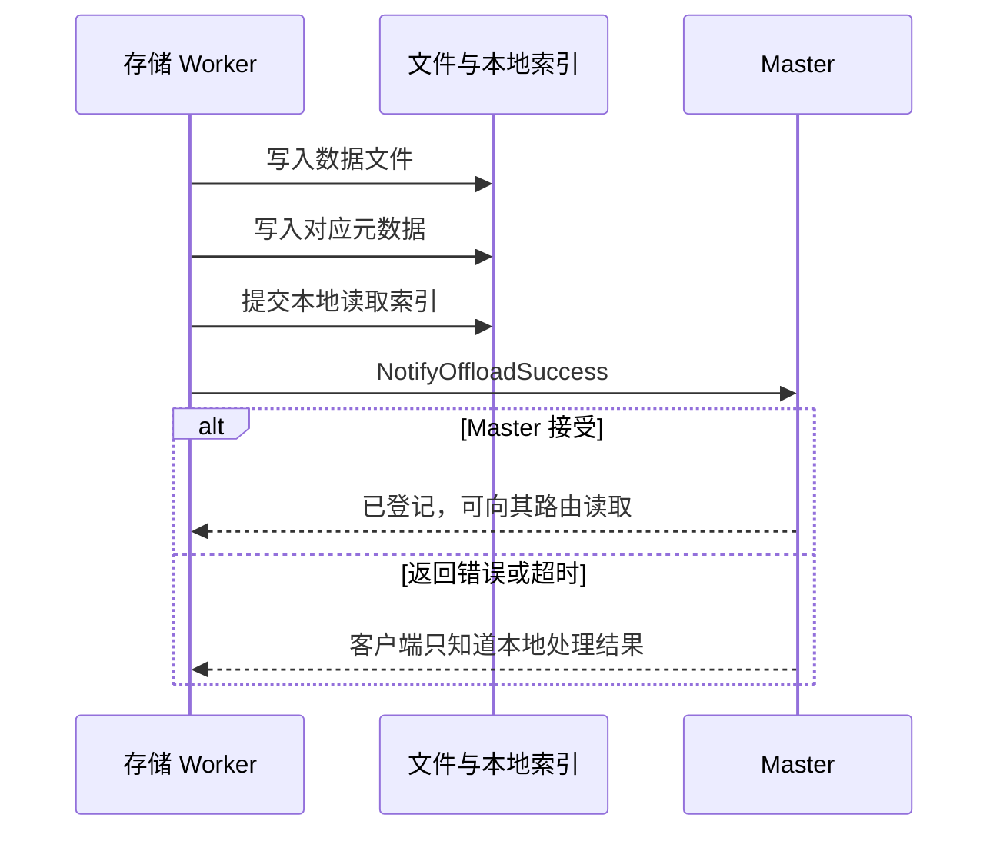

# 第10篇｜文件与本地索引都好了，通知 Master 失败会怎样？

**摘要：**数据文件、本地索引、Master 注册，是三个不同层次。通知返回错误时，先分清"确定没执行"与"可能执行了但响应丢了"。

内存容量有限，SSD 更便宜，把冷数据下沉到磁盘似乎很自然。

但在分布式缓存里，完成文件写入只是其中一步。其他节点要读到这份副本，还需要本地索引能够定位它，Master 也必须知道它已经可用。

本篇只跟 LOCAL_DISK 的一条下沉路径：bucket 的数据文件和元数据文件已经写好，本地 `object_bucket_map_` 也已提交，随后通知 Master 时出现异常。看这个窗口里，四个视图分别能确认什么。

## 下沉通常是增加副本

上一篇提到，有些策略会先下沉、再回收内存。这里把动作拆开看。

下沉：把数据写入 SSD，并建立相应磁盘副本。

淘汰：在满足条件时回收某份副本，常见目标是内存空间。

提升：需要时重新建立内存副本。

因此，下沉写入成功并完成 Master 登记后，可能出现内存与磁盘副本共存的阶段。

**下沉不等于立即删除内存，磁盘命中也不等于每次都必须提升。**

*配图1：副本组合变化。*

*图注：正常下沉后内存与磁盘副本可能共存；淘汰与提升都是可选动作。*

## 写入与通知的顺序

下沉的物理单位是 bucket，不是单个对象。每个 bucket 有两个文件：`<bucket_id>.bucket` 存数据，`<bucket_id>.meta` 存索引。写入顺序是数据先、元数据后。

`BatchOffload` 在写完后先提交本地索引：`object_bucket_map_` 和 `buckets_` 已经能在本节点定位这些 key，然后才调用 `complete_handler` 通知 Master。

本地索引先于 Master 通知，是因为 Master 一旦把读请求指向本节点，`BatchLoad` 必须能立刻在 `object_bucket_map_` 里查到 key。否则会出现"目录说能读，存储节点却找不到"的窗口。

*配图2：从落盘到集群可见。*

*图注：本地索引先于通知提交。通知返回错误时，客户端能确定本地索引状态，但不能仅凭返回值确定 Master 是否登记；图示省略后端相关的数据同步动作，同步强度需要另外核实。*

## 四个视图：本地、Master、其他 Client、后续处理

通知 Master 出现异常时，先不要用一句"下沉失败"概括。至少要分开四个问题：

| 视图 | 请求确定未到达 Master | 请求可能已执行，只是响应丢失 |
|---|---|---|
| 本节点能否定位 | 能。本地索引已提交 | 能。本地索引已提交 |
| Master 是否登记 | 没有 | 无法仅凭返回值确认，可能已经新增 LOCAL_DISK 副本 |
| 其他 Client 能否通过普通查询拿到 | 不能 | 如果 Master 已登记，可能拿到；如果没有，不能 |
| 后续由谁处理 | Worker 走上报失败与回滚路径 | 客户端不能直接假定未登记；需要额外查询或对账 |

`storage_backend.cpp` 在 `complete_handler` 返回非 OK 时，日志写的是"Master was NOT notified"，然后调用 `RollbackCommittedBucket`：删除本地索引、等待已经开始的本地读取结束、再删除磁盘文件。

这段处理对"请求确实没有到达 Master"是成立的。但一个非 OK 结果也可能来自请求已经发出后的超时或连接中断。此时客户端只知道这次 RPC 没有拿到成功响应，不能区分"Master 没执行"与"Master 执行了，但响应丢了"。

**分析（推断）：**如果 Master 实际登记成功，而客户端按"未通知"回滚并删除了文件，Master 就可能向其他 Client 发布一个本节点已经无法读取的副本。这是从当前代码路径推导出的风险，不是已在生产验证的行为；源码注释的假设是"通知失败即未登记"。

反过来，如果客户端不回滚，只保留本地文件和索引，Master 又没有登记，这份副本就是"本地能读、集群目录不知道"的幽灵副本。两个方向都需要额外的对账信息，不能只靠这次通知的返回值判断。

这里说的是 `NotifyOffloadSuccess` 这个 RPC 本身的异常。单个 key 写失败走的是另一条明确路径：失败元数据用 `data_size = -1` 作为 NACK，Master 看到负值后清理任务、不新增副本。NACK 明确表达了失败；RPC 超时则不明确。

## 回滚、重启扫描与重新注册，各修哪一层

回滚修的是本地层。`RollbackCommittedBucket` 删除索引、等待在途读取、删除文件，目标是避免留下本地可读但 Master 不知道的副本。它不能修复"Master 已经登记"的另一半。

重启扫描修的也是本地层。`Init` 遍历 `.meta`，校验后加载；再扫 `.bucket`，删掉没有 `.meta` 的孤儿文件。它可以从 `.meta` 重建本地索引；从这条 Init 路径看，没有主动核对 Master 目录的步骤，也不会自动解决"Master 记得、本地已回滚"的竞态。

重新注册处理的是另一种情况：Heartbeat 收到 `SEGMENT_NOT_FOUND` 后，client 重新挂载本地段，并异步调用 `ReRegisterOffloadedObjects`，从 `.meta` 重新向 Master 报告副本。它覆盖的是"Master 忘了这个段/注册"，不等价于修复上面那个响应丢失窗口。

这三个动作层次不同：回滚清理本地提交，重启扫描重建本地索引，重新注册重建 Master 侧的副本记录。把它们都说成"恢复机制"，会掩盖各自能证明的范围。

## 文件存在，不足以证明掉电持久性

进程重启、机器掉电、磁盘故障，是不同的验证场景。

数据文件写完，不表示缓存已经刷到稳定介质；使用 O_DIRECT，也不自动等价于完整的掉电持久化保证。开启 `USE_URING` 时，数据写入后还要 `datasync` 才写元数据；非 uring 回退路径只做 `vector_write`，没有显式 sync。于是可能出现 `.meta` 在、数据块在掉电后损坏的情况。

还需要核对数据、元数据文件、目录以及底层设备的同步行为。对于可重算 KV Cache，这些取舍可以根据成本决定，但系统文档应准确说明承诺。

本文讨论的是 LOCAL_DISK bucket 路径；其他磁盘或 DFS 路径的提交与恢复不能直接套用这套结论。

下一篇进入推理框架侧，讨论共享缓存什么时候能真正减少计算。

**源码延伸：**原系列篇9；FileStorage、存储后端、offload、promotion 与重新注册。版本基线为 `v0.3.13.post1`。

- [BatchOffload 本地索引提交](https://github.com/kvcache-ai/Mooncake/blob/719735896c86b56fabec6cf3e825fb2ea640597a/mooncake-store/src/storage_backend.cpp#L1809) · [complete_handler 与回滚](https://github.com/kvcache-ai/Mooncake/blob/719735896c86b56fabec6cf3e825fb2ea640597a/mooncake-store/src/storage_backend.cpp#L1865)
- [NotifyOffloadSuccess](https://github.com/kvcache-ai/Mooncake/blob/719735896c86b56fabec6cf3e825fb2ea640597a/mooncake-store/src/master_service.cpp#L7365) · [LOCAL_DISK 副本写入](https://github.com/kvcache-ai/Mooncake/blob/719735896c86b56fabec6cf3e825fb2ea640597a/mooncake-store/src/master_service.cpp#L7460)
- [FileStorage::Init](https://github.com/kvcache-ai/Mooncake/blob/719735896c86b56fabec6cf3e825fb2ea640597a/mooncake-store/src/file_storage.cpp#L131) · [ReRegisterOffloadedObjects](https://github.com/kvcache-ai/Mooncake/blob/719735896c86b56fabec6cf3e825fb2ea640597a/mooncake-store/src/file_storage.cpp#L1195)

[源码解析版](../09-ssd-tiering.md) · [系列目录与排版说明](README.md)

[上一篇](09-cache-eviction.md) · [下一篇](11-kv-reuse-and-inference.md)
