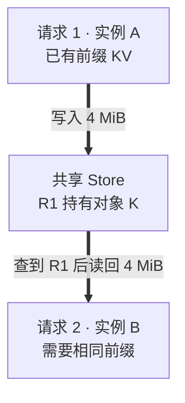
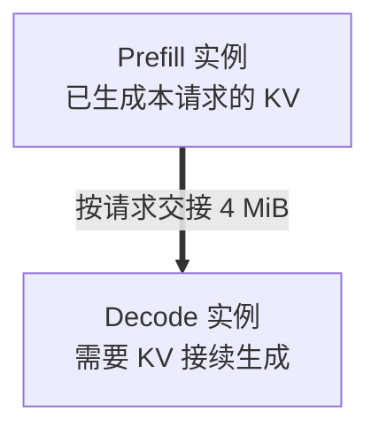

# 共享 KV Cache 命中了，首个 token 为什么还可能没变快？

**摘要：** 推理实例 B 命中了共享的前缀 KV，其中一个对象是 A 写入的 4 MiB 对象 `K`。首个 token 能否更早出现，取决于加载和调度在关键路径上花了多久，以及这次命中省下多少 Prefill 计算。

回到第 1 篇的 A 和 B。两次请求共享 1024 个前缀 token。A 先算过这段前缀并保存了可复用的 KV，其中一个示意对象是 4 MiB 的 `K`。B 后来收到另一个请求，要复用这段前缀。前缀长度和对象大小是两个独立的示意量，实际映射由模型和缓存布局决定。

识别出相同前缀后，B 仍需查到相关对象、读回数据，再由框架确认哪些 KV 已经可用。**TTFT（首 token 延迟）从请求开始计到首个输出 token**，包括请求在这些阶段的等待。

## 一次命中到首个 token

B 可能经历以下步骤。这里用对象 `K` 跟踪一个数据单元，实际加载范围由推理框架决定。

1. 识别可复用 token 范围，构造缓存 key；
2. 向 Store 查询 key，拿到可读副本描述；
3. 从副本读取数据，搬进 B 的缓冲区；
4. 按需转换布局，等待相关设备操作完成；
5. 由框架确认加载成功的范围，调度器据此让请求继续，B 生成首个 token。

字节到达缓冲区时，框架仍可能在等设备同步。测量时，把 Store 读取完成、设备可用和请求恢复执行分别记下来，才能看出等待落在哪一段。

## 跨请求复用是怎样发生的？

在共享 Store 路径里，A 已经写入并提交了 `K`。B 在后续请求中算出兼容的 key，才向 Master 查询可读副本。以这里的内存副本 R1 为例，B 拿到副本描述后从 R1 读回字节。

*配图1：跨请求的 key 查询与加载。*

*图注：箭头表示字节流向。A 提交后，B 按 key 向 Master 查到可读的 R1，才沿第二条箭头读取。*

## 同一请求的 KV 如何交给 Decode？

在 Prefill/Decode（PD）分离的点对点路径里，Prefill 实例已经产生当前请求的 KV，处理同一请求的 Decode 实例需要接续生成。交接按本次请求协调。图中也取 4 MiB 作为载荷量示意。

*配图2：同一请求内的 Prefill→Decode 交接。*

*图注：箭头表示 KV 字节从 Prefill 流向 Decode。交接双方已由当前请求确定。*

Mooncake 的两份 vLLM 集成指南分别描述了共享池和 PD 直传。图中的箭头表达数据方向，传输由哪端发起、调度器怎样确认完成，要看实际部署的 connector 版本。下文的 TTFT 对照针对 A、B 之间的 Store 共享复用。 [共享池指南](https://github.com/kvcache-ai/Mooncake/blob/719735896c86b56fabec6cf3e825fb2ea640597a/docs/source/deployment/integrations/vllm/kv-cache-storage.md#L3-L5) · [PD 指南](https://github.com/kvcache-ai/Mooncake/blob/719735896c86b56fabec6cf3e825fb2ea640597a/docs/source/deployment/integrations/vllm/disagg-prefill-decode.md#L3-L5)

## 用两组请求测 TTFT

要判断 Store 命中是否降低 TTFT，可以固定同一模型、同一请求、同一段 1024 个 token 的前缀和同一并发度，做两组对照：

- **重算组**：禁用外部缓存，或强制让这段前缀不命中，由 B 重新 Prefill；
- **加载组**：允许 B 从 Store 命中并加载这段前缀。

关键是控制本地前缀缓存和其他缓存，避免两组跑到不同路径。比如每组开始前清空或禁用 B 的本地前缀缓存，或者用独立进程；否则重算组可能先在本地命中，看起来反而更快。

两条时间线都以 B 收到请求为起点、首个输出 token 为终点：

- **重算路径**：B 收到请求 → 排队 → 计算整段输入的 Prefill → 首个 token。
- **加载路径**：B 收到请求 → 排队 → 查询并加载可复用前缀 → 计算剩余输入 → 首个 token。

两条时间线按串行排列，用于比较关键路径。实际系统中，读取可能与排队或后续计算重叠；一旦重叠，TTFT 取决于哪段等待真正挡在首个 token 前面，而不是两段耗时简单相加。

最少记录这些数据：

- **实际命中的 token 数**：确认命中窗口是否覆盖预设的 1024 个 token。
- **实际读取的字节数**：记录框架真正搬运的数据量，包含本例的 `K` 以及命中范围内的其他对象。
- **查询、读取、布局转换、设备同步的耗时**：找出加载成本落在哪一段。
- **从请求开始到首个 token 的 TTFT**：端到端结果，不用传输接口的完成时间代替。
- **并发度与批次组成**：判断调度和排队是否混入差异。

这组对照是实验设计，尚未实测。如果加载组的 TTFT 没有下降，先核对实际命中长度和读取介质，再看查询、读取或同步有多少时间进入了关键路径。如果下降了，也要排查本地缓存、批次差异和缓存预热的影响。

## 什么时候加载比重算划算？

可以先比较下面两项成本：

> 外部加载成本 = 探测 + 数据读取 + 必要的转换与同步

> 串行近似下，外部加载成本低于重算同一前缀的成本，才可能缩短 TTFT。

这个估算以其余条件相同为前提。读取与排队、计算重叠时，要看哪段等待推迟了首个 token。对象 `K` 的 4 MiB 只代表一个示意读取单元，整个前缀的搬运量还取决于实际命中范围和分块。

前缀很短时，省下的计算可能不足以覆盖加载开销。

KV 对象较大、介质较慢或并发很高时，读取成本也可能上升。相反，长前缀、多次复用和高效数据路径，可能提高收益。

所以，命中率重要，但不足以单独解释 TTFT。性能报告还应说明对象大小、命中长度、模型、并发、硬件和版本；缺少这些条件，单个带宽数字不能直接换算成端到端收益。

## 加载失败，谁负责恢复？

假设 B 要加载包括 `K` 在内的一串对象，`K` 已经到了，但后续对象读取超时。排查要追到框架侧，确认它怎样记录已加载的范围、怎样处理失败块对应的目标缓冲区，以及何时允许调度器继续。

按块重试、重新计算缺失前缀、让请求失败，分别是可能的处理策略。实际选择，以及怎样保证部分写入的缓冲区不会被提前使用，都需要查证固定版本的 connector 和调度器。本文依据集成指南说明职责，vLLM 版本的具体调用链与恢复行为待核实。

## 总结

共享 Store 用 key 把前一次请求的计算结果交给后一次请求。PD 直传把当前请求的 KV 交给接续解码的实例。对共享复用来说，省下的 Prefill 计算要在关键路径上超过新增的加载等待，才会表现为更短的 TTFT。用同一负载对照，记录真实命中 token 数、读取字节数和请求侧 TTFT，才能验证收益。

**源码延伸** · [Mooncake 侧 Python 绑定、缓冲区和集成契约](../10-vllm-integration.md)

[系列目录与排版说明](README.md)

[上一篇](10-ssd-tiering.md) · [源码阅读番外](05-source-reading.md)
