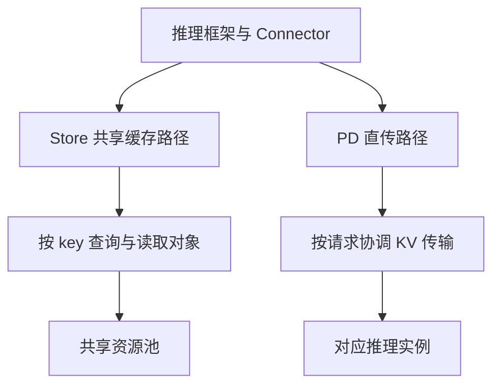

# 第11篇｜共享了 KV Cache，为什么推理不一定更快？

**摘要：**共享存储提供复用能力，是否减少 Prefill、降低 TTFT，还取决于 key 兼容、加载成本和推理框架的调度。

把多个推理实例接到同一个 Mooncake Store，是否就能自动复用 KV Cache？

还不够。

存储系统能够按 key 保存和读取字节，但这些字节能否被另一个请求安全使用，需要推理框架与 connector 共同完成。

**存得进去，是存储能力；知道何时能够复用，是推理语义。**

## Mooncake 不替框架理解前缀

推理框架负责识别可复用的 token 范围，组织 KV block，并决定如何构造缓存 key。

Mooncake Store 负责 key 对象的存储、副本管理、读取保护和数据搬运。

这条边界很重要。相同输入能否得到兼容的 key，还可能受到模型版本、token 序列、布局、命名空间和具体哈希实现影响。

仅仅连接同一个资源池，并不能证明两个实例生成的对象可以互相解释。

## Store 共享缓存与 PD 直传要分开

一种路径是共享 Store：按 key 查找并加载已有 KV 对象。

另一种路径是 Prefill/Decode 分离中的点对点传输：把特定请求产生的 KV 交给对应消费方。

两者都可以使用 Mooncake 的传输能力，但协调对象和生命周期不同。

*配图1：两种接入目标。*

*图注：这是职责示意。具体接口、回调和配置需要绑定相应 vLLM 版本。*

## 命中之后，还要完成加载和同步

一次外部缓存命中，至少要经过几个逻辑动作：

识别可复用范围，确认对象可读，加载数据，完成必要的布局转换或设备同步，最后通知调度器哪些 KV 已经可用。

读取完成、GPU 可使用、调度器允许复用，可能不是同一个时刻。

Mooncake 中存在某个张量 API，只能证明它提供这种能力，不能直接证明某个版本的 vLLM connector 必然采用它。

本文没有固定并验证 vLLM 的具体 commit，因此不把这些逻辑步骤写成已审计的函数调用链。

## 什么时候加载比重算划算？

可以先比较下面两项成本：

> 外部加载成本 = 探测 + 数据读取 + 必要的转换与同步

> 复用成立的性能条件 = 外部加载成本小于重算对应前缀的成本

前缀很短时，省下的计算可能不足以覆盖加载开销。

KV 对象较大、介质较慢或并发很高时，读取成本也可能上升。相反，长前缀、多次复用和高效数据路径，可能提高收益。

所以，命中率重要，但不足以单独解释 TTFT。

性能报告还应说明对象大小、命中长度、模型、并发、硬件和版本。缺少这些条件，单个带宽数字不能直接换算成端到端收益。

## 加载失败，谁负责恢复？

绑定层返回失败，只能证明它报告了结果。

Connector 如何告知调度器，是否重试，哪些块需要重算，以及部分写入的 KV 是否可能被误用，都需要沿具体版本实现核实。

“缓存可以重算”是一种恢复思路，不是自动成立的正确性保证。

回看整个系列，Mooncake 处理了位置、可见性、读保护、传输与分层；这些能力能否转化为推理收益，最终仍要通过框架接入和相同负载下的端到端验证来确认。

**源码延伸：**原系列篇10；Mooncake Python 绑定及 vLLM 集成文档。Mooncake 基线为 `v0.3.13.post1`；vLLM connector 的实际接口与失败恢复行为尚未按固定版本验证。

[源码解析版](../10-vllm-integration.md) · [系列目录与排版说明](README.md)

[上一篇](10-ssd-tiering.md)
