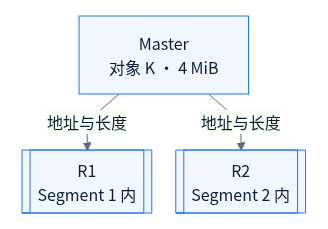
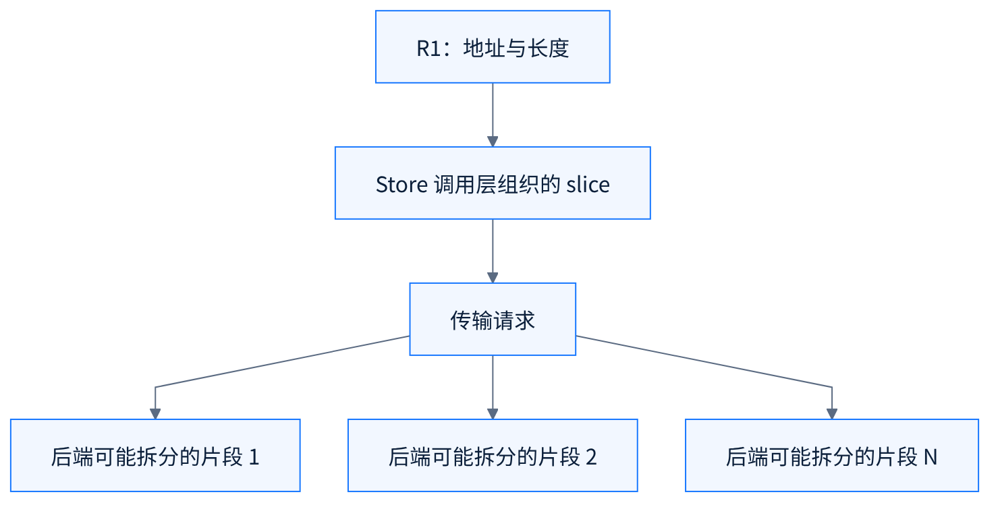

# 一个 KV Cache 对象，在 Mooncake 里到底怎么放？

**摘要：**key K 在 Master 里变成对象元数据，R1、R2 各占一段内存。对象、副本、Segment、Slice 分别回答什么？

推理实例 A 算完 1024 个 token 的前缀 KV，把数据以 key `K` 写入共享缓存。

从 A 调用 Put 的角度看，这只是"写一个对象"。但在 Mooncake 内部，这个动作经过了好几层结构：key 先变成元数据，元数据下面挂着副本，副本指向一段分配好的内存，传输时又被组织成 slice。

如果把这些结构都笼统理解为"一块内存"，后面的可见性、淘汰、SSD 下沉就会越来越难读。

它们各自回答一个具体问题：

- 对象：存的是什么？
- 副本：同一份数据有几份、在哪里？
- Segment：这段内存从哪来？
- Slice：这次搬运按什么单位组织？

先把前缀长度换算成存储工程师更熟悉的字节数。假设模型有 32 层、每层 8 个 KV 头、头维度 128，K 和 V 都采用 BF16（每元素 2 字节）：

> 1024 × 32 层 × 8 个 KV 头 × 128 维 × 2（K 和 V）× 2 字节 = 128 MiB

128 MiB 是这组假设下，整段前缀跨全部层的逻辑 KV 数据量。落到 Store 里会形成几个对象、单个实例实际读取多少字节、一次传输搬多少字节、拆成多少 slice，则取决于框架分块、并行布局和实际命中范围。先记住这个量级，再看对象、副本、Segment 和 Slice 如何各自承担一部分。

## 一个 key，先变成对象元数据

应用通过 key 访问对象。Master 收到 `PutStart` 后，为 key 建立 `ObjectMetadata`。

这份元数据记录对象的身份与生命周期信息：谁发起的写入、什么时候开始、对象多大、数据类型、读保护截止时间，以及副本列表。

对象元数据只存在于 Master 的内存态里。客户端拿到的不是这个结构本身，而是副本列表序列化后的描述。

## R1、R2：同一对象的两个副本

同一个对象可以有多个副本。为了说清楚，本篇把两份内存副本记作 `R1`、`R2`。

`R1`、`R2` 可能位于不同存储节点，各自占据一段分配好的内存。它们的内容相同，但地址不同，状态也可能不一致——一个已经 `COMPLETE`，另一个仍在 `PROCESSING`。

图注：Master 内存态保存 `ObjectMetadata` 与副本列表 `R1`、`R2`；双线边框表示副本只占所在 Segment 的一段已分配区间。副本记录地址与长度，Segment 提供可分配空间，两者不是同一个对象。

对象存在，和某一份内存副本存在，不是一回事。

内存副本被淘汰后，如果还有磁盘副本仍然有效，对象仍可能被读取。磁盘副本是可选的另一种介质，它不是内存副本的别名；本篇的主线仍是 R1、R2 这两份内存副本。

## Segment 提供空间，副本只占其中一段

存储节点向集群贡献一段连续内存，Master 侧把它登记为一个 Store Segment：起点、大小、传输端点等。

分配器再从这个范围里划出一块，交给具体副本使用。所以对象通常不会独占整个 Segment，副本只是其中一段已分配区域。

Store 与 Transfer Engine 都会出现 Segment 概念，但语境不同。

Store Segment 是 Master 侧的分配与注册记录，关心“这段空间归谁、还剩多少”。Transfer Engine 侧的 Segment 则是传输侧的地址空间抽象，通常每个进程一个，内部再划分 buffer。

阅读源码或配置时，要先确认讨论的是哪一层，不能只凭名字把它们直接等同。

## Slice 是搬运单位

副本描述告诉客户端"数据在哪、有多长"。真正发起传输时，还要把这些范围组织成 slice。

Store 层的 slice 是一个连续内存区域：指针加长度。调用方把目标 buffer 切开，组成 slice 列表；Master 按 slice 长度分配空间，传输层再按需搬运。

图注：slice 数量为示意。Store 调用层如何组织 slice、传输后端是否再拆分，取决于实际路径，不固定一一对应。

因此不能假设：

> 一个对象对应一个请求，一个请求对应一个网络操作。

实际关系可能是一对多，而且不同层次切分的目的并不相同。

回到两个具体问题：

先看第一个：只回收 R1，K 还可读吗？只要 K 还有另一个可读副本——例如 R2 已经 `COMPLETE`，或存在有效的磁盘副本——B 仍可能读到 K。只有 R1 是最后一份可读副本时，回收它才会让对象进入不可读或清理流程。因此，“R1 的空间被回收”和“K 被删除”不是同一个动作。

第二个问题：一次传输拆成多个 slice，副本数量会变吗？不会。slice 是这次搬运的组织单位，不是副本。Store 调用层可能把范围切成多个 slice，传输后端也可能再拆，副本仍是 R1、R2 这些独立的数据位置。

## 空间什么时候能释放？

这比"地址在哪里"更重要。

内存副本持有 `AllocatedBuffer`。副本被删除时，buffer 析构，通过弱引用找到所属分配器，把空间归还。

这条链上有几个边界：

- 分配器可以比 buffer 先失效，例如 Segment 被卸载。此时析构不再归还，因为分配器自身已经不在了。
- 副本上的引用计数表示"是否正在被读写占用"，它不等于生命周期引用计数。生命周期由对象元数据强持有。
- 客户端拿到的描述符可能仍被在途任务使用，释放空间时要考虑这个时间差。

读 lease 保护的是另一层：普通读取窗口内对象不被删除。lease 的细节留到第4篇；后台引用与淘汰策略留到第9篇。

## 总结

key `K` 进入 Master 后先成为 `ObjectMetadata`；副本 R1、R2 各自记录地址与长度，占用 Segment 中一段已分配区间；一次搬运再把这些范围组织成 slice。四层各回答一个问题：对象说明存的是什么，副本说明有几份、在哪里，Segment 说明空间从哪来，Slice 说明这次按什么单位搬。

判断可读性和回收时，要记住两条边界：对象存在不等于某份副本存在，R1 的空间被回收也不等于 K 被删除；内存副本之外还可能有磁盘副本，但本篇主线仍看 R1、R2。

**源码延伸：**`ObjectMetadata`、`Replica`、`AllocatedBuffer`、`Segment`。版本基线为 `v0.3.13.post1`。

- [ObjectMetadata](https://github.com/kvcache-ai/Mooncake/blob/719735896c86b56fabec6cf3e825fb2ea640597a/mooncake-store/include/master_service.h#L1031)
- [Replica](https://github.com/kvcache-ai/Mooncake/blob/719735896c86b56fabec6cf3e825fb2ea640597a/mooncake-store/include/replica.h#L203) · [AllocatedBuffer](https://github.com/kvcache-ai/Mooncake/blob/719735896c86b56fabec6cf3e825fb2ea640597a/mooncake-store/include/allocator.h#L39) · [Segment](https://github.com/kvcache-ai/Mooncake/blob/719735896c86b56fabec6cf3e825fb2ea640597a/mooncake-store/include/types.h#L433)

[系列目录与排版说明](README.md)

[上一篇](01-shared-kv-cache.md) · [下一篇](03-put-visibility.md)
