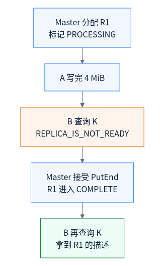

# KV 已经写到远端，Mooncake 什么时候才让其他实例读？

**摘要：** 实例 A 已把 4 MiB 前缀 KV 写到 R1，实例 B 却查不到可读副本。普通 Put 先分配、再写入、最后提交。同一个 key 重试时，写方收到成功，也可能只是碰到了已有对象。

实例 A 正在写入本系列的示意对象 `K`。先看只有一个内存副本 R1 的情形。4 MiB 字节都到了远端，等待提交时，B 恰好查询这个 key。

这时候，Master 能找到 `K` 的元数据，但 R1 仍处于 `PROCESSING`，B 收到 `REPLICA_IS_NOT_READY`。

## R1 在什么时候进入可读列表？

1. **申请**。A 调用 `PutStart`，Master 分配 R1、记录 `PROCESSING`，并返回包括地址、长度和传输端点的副本描述。
2. **搬运**。A 通过 Transfer Engine 写入 R1，并等待数据传输返回。
3. **提交**。A 调用 `PutEnd`，Master 将符合条件的目标副本标记为 `COMPLETE`。B 随后查询时，R1 才有资格进入结果列表。

*图注：图中的 R1 句柄和端点有效。两次查询之间改变的是 Master 记录的副本状态。*

Master 的 `GetReplicaList` 会过滤副本。`COMPLETE` 是第一道条件，内存或 NoF 句柄失效、传输端点被标记为失效，也会导致相关副本被排除。

如果没有可读副本，但仍有未完成或不可用的副本，查询会返回 `REPLICA_IS_NOT_READY`。Master 查不到对象，或副本都已标记为 `REMOVED` 时，返回 `OBJECT_NOT_FOUND`。前一个错误可能只是撞上提交窗口，也可能由不可用端点引起。按同一 key 短暂重查，只适用于调用方有等待预算的场景。

## R2 失败时，R1 能提交吗？

现在给同一个 `K` 配两个内存副本 R1、R2。假设两份空间都分配成功，A 写完 R1 后，写向 R2 的传输返回错误。可靠模式要求参与同步提交的已分配副本都写成功。客户端会请求 `PutRevoke(ALL)`，R1 的传输虽然完成，这条路径也不会把它提交为可读副本。

换一种配置，给 K 分配一个内存副本 R1 和一个 NoF SSD 副本 N1。启用 `FLEXIBLE_DUAL_REPLICA` 后，客户端按成功的一侧决定如何提交。

- 两侧都成功，提交两类。
- 仅 R1 成功，先 `PutEnd(MEMORY)`，再 `PutRevoke(NOF_SSD)`。
- 仅 N1 成功，先提交 NoF，再撤销内存。
- 两侧都失败，撤销两类。

这种配置下的 Put 成功可能只有一份可读副本。

`PutRevoke` 只处理仍在 `PROCESSING` 的目标副本。若撤销目标类中已有 `COMPLETE` 等非 `PROCESSING` 副本，Master 会拒绝请求并返回 `INVALID_WRITE`。在先提交、再撤销的分支里，若 `PutEnd` 报错，该次调用会立即返回，后续的 `PutRevoke` 不会发出。若内存侧已提交，随后撤销 NoF 侧时 RPC 报错，`Client::Put` 会返回撤销错误，而 R1 可能已经能被 B 查到。

若 `PutStart` 就报告 `NO_AVAILABLE_HANDLE`，客户端没有拿到这次写入的分配结果，也不会进入传输。若 `PutRevoke` 成功，客户端返回提交决策里的失败原因。若撤销本身失败，客户端优先返回该 RPC 错误，排查时仍需要找原先的传输错误。

## 同一个 key 重试，可能在哪一步就返回？

`Client::Put` 将 `PutStart` 返回的 `OBJECT_ALREADY_EXISTS` 转成成功。这条路径不会搬运本次提交的 4 MiB。以下两种故障在写方看起来相似。

**提交已执行，回复丢失。** A 发送了 `PutEnd`，Master 已把 R1 标为 `COMPLETE`，但 A 没收到回复。A 用相同 key 重试 Put，会因为对象已存在而提前返回。只要 R1 仍然可读，B 此时能查到它。重试时传入不同字节也不会覆盖 R1。覆盖写属于 `Upsert`。

**写方在提交前中断。** A 完成了 `PutStart`，却没执行 `PutEnd` 或 `PutRevoke`，例如分配回复丢失后写方退出。在 discard 窗口内，同 key Put 也会提前成功返回，但此时 R1 仍是 `PROCESSING`，B 仍然拿不到它。

对于两个分支，查 Master 是否已经把 R1 放入可读列表，比反复观察写方的“成功”更能判断卡在哪里。

## 旧写入可以被顶替，旧地址还要等释放

对于上述悬挂写入，两个超时都从 Master 记录的 `put_start_time` 起算。

- **discard，默认 30 秒**。超过窗口后，若旧对象仍无 `COMPLETE` 副本，新的 `PutStart` 可以移出旧元数据，尝试重新分配。新分配仍可能失败。
- **release，默认 600 秒**。在本例的内存路径中，旧 `PROCESSING` 副本被移到 `discarded_replicas_`，到释放期限后才由清理流程回收。延后释放给可能仍在途的旧写入留出时间。这样，新写方在旧地址仍被保留时就可以申请其他空间。

这两个默认值分别对应 `put_start_discard_timeout_sec` 和 `put_start_release_timeout_sec`。释放期限是清理条件，实际回收取决于清理流程何时运行。

## 总结

沿着 4 MiB 写入跟踪三个信号：Transfer Engine 返回、Master 提交、读方查询。R1 写完后仍可能不可见，R2 失败也可能改变整次 Put 的提交动作。遇到超时或同 key 重试时，要结合副本状态和 RPC 结果判断 `K` 是否已可读。

**源码延伸**（`v0.3.13.post1`）

- [Client::Put](https://github.com/kvcache-ai/Mooncake/blob/719735896c86b56fabec6cf3e825fb2ea640597a/mooncake-store/src/client_service.cpp#L1853) · [提交决策](https://github.com/kvcache-ai/Mooncake/blob/719735896c86b56fabec6cf3e825fb2ea640597a/mooncake-store/src/client_service.cpp#L332) · [先提交再撤销](https://github.com/kvcache-ai/Mooncake/blob/719735896c86b56fabec6cf3e825fb2ea640597a/mooncake-store/src/client_service.cpp#L1967)
- [PutStart 的已有对象分支](https://github.com/kvcache-ai/Mooncake/blob/719735896c86b56fabec6cf3e825fb2ea640597a/mooncake-store/src/master_service.cpp#L4422) · [PutEnd](https://github.com/kvcache-ai/Mooncake/blob/719735896c86b56fabec6cf3e825fb2ea640597a/mooncake-store/src/master_service.cpp#L4509) · [PutRevoke](https://github.com/kvcache-ai/Mooncake/blob/719735896c86b56fabec6cf3e825fb2ea640597a/mooncake-store/src/master_service.cpp#L4776)
- [GetReplicaList](https://github.com/kvcache-ai/Mooncake/blob/719735896c86b56fabec6cf3e825fb2ea640597a/mooncake-store/src/master_service.cpp#L3626) · [IsReplicaReadable](https://github.com/kvcache-ai/Mooncake/blob/719735896c86b56fabec6cf3e825fb2ea640597a/mooncake-store/src/master_service.cpp#L3546)
- [discard / release 超时默认值](https://github.com/kvcache-ai/Mooncake/blob/719735896c86b56fabec6cf3e825fb2ea640597a/mooncake-store/include/types.h#L119) · [后台释放](https://github.com/kvcache-ai/Mooncake/blob/719735896c86b56fabec6cf3e825fb2ea640597a/mooncake-store/src/master_service.cpp#L9446)

[系列目录与排版说明](README.md)

[上一篇](02-objects-and-replicas.md) · [下一篇](04-get-and-lease.md)
