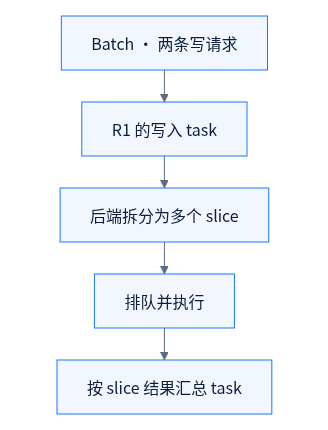

# Mooncake 提交失败后，为什么还不能释放源缓冲区？

**摘要：** Transfer Engine 的提交成功只确认后端已接受工作。出现部分提交或状态查询先报错时，其他 task 仍可能在执行。调用方要跟踪每项工作的完成状态，并用 `freeBatchID` 确认 batch 可以回收。

继续用前几篇的 **4 MiB 对象 `K`**。这次单独看 Transfer Engine（TE），假设调用方把 `K` 发往 R1、R2 的两条写请求放进同一个 batch，两个目标由不同的传输后端处理。这个例子用于观察 TE 的分组提交，Store 普通 Put 有独立的副本提交流程。[Put 提交流程](03-put-visibility.md)

假设 R1 对应的后端先接受请求，R2 对应的后端随后报错。调用方已经看见提交失败，但 R1 那条写可能还在队列里，网卡也可能正在读 `K` 的源缓冲区。

## 从 batch 看到 slice

调用方用 batch 管理一组工作。在这个普通提交示例里，两条写请求各对应一个 task。后端可以再把每个 task 拆成多个 slice，拆分方式和片段大小由后端决定。

*图注：只展开 R1 这一条 task。R2 对应另一条 task，两个 task 有各自的进度。*

## 提交前拒绝与部分提交

在本文的版本里，`MultiTransport::submitTransfer` 先检查普通提交的批次容量，再为所有请求选 transport。容量不够或目标段无法选出 transport，此次调用会在向后端分派前返回。若这个 BatchID 之前已经装入任务，还要继续管理那些任务。

进入分派阶段后，`MultiTransport` 按 transport 分组调用后端。某一组返回错误，它仍会尝试剩余分组，最后返回非 OK 状态。分组遍历次序也无法由请求顺序推出。

回到 `K`。只要发往 R1 的请求已被接受，错误返回就没有撤销这条写。即使 R2 先报错，R1 也可能在之后被分派。要判断已经接受了哪些工作，需要看 task 状态和后端记录。整批直接重交可能与仍在进行的写重叠。

## 超时、失败与完成各能证明什么

`getTransferStatus` 有两层结果。接口返回的 `Status::OK` 表示查询成功，task 的传输结果要看输出字段里的状态。以此版本的 RDMA 路径为例：

- **`WAITING`**：task 的 slice 还没全部收尾。若启用 slice 超时，查询可以把一项仍在等待的工作报告为 `TIMEOUT`。这段检查只改查询结果，未取消设备操作。
- **`FAILED`**：对 RDMA task，所有 slice 已记账且至少一项失败时，查询会报告失败并设置完成标记。此前已完成的 slice 可能已把部分字节写到远端。
- **`COMPLETED`**：在这里表示 task 的 slice 全部成功。若写入服务于 Store Put，仍需 Store 提交流程才会让副本可查询。

`getBatchTransferStatus` 遇到某个 task 失败或超时就可能报告整批 `FAILED`，并提前返回。它给出的是整批传输结果。收尾时要逐项查看，避免后面尚未检查到的 task 被误当成已经结束。

## 什么时候可以回收 batch

错误返回后，保留 BatchID、原始请求向量和传输缓冲区。当前路径下，task 持有指向原向量元素的指针，后端可能继续访问缓冲区。因此收尾前要保持描述有效、缓冲区仍已注册，也别将这块内存交给下一次写入。

继续用逐项状态查询和后端的完成机制推进收尾，再调用 `freeBatchID`。本文版本的实现逐项检查 `is_finished`。只要有一项还没完成，就返回 `BatchBusy` 并保留 batch；返回 `OK` 时才删除批次描述。之后按各自所有权解除注册或复用缓冲区。

如果状态一直无法推进，要按所用 transport 的退出与清理机制排查。仅凭查询超时，无法证明设备已经停止访问内存。

## 总结

对于示意对象 `K`，R2 的提交错误可以先返回，而 R1 的写仍在执行。排障时先定位失败发生在分派前还是分派中，再看每个 task 如何收尾。`TIMEOUT` 记录等待超时，`freeBatchID` 的结果才用于确认批次资源何时回收。

**源码延伸**　版本基线为 `v0.3.13.post1`。

- [MultiTransport::submitTransfer](https://github.com/kvcache-ai/Mooncake/blob/719735896c86b56fabec6cf3e825fb2ea640597a/mooncake-transfer-engine/src/multi_transport.cpp#L130) · [MultiTransport::freeBatchID](https://github.com/kvcache-ai/Mooncake/blob/719735896c86b56fabec6cf3e825fb2ea640597a/mooncake-transfer-engine/src/multi_transport.cpp#L108)
- [task 查询与超时](https://github.com/kvcache-ai/Mooncake/blob/719735896c86b56fabec6cf3e825fb2ea640597a/mooncake-transfer-engine/src/multi_transport.cpp#L256) · [batch 状态聚合](https://github.com/kvcache-ai/Mooncake/blob/719735896c86b56fabec6cf3e825fb2ea640597a/mooncake-transfer-engine/src/multi_transport.cpp#L363)
- [RDMA task 完成判定](https://github.com/kvcache-ai/Mooncake/blob/719735896c86b56fabec6cf3e825fb2ea640597a/mooncake-transfer-engine/src/transport/rdma_transport/rdma_transport.cpp#L1023)

[系列目录与排版说明](README.md)

[上一篇](04-get-and-lease.md) · [下一篇](07-rdma-data-path.md)
