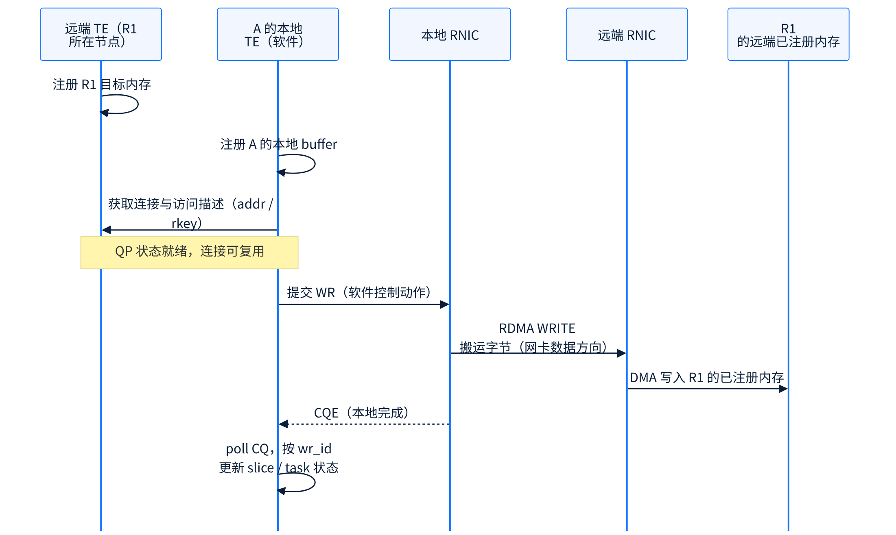

# 第7篇｜一次 RDMA 传输，究竟经历了什么？

**摘要：**推理实例 A 把主机内存里的 KV 写到远端 R1。沿着一次 WRITE 看源 buffer、目标 buffer、WR 提交与本地完成观察。

推理实例 A（下文简称实例 A）算完一段前缀 KV，准备把它写入 R1。R1 是这次写入在远端 Store Segment 中分配到的副本区间。源数据在 A 的主机内存里，目标 R1 在另一台机器，两端都通过 RDMA 访问。

这一篇只跟这一条从主机内存到远端已注册内存的 WRITE 路径。它回答四个问题：源和目标的 buffer 在哪里，哪些准备可以复用，谁提交这次搬运，谁观察本地完成。

## 源 buffer 和目标 buffer 在哪里

源 buffer 是 A 进程里的一段主机内存。它必须先注册，网卡才能按 RDMA 语义访问。

目标 buffer 不是远端 TE 进程里的一个临时变量，而是 R1 所在 Store Segment 中的一段已注册内存。A 拿到的副本描述包含远端地址和访问凭据，用来告诉本地 RNIC：把字节写到哪个远端地址。

普通指针只对进程的软件逻辑有意义。RDMA 还需要内存注册等准备工作，让网卡能够按规定访问相应范围。遇到地址相关错误时，不能只检查"指针是不是非空"，还要看这段范围是否已注册、使用了哪张网卡，以及描述是否仍然有效。

## 准备阶段：注册与连接可以复用

远端信息需要通过配置的元数据与握手机制交换。QP 也需要完成相应状态转换，才能执行后续数据操作。

这些准备通常可以复用。不能把每个数据请求都理解成重新注册内存、重新建立全部连接。对于同一个 Segment 和同一组 QP，后续请求主要是在已有连接上提交新的 WR。

图注：准备阶段由两端 TE 参与；交换的是 Segment、远端地址与访问凭据。同一 Segment 与同一组 QP 的准备可以复用，不必为每个请求重新注册或建连。

## 提交：本地 TE 把 slice 变成 WR

WR 描述希望网卡执行的工作。在这条固定路径上，`RdmaEndPoint::submitPostSend` 为每个 slice 构造一个 `ibv_send_wr`：

- `opcode` 为 `IBV_WR_RDMA_WRITE`；
- `send_flags` 为 `IBV_SEND_SIGNALED`；
- `sg_list` 指向 A 的本地已注册 buffer，携带 `lkey`；
- `wr.rdma.remote_addr` 与 `rkey` 指向 R1 的远端已注册内存；
- 最后调用 `ibv_post_send`。

这是软件提交 WR 的控制动作；真正搬字节的是本地 RNIC 到远端 RNIC 的 RDMA WRITE，远端 TE 软件不在数据路径上逐次接收这些字节。

对象字节最终落在 R1 的远端内存里，而不是落在远端 TE 的某个应用缓冲区里。这个区别决定了后面"传输完成"能证明什么、不能证明什么。

## 完成：本地 worker 从 CQ 观察

完成侧由本地 `WorkerPool` 的 worker 调用 `context_.poll` 读取 `ibv_wc`，用 `wr_id` 找回 `Slice*`；`wc.status` 成功时调用 `slice->markSuccess()`，失败时调用 `markFailed()`。这两个函数再更新 task 的 slice 计数与 batch 完成状态。

一次 poll 最多取 64 个 CQE。即使每个 WR 都设置了 `IBV_SEND_SIGNALED`，上层看到的也是 CQE 批量回收后映射到 slice，再由 slice 聚合到 task，不意味着每个 WR 都由上层单独处理一个事件。

这里观察的是**本地完成**：本地 RNIC 已经回收这次 WRITE 的完成事件。远端应用是否已经处理这块内存，不在这个 CQE 的语义里。

图注：软件提交发生在本地 TE 到本地 RNIC；对象字节经 RDMA WRITE 到达远端 RNIC，再 DMA 写入 R1。CQE 只表示本地完成；副本可见性还要等 PutEnd（第3篇）。

这就形成一条流水线：

待发送片段 → 路径与连接检查 → WR 提交 → 网卡执行 → CQE 回收 → 上层状态更新。

如果不把这些阶段分开，很容易把"尚未提交""已经提交但未完成""完成事件未被处理"都看成同一种卡住。

QP 或 CQ 相关额度不足时，后端可能暂缓提交，让片段留在队列等待。这是背压，与连接失效或数据操作错误不同：前者需要等待资源，后者可能需要更换路径、重建连接或报告失败。

## 传输完成，不等于 Store 可见

RDMA 的完成结果属于传输层。它不能替代 Store 的对象提交。

`ibv_post_send` 成功，只表示 WR 被本地提交；CQE 成功，只表示本地观察到了这次 WRITE 的完成。这条路径的完成只表示字节到了 R1 的远端已注册内存。要用普通 Put 让读方查到副本，`Client::Put` 还需要调用 `PutEnd`，Master 把副本从 `PROCESSING` 翻成 `COMPLETE`；在此之前 `GetReplicaList` 不会返回它。

## "零拷贝"也有范围

RDMA 可以减少传统网络栈中的部分 CPU 搬运，但应用是否存在 staging、GPU 与主机之间是否复制，取决于整条路径。

讨论这条 WRITE 路径的性能时，应说明省掉的是哪一次拷贝，而不是把"用了 RDMA"当成全路径没有拷贝的证明。

## 总结

这条 WRITE 路径上，软件只做两件事：本地 TE 把 slice 构造成 WR 并 `ibv_post_send`；本地 worker 从 CQ 回收 CQE，把完成映射回 slice 和 task。对象字节由 RNIC 经 RDMA WRITE 直接写入 R1 的远端已注册内存。

CQE 成功只证明本地完成，不证明 Store 可见；要让读方查到副本，还需要 `PutEnd` 把状态翻成 `COMPLETE`。RDMA 省掉的是传统网络栈中的部分 CPU 搬运，"零拷贝"不能外推为整条 GPU 或应用路径都没有拷贝。

**源码延伸：**原系列篇6；RDMA transport、endpoint、worker pool、WR/CQE 处理。版本基线为 `v0.3.13.post1`。

- [RdmaEndPoint::submitPostSend](https://github.com/kvcache-ai/Mooncake/blob/719735896c86b56fabec6cf3e825fb2ea640597a/mooncake-transfer-engine/src/transport/rdma_transport/rdma_endpoint.cpp#L915) · [IBV_WR_RDMA_WRITE / IBV_SEND_SIGNALED](https://github.com/kvcache-ai/Mooncake/blob/719735896c86b56fabec6cf3e825fb2ea640597a/mooncake-transfer-engine/src/transport/rdma_transport/rdma_endpoint.cpp#L972)
- [WorkerPool CQ poll](https://github.com/kvcache-ai/Mooncake/blob/719735896c86b56fabec6cf3e825fb2ea640597a/mooncake-transfer-engine/src/transport/rdma_transport/worker_pool.cpp#L599) · [Slice::markSuccess / markFailed](https://github.com/kvcache-ai/Mooncake/blob/719735896c86b56fabec6cf3e825fb2ea640597a/mooncake-transfer-engine/include/transport/transport.h#L206)

[源码解析版](../../06-rdma-data-path.md) · [系列目录与排版说明](README.md)

[上一篇](06-transfer-lifecycle.md) · [下一篇](08-multi-nic-numa.md)
