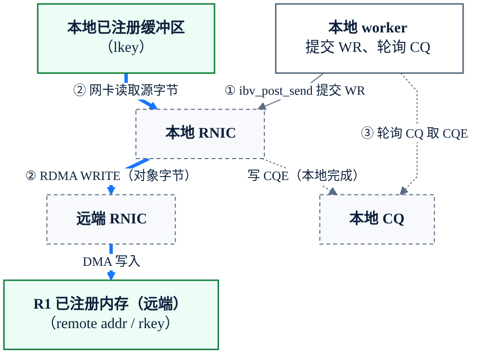

# 一次 RDMA WRITE：KV 怎么写到远端，谁来确认传输完成？

**摘要：** 推理实例 A 把 4 MiB 对象 `K` 写入远端 R1。Transfer Engine（TE）提交 WR，RDMA 网卡搬字节，本地 worker 从 CQ 观察完成。如果写入失败，先看请求是否已经交给网卡，再看异常发生在哪条路径。

A 已在主机内存准备好对象 `K`。R1 在另一台机器的 Store Segment 中，示意起点为 `base + 8 MiB`，长度为 4 MiB。看清这次 RDMA WRITE 需要回答两个问题。网卡怎样找到正确的内存区间，提交或完成出错后哪些字节还可能在路上？

## 准备好地址、访问凭据与连接

Store 返回的副本位置指明 R1 在哪个 Store Segment、要写哪个地址范围。TE 再从 RDMA 段描述查与该地址范围和目标设备对应的 `rkey`。本地源缓冲区也需要注册，以便发送侧网卡用 `lkey` 读取 `K`。

内存描述与连接信息来自两处。内存注册后，TE 可在段描述里发布地址范围和访问键。建立队列对（QP）时，两端 TE 交换 QP 编号等连接信息。两类准备在条件保持有效时都可复用。

图注：Store 返回的副本描述只给出 R1 的地址范围；本地 TE 还要在 RDMA 段描述里查到 rkey，并与远端完成 QP 握手，才能提交 WR。两条点线分别表示 Store 位置和注册信息，都不搬运对象字节；字节路径见配图 2。

## 本地 TE 把 slice 变成 WR

WR 描述希望网卡执行的工作。在这条固定路径上，`RdmaEndPoint::submitPostSend` 为每个 slice 构造一个 `ibv_send_wr`：

- `opcode` 为 `IBV_WR_RDMA_WRITE`；
- `send_flags` 为 `IBV_SEND_SIGNALED`；
- `sg_list` 指向 A 的本地已注册缓冲区，携带 `lkey`；
- `wr.rdma.remote_addr` 与 `rkey` 指向 R1 的远端已注册内存；
- 最后调用 `ibv_post_send`。

TE 提交 WR 后，本地 RDMA 网卡（RNIC）读取源字节，经远端 RNIC 写到 R1 的已注册内存。远端 TE 参与连接准备。

## 本地 worker 从 CQ 观察完成

本地 `WorkerPool` 从完成队列（CQ）读取完成记录（CQE），用 `wr_id` 找回对应的 slice。一次轮询最多取 64 条。成功的完成记录记入该 slice，多个 slice 的结果再汇总到 task。失败的完成记录还要判断是否需要换路重试。

这里观察的是**本地完成**。写入成功的 CQE 告诉 TE 这条 WR 已完成；Store 的副本状态何时变为 `COMPLETE`，要看后续 `PutEnd` 的结果。

图注：① 是本地 TE 到 RNIC 的软件提交；② 中蓝色粗线表示网卡读取源字节、经 RDMA WRITE 写入 R1，再 DMA 到远端内存；③ 是本地 worker 从 CQ 取完成记录。CQE 只表示本地观察到这条 WRITE 完成，副本何时可读仍取决于 Store 层的 `PutEnd`。

## 等额度、提交失败、完成失败

同样卡在一次 R1 写入，处理方式取决于卡在哪一步。

- **QP 或 CQ 暂时没有额度。** `submitPostSend` 按剩余额度限制本轮可以提交多少 WR。暂时交不出去的 slice 留在待发送队列。
- **`ibv_post_send` 在一串 WR 中返回错误。** 代码用 `bad_wr` 找到首个未提交的 WR，将它和后继项交回失败处理。其前面的 WR 可能已经提交，仍要等 CQ 回收。
- **已发出的 WR 返回错误 CQE。** Worker 区分本地网卡侧故障和远端或默认路径故障，有条件地尝试换本地设备或调整远端路径。重试额度用完、或找不到可用路径时，slice 记为失败。R1 仍可能留有先到达的字节。

这三类信号分别来自排队、提交和完成阶段。看日志时，对照当前阶段的 QP/CQ 额度、`ibv_post_send` 返回值或 CQE 状态，能把同一条“写失败”定位到具体动作。

## 什么时候能查到 R1

`ibv_post_send` 成功，只表示 WR 被本地提交；CQE 成功，只表示本地观察到了这次 WRITE 的完成。对发往 R1 的普通内存 Put，Store 客户端还要调用 `PutEnd`。Master 将 R1 的副本状态从 `PROCESSING` 置为 `COMPLETE` 后，查询路径才能把它作为可读副本返回。[Put 提交流程](03-put-visibility.html)

## “零拷贝”也有范围

RDMA 可以减少传统网络栈中的部分 CPU 搬运，但应用是否存在暂存、GPU 与主机之间是否复制，取决于整条路径。

讨论这条 WRITE 路径的性能时，应说明省掉的是哪一次拷贝，而不是把“用了 RDMA”当成全路径没有拷贝的证明。

## 总结

本地 TE 提交 WR，网卡把 `K` 的字节写入远端 R1，本地 worker 在 CQ 上回收完成。提交失败和完成失败需要分别处理。已经成功的写入片段仍可能留在 R1，副本对读者何时可见由 `PutEnd` 后的副本状态决定。

**源码延伸**　版本基线为 `v0.3.13.post1`。

- [RdmaEndPoint::submitPostSend](https://github.com/kvcache-ai/Mooncake/blob/719735896c86b56fabec6cf3e825fb2ea640597a/mooncake-transfer-engine/src/transport/rdma_transport/rdma_endpoint.cpp#L915) · [IBV_WR_RDMA_WRITE / IBV_SEND_SIGNALED](https://github.com/kvcache-ai/Mooncake/blob/719735896c86b56fabec6cf3e825fb2ea640597a/mooncake-transfer-engine/src/transport/rdma_transport/rdma_endpoint.cpp#L972)
- [WorkerPool CQ poll](https://github.com/kvcache-ai/Mooncake/blob/719735896c86b56fabec6cf3e825fb2ea640597a/mooncake-transfer-engine/src/transport/rdma_transport/worker_pool.cpp#L599) · [Slice::markSuccess / markFailed](https://github.com/kvcache-ai/Mooncake/blob/719735896c86b56fabec6cf3e825fb2ea640597a/mooncake-transfer-engine/include/transport/transport.h#L206)
- [注册后的 RDMA 内存描述](https://github.com/kvcache-ai/Mooncake/blob/719735896c86b56fabec6cf3e825fb2ea640597a/mooncake-transfer-engine/src/transport/rdma_transport/rdma_transport.cpp#L489) · [连接握手字段](https://github.com/kvcache-ai/Mooncake/blob/719735896c86b56fabec6cf3e825fb2ea640597a/mooncake-transfer-engine/src/transport/rdma_transport/rdma_endpoint.cpp#L39) · [从段描述选取 rkey](https://github.com/kvcache-ai/Mooncake/blob/719735896c86b56fabec6cf3e825fb2ea640597a/mooncake-transfer-engine/src/transport/rdma_transport/worker_pool.cpp#L196)
- [部分 WR 提交失败](https://github.com/kvcache-ai/Mooncake/blob/719735896c86b56fabec6cf3e825fb2ea640597a/mooncake-transfer-engine/src/transport/rdma_transport/rdma_endpoint.cpp#L984) · [CQE 失败与重试](https://github.com/kvcache-ai/Mooncake/blob/719735896c86b56fabec6cf3e825fb2ea640597a/mooncake-transfer-engine/src/transport/rdma_transport/worker_pool.cpp#L651)

[系列目录与排版说明](index.html)

[上一篇](06-transfer-lifecycle.html) · [下一篇](08-multi-nic-numa.html)
