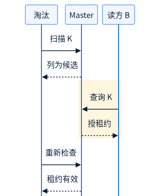

# 已经选中要淘汰的 KV，为什么又被跳过了？

**摘要：** Master 扫描时把 4 MiB 对象 K 列为淘汰候选。读方 B 随后拿到读租约，真正驱逐前重查时，Master 跳过了 K。租约、pin 和后台任务各自影响这次回收。

## 从一次候选扫描说起

Mooncake 的缓存接近满载。Master 的淘汰线程扫描对象时，发现 4 MiB 的 K 已过读租约，至少还有一个可淘汰的 MEMORY 副本，也没有 hard pin。K 进入候选池。

在这次快照里，K 的租约截止时间较早。候选扫描与驱逐分两阶段，新读请求可以插在中间。

1. 读方 B 查询 K，Master 按默认 TTL 授予 10 秒读租约。
2. B 拿到 R1 的副本描述，准备搬运 K 的 4 MiB 数据。
3. 淘汰线程处理到 K，重新查表并检查租约和可淘汰性。
4. K 的租约尚未过期，本次普通淘汰跳过它。

如果没有第 3 步的重检，淘汰线程就会按旧快照删掉一个刚刚承诺给 B 的读取窗口。

*图注：黄色区间是候选扫描后插入的读取。B 获得租约后，驱逐前的重查会按更新后的截止时间判断。*

census 是按分片扫描的统计阶段。普通候选保存分片、租户、key 和租约截止时间。驱逐阶段据此重新定位对象，再检查租约、soft pin 和可淘汰副本。

## 四种保护，各管一件事

**读租约**保护普通读取的时间窗。新读取可以延长截止时间。到期后，对象可以参加下一轮回收判断。

**hard pin**是对象的强保留标记。普通淘汰的 census 直接跳过它。

**soft pin**提供一段优先保护期，默认 30 分钟。如果第一轮回收不足，默认配置允许第二轮处理仍在保护期内的对象。

**后台引用计数**保护任务正在使用的源副本。副本 `refcnt > 0` 时，Master 会跳过这一份内存副本。

普通内存读取通过对象的租约保护时间窗。下沉任务则按副本计数。比如下沉开始后 R1 的引用数大于零，同时 R2 仍满足可淘汰条件，Master 可以先回收 R2。

## 淘汰副本，不一定删除对象

这一轮内存淘汰只移除可读且 `refcnt == 0` 的 MEMORY 副本。假如后来 SSD 副本 R3 已登记，即使 R1 和 R2 都被回收，K 仍可保留目录记录。R3 能否读回还要看磁盘所在节点能否加载和发送数据。

最后一个有效副本被移除后，普通淘汰路径才会清理对象元数据。清理还可能涉及下沉任务、引用和容量统计。

## 下沉和淘汰如何配合？

在未启用 OpLog、开启 `offload_on_evict` 且 K 还没有 LOCAL_DISK 副本的这条分支里，Master 先尝试把 K 加入下沉队列，成功后增加源副本 R1 的引用计数。其余符合条件的内存副本仍可回收。

队列拒绝时，默认行为是本轮跳过 K。显式开启 `offload_force_evict` 后，入队失败或本轮排队达到上限时，Master 可以直接驱逐符合条件的内存副本。选择强制回收的代价是 K 可能失去最后一份可读副本。

## 总结

K 被扫描为候选后，B 的新读租约让 Master 在驱逐前跳过了它。排查回收量偏低时，先确认候选是否在重检阶段被跳过，再看 pin、后台任务引用和下沉队列。下一篇继续跟踪 K 的 SSD 副本 R3，看看落盘之后还需要什么才能读回。

**源码延伸**：读租约（lease）、pin、census、驱逐重检与元数据清理。版本基线为 `v0.3.13.post1`。

- [GetReplicaList / 读租约](https://github.com/kvcache-ai/Mooncake/blob/719735896c86b56fabec6cf3e825fb2ea640597a/mooncake-store/src/master_service.cpp#L3626) · [GrantReadLease](https://github.com/kvcache-ai/Mooncake/blob/719735896c86b56fabec6cf3e825fb2ea640597a/mooncake-store/include/master_service.h#L1322)
- [候选收集](https://github.com/kvcache-ai/Mooncake/blob/719735896c86b56fabec6cf3e825fb2ea640597a/mooncake-store/src/master_service.cpp#L10416) · [驱逐前重检](https://github.com/kvcache-ai/Mooncake/blob/719735896c86b56fabec6cf3e825fb2ea640597a/mooncake-store/src/master_service.cpp#L10530) · [IsEvictableMemoryReplica](https://github.com/kvcache-ai/Mooncake/blob/719735896c86b56fabec6cf3e825fb2ea640597a/mooncake-store/src/master_service.cpp#L3570)
- [下沉入队和强制驱逐](https://github.com/kvcache-ai/Mooncake/blob/719735896c86b56fabec6cf3e825fb2ea640597a/mooncake-store/src/master_service.cpp#L10024)
- [EraseMetadata](https://github.com/kvcache-ai/Mooncake/blob/719735896c86b56fabec6cf3e825fb2ea640597a/mooncake-store/src/master_service.cpp#L10550) · [默认参数（10 s / 30 min / allow_evict）](https://github.com/kvcache-ai/Mooncake/blob/719735896c86b56fabec6cf3e825fb2ea640597a/mooncake-store/conf/master.json#L10)

[系列目录与排版说明](README.md)

[上一篇](08-multi-nic-numa.md) · [下一篇](10-ssd-tiering.md)
