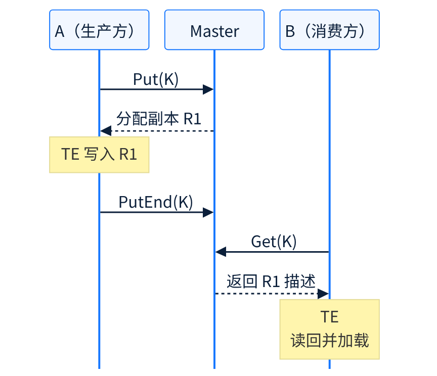
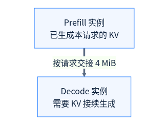

# 第11篇｜共享了 KV Cache，为什么推理不一定更快？

**摘要：**A 写入的 1,024 token 前缀，B 能命中。B 什么时候拿到首个 token，取决于加载、同步和调度，而不只取决于"命中"。

回到第1篇的 A 和 B：同一段 1,024 个 token 的前缀，A 已经算过并以 key `K` 写入共享缓存，B 的请求命中这段前缀。

B 不用再 Prefill 这 1,024 个 token，是否就能更早输出首个 token？

不一定。命中只说明缓存里可能有可复用的数据；B 还要完成查询、读取、布局转换、设备同步，并让调度器确认这些 KV 已经可用。TTFT 量的是从请求开始到首个输出 token，不是从缓存命中到字节到达。

## 一次命中到首个 token

B 的框架大致要经过这些动作：

1. 识别可复用 token 范围，构造缓存 key；
2. 向 Store 查询 key，拿到可读副本描述；
3. 从副本读取数据，搬进 B 的 buffer；
4. 完成必要的布局转换或设备同步；
5. 通知调度器：这段前缀的 KV 已经可用；
6. 调度器允许请求继续，B 生成首个 token。

"数据到达 buffer""设备上的数据可用""调度器允许复用"是三个不同时刻。Store 的读取完成只覆盖第 3 步；它不证明第 4、5 步已经完成。

因此，讨论命中收益时，不能把"Store 读到了"直接写成"TTFT 降低了"。

## Store 共享缓存与 PD 直传要分开

一种路径是共享 Store：按 key 查找并加载已有 KV 对象。A 和 B 不需要知道对方是谁，只需要生成兼容的 key，并读出同一个对象。

图注：A 在一个请求写入 K，B 在另一个请求按同一 key 查询并加载；两者不需要知道对方是谁。图中省略布局转换与调度器确认。

另一种路径是 Prefill/Decode 分离中的点对点传输：把某个请求产生的 KV 交给对应的 Decode 实例。它按请求协调，不依赖一个可被任意请求查询的共享池。

图注：Prefill 实例把本轮请求的 KV 直接交给 Decode 实例；按请求协调，不经过可被任意请求查询的共享池。

两者都可以使用 Mooncake 的传输能力，但协调对象和生命周期不同。本篇的 A/B 例子属于 Store 共享缓存路径。

## 用两组请求测 TTFT

要判断 Store 命中是否降低 TTFT，可以固定同一模型、同一请求、同一段 1,024 token 前缀和同一并发度，做两组对照：

- **重算组**：禁用外部缓存，或强制让这段前缀不命中，由 B 重新 Prefill；
- **加载组**：允许 B 从 Store 命中并加载这段前缀。

关键是控制本地前缀缓存和其他缓存，避免两组跑到不同路径。比如每组开始前清空或禁用 B 的本地前缀缓存，或者用独立进程；否则重算组可能先在本地命中，看起来反而更快。

两条时间线都以 B 收到请求为起点、首个输出 token 为终点：

- **重算路径**：B 收到请求 → 排队 → Prefill 1,024 token → 首个 token
- **加载路径**：B 收到请求 → 识别前缀 → 查询 → 读取 → 必要的布局转换与同步 → 剩余计算 → 首个 token

两条时间线按串行排列，用于比较关键路径。实际系统中，读取可能与排队或后续计算重叠；一旦重叠，TTFT 取决于哪段等待真正挡在首个 token 前面，而不是两段耗时简单相加。

最少记录这些数据：

- **实际命中的 token 数**：确认复用的确实是那 1,024 个 token，而不是假设。
- **实际读取的字节数**：区分"命中"与"真的搬了这么多数据"。
- **查询、读取、布局转换、设备同步的耗时**：找出加载成本落在哪一段。
- **从请求开始到首个 token 的 TTFT**：端到端结果，不用传输接口的完成时间代替。
- **并发度与批次组成**：判断调度和排队是否混入差异。

测量点应放在请求侧，而不是只测 Transfer Engine 的传输时间。若加载与后缀 Prefill 或其他工作重叠，TTFT 取决于关键路径，不是"加载耗时 + 重算耗时"的简单相加。

这组对照只是实验设计，本文没有运行，也没有给出性能数字。如果加载组的 TTFT 没有下降，先看加载是否卡在关键路径上、命中长度是否真的达到 1,024、读取是否走了慢介质。如果下降了，也要确认不是因为本地缓存、批次差异或缓存预热造成的假象。

## 什么时候加载比重算划算？

可以先比较下面两项成本：

> 外部加载成本 = 探测 + 数据读取 + 必要的转换与同步

> 复用成立的性能条件 = 外部加载成本小于重算对应前缀的成本

这是其余条件相同、各阶段串行时的直观估算。若读取与排队、计算重叠，不能直接用这个不等式预测 TTFT；要看哪段等待推迟了首个 token。第2篇的 128 MiB 是 32 层、8 头、128 维、BF16 假设下的逻辑 KV 量；实际读取字节还要看命中范围与分块。

前缀很短时，省下的计算可能不足以覆盖加载开销。

KV 对象较大、介质较慢或并发很高时，读取成本也可能上升。相反，长前缀、多次复用和高效数据路径，可能提高收益。

所以，命中率重要，但不足以单独解释 TTFT。性能报告还应说明对象大小、命中长度、模型、并发、硬件和版本；缺少这些条件，单个带宽数字不能直接换算成端到端收益。

## 加载失败，谁负责恢复？

绑定层返回失败，只能证明它报告了结果。

Connector 如何告知调度器，是否重试，哪些块需要重算，以及部分写入的 KV 是否可能被误用，都需要沿具体版本实现核实。

"缓存可以重算"是一种恢复思路，不是自动成立的正确性保证。

本文没有固定并验证 vLLM 的具体 commit，因此不把上述逻辑步骤写成已审计的函数调用链。Mooncake 中存在某个张量 API，只能证明它提供这种能力，不能直接证明某个版本的 vLLM connector 必然采用它。

## 总结

命中只说明共享池里可能有可复用 KV。B 的首个 token 要等识别前缀、查询、读取、布局转换与同步、剩余计算都走完关键路径；Store 读得再快，也不能单独证明 TTFT 下降。

判断收益要固定模型、请求、前缀长度、并发与批次，记录实际命中 token 数、实际读取字节和请求侧 TTFT。本文没有 GPU 端到端测量，也没有固定并验证 connector 版本；"加载比重算划算"只在其余条件相同、各阶段串行的假设下成立，实际结论以相同负载的测量为准。

**源码延伸：**原系列篇10；Mooncake Python 绑定及 vLLM 集成文档。Mooncake 基线为 `v0.3.13.post1`；vLLM connector 的实际接口与失败恢复行为尚未按固定版本验证。

[源码解析版](../../10-vllm-integration.md) · [系列目录与排版说明](index.html)

[上一篇](10-ssd-tiering.html)
